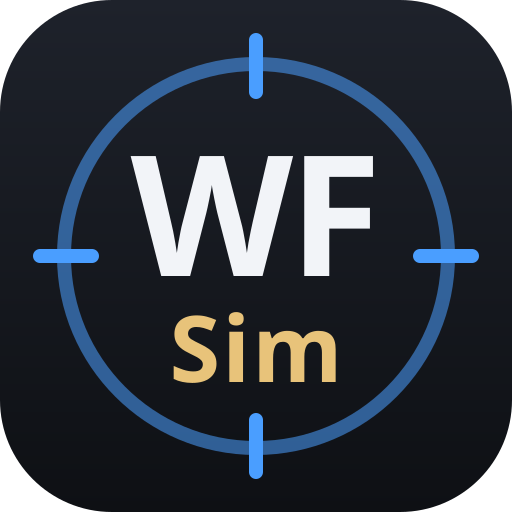

<div align="center">



# WFSim

**The real Simulacrum Prime.**

A Warframe calculator that simulates the fight instead of estimating it —
builder, simulator, optimizer.

[**wfsim.app**](https://wfsim.app) ·
[Discord](https://discord.gg/H4BMqvYFVg) ·
[QQ](https://qm.qq.com/q/uiXrMSTs8S)

[](https://github.com/magenie33/wfsim/actions/workflows/ci.yml)

</div>

**Status:** active. Covers [the weapon roster](https://wfsim.app/weapons) —
primary, secondary, archgun, melee (with each attack form its own build),
modular Kitguns and Zaws, companion and exalted weapons, and Incarnon forms —
alongside Warframe, Companion and Operator builders. Mods, arcanes, evolutions,
rivens, custom enemies, the Build Library and [leaderboard](docs/BOARD.md),
Riven Analyst, volunteer computing ([CLI](client/README.md)), and an
[MCP server](https://mcp.wfsim.app/mcp) are live. Fights run single-target or
multi-target formations. Gaps are expected — issues welcome.

**On AI:** I use AI assistance while writing this code (see
[AGENTS.md](AGENTS.md)). The simulator uses a deterministic damage model, and
the optimizer compares builds across repeated, seeded simulations. See the
[in-game measurement records](docs/MEASUREMENTS.md) and
[Warframe Wiki](https://wiki.warframe.com/) to check specific mechanics.

What the sim does **not** model — movement, holstering, nobody shooting back,
the Warframe's own actions beyond the buffs it puts on the weapon — is listed
in [`docs/UNMODELLED.md`](docs/UNMODELLED.md) and stated on the page itself,
per weapon.

## Contributing

The most valuable contribution here is **an in-game measurement, not code** —
the engine is only as trustworthy as its baseline, and one maintainer cannot
run every test in game. See [CONTRIBUTING.md](CONTRIBUTING.md).

## Third-party projects & agents

Independent tools built around WFSim — volunteer compute clients, overlays,
chat bots, AI agents and build-link launchers — are welcome.

| use | entrypoint | rules |
| --- | --- | --- |
| open a build in a user's browser | `https://wfsim.app/weapons/<id>?b=<code>` | [`TRADEMARK.md`](TRADEMARK.md); internal wire format, not a frozen external API |
| query weapons, builds & method | [`llms.txt`](https://wfsim.app/llms.txt), [AI catalog](https://wfsim.app/.well-known/ai-catalog.json), [MCP](https://mcp.wfsim.app/mcp), [A2A](https://mcp.wfsim.app/a2a), `.md` twins | [`docs/AGENT.md`](docs/AGENT.md), [reuse policy](https://wfsim.app/reuse) |
| volunteer compute clients | [official CLI](client/README.md) & public work API | [`docs/CLIENTS.md`](docs/CLIENTS.md) |
| community directory listing | [Community Projects](https://wfsim.app/community/projects) | `"Verified by WFSim"` confirms usefulness & compatibility, not official authorship |

- **Stay independent:** use your own product name, icon and release branding
  ([`TRADEMARK.md`](TRADEMARK.md)), respect [`LICENSE`](LICENSE),
  [`LICENSE-DATA.md`](LICENSE-DATA.md), the [reuse policy](https://wfsim.app/reuse)
  (on-demand AI retrieval allowed; model training reserved) and service rate
  limits, and do not read game memory or inject into the game process.
- **No external API freeze:** WFSim keeps older posted links readable where
  practical, but `?b=` and query tool names evolve with WFSim; external tools
  adapt when formats or IDs change.
- **Recognition:** useful, well-maintained, compatible independent projects may
  apply for listing on [Community Projects](https://wfsim.app/community/projects).

## Run

```sh
mise install             # pinned Rust toolchain
cargo test --workspace
cargo run -p wfsim-web   # web UI → http://localhost:8787

cargo run --release --bin one_fight -- save   # engine cost, before a change
cargo run --release --bin one_fight           # …and after: delta + did the answer move
```

## Docs

[Design](docs/CORE.md) · [Mechanics](docs/MECHANICS.md) ·
[Measurements](docs/MEASUREMENTS.md) · [Data](data/README.md) ·
[Clients](docs/CLIENTS.md) · [Agents & MCP](docs/AGENT.md) ·
[Contributing](CONTRIBUTING.md)

## License

[AGPL-3.0-or-later](LICENSE). If you use this code in a product or
network service, you must release your modifications under the same
license. The "WFSim" name and logo are not covered by the license and
may not be used to brand derived products or services —
[`TRADEMARK.md`](TRADEMARK.md) sets out what is permitted without asking,
which is most things, including forks that say what they descend from.

Game data sourced from the community
[Warframe Wiki](https://wiki.warframe.com/) — **facts**, re-expressed in
WFSim's own schema, reproducing no wiki page or prose. The wiki declares its
own content **CC BY-NC-SA 3.0** and is credited accordingly here and in the
footer of every page. Measurements, engine
outputs and game art each carry terms of their own:
[`LICENSE-DATA.md`](LICENSE-DATA.md) sets out all four categories. DE's
Public Export is fetched locally rather than redistributed here.

Creators can quote results in original guides, videos and streams, including
ad-supported and sponsored work. The [creator policy](https://wfsim.app/reuse)
explains how to credit sources, how automated services can retrieve results
and where to propose commercial licensing or a project partnership.

Unofficial fan project, not affiliated with Digital Extremes; Warframe
is a trademark of Digital Extremes Ltd.

As the copyright holder, the maintainer also offers WFSim, and components
built alongside it, under separate terms. A **commercial licence** covers use
AGPL-3.0 does not permit — a closed-source product, a network service whose
modifications are not published, or redistribution inside a proprietary
application. Ask at <magenie33@moginlabs.com>. Every version published under
AGPL-3.0-or-later stays available under it.
