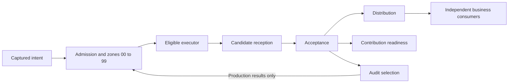

# Task and queue contract

This specification defines the target module contracts. It does not assert
runtime deployment. [COMPUTE_TASKS.md](COMPUTE_TASKS.md) describes the installed
interfaces; implementation gaps and production qualification are separate
operation records. Field names below describe responsibilities, not a migration
of durable protocol names. [NAMING.md](NAMING.md) governs their storage mapping.

## Objects and authority

| Object | Meaning | Authority |
| --- | --- | --- |
| Order | A source's request for one or more outputs | Its captured request and consumer links |
| Task | Fixed inputs and an output contract, independent of its initiators | Its immutable task definition |
| Queue item | The task's current admission to execution | Its zone, position and scheduling state |
| Execution round | One requested generation of a task's output | Its immutable round identity and reason |
| Execution attempt | One executor's claim within a round | Its executor, round and lease |
| Result | Immutable output and its execution evidence | Its result identity and acceptance selection |
| Delivery | An obligation to apply a selected result to one consumer | Its guarded readiness and acknowledgement |
| Workflow | Explicit dependencies and completion requirements across tasks | Its captured nodes and source bindings |

An order may require several tasks. Several orders may share one task.
An executor retry does not create another order or input identity. A fresh
explicit recalculation may create another execution round under the same
input identity. Cancelling one order withdraws only its own obligations;
remaining consumers retain their shared task.

Computation identity keeps the canonical operation and entity inputs defined
in [COMPUTE_TASKS.md](COMPUTE_TASKS.md#computation-identity-and-admission).
Queue position, source, executor, thread count, engine and audit selection do
not change that identity. An audit is a distinct operation bound to an exact
target result and audit policy, so it cannot merge with production of that result.

## Queue ordering

Every schedulable task uses zones `00` through `99`, lowest number first.
Admission appends to the selected zone's tail. A monotonically allocated
position defines FIFO; timestamps are observations rather than ordering keys.
Selection takes the first executable item in the earliest eligible zone.
Dependencies, executor capability, witness independence and active claims
determine executability before the selection limit. An ineligible head does
not block other eligible items.

A source declares its requested zone. The common admission policy resolves
the effective zone of a shared task from its live sources. The highest requested
priority is the lowest zone number. Moving an item to another zone allocates
a position at that zone's tail. Withdrawing a source reconciles the remaining
priority by the same rule. A source update within the same zone preserves FIFO.
Zone changes affect future claims and preserve a running attempt's credentials.
Preemption requires an explicit execution-control rule.

Zones do not imply a source type, executor type or service deadline. Their
business assignments are configuration. Sustained earlier-zone work can delay
later zones; elapsed waiting does not silently move an item between zones.
Capacity sharing can limit a witness's next claim, but cannot reorder eligible
items inside a zone. Physical partitions or readiness indexes must preserve
this logical contract and one authority for each live queue item.

## Field responsibilities

| Group | Logical fields | Rule |
| --- | --- | --- |
| Definition | Task identity, operation, input reference, output contract | Immutable; enough to reproduce and validate the output |
| Scheduling | Queue item identity, zone, zone position, scheduling state | One live execution obligation; zone and position form its ordering key |
| Eligibility | Dependency references, executor capabilities, block reason | A block retains the item's identity and position |
| Sources | Source identity, trigger identity, order/workflow reference, consumer reference | Appendable provenance; independent of execution and payment |
| Round | Round identity, reason, required execution contract | A stale round cannot acknowledge its replacement |
| Attempt | Attempt identity, executor identity, lease token, lease expiry | Execution recovery; separate from business validity |
| Output | Result reference, acceptance selection, engine/data references, evidence references | Immutable body; retirement is an explicit selection event |
| Audit | Target result reference, policy version, selection receipt, audit state | Does not fabricate a production result or a contribution |
| Delivery | Consumer identity, selected result and round, readiness, acknowledgement | Retry applies the same committed output |
| Observation | Created/entered/started/completed clocks, progress, sampled-at clock | Missing or stale observation remains unknown |

The public task list projects these authorities. It shows zone, stable FIFO
position, state, a block reason when present, progress and result access.
Sources, attempts and evidence belong in details. An exact count of items ahead
requires a separately bounded observation; it is not stored as another authority.

Business deadlines, overdue state and automatic timeout cancellation are absent
from the queue contract. Waiting duration can be displayed without affecting
validity. Lease expiry releases execution rights for recovery. Retry delays
govern another attempt. Artifact retention governs stored detail and access.
Neither leases, retry delays nor retention expiry cancel an active obligation.

## Modules

| Module | Durable input | Committed output and completion | Failure ownership |
| --- | --- | --- | --- |
| Intake | Captured request and source identity | Frozen task definitions, sources and admission obligations | Retains unacknowledged inputs; retries its own admission |
| Queue | Admitted definitions, zones and dependencies | Guarded execution claim with round and lease | Returns or reclaims attempts without replacing task identity |
| Executor | Claimed task and pinned execution contract | Candidate output and original execution evidence | Retains unacknowledged submissions; returns interrupted work |
| Acceptance | Durable candidates and the task's acceptance policy | Accepted output or explicit waiting/attention decision, plus downstream readiness | Reclaims its own verification work; preserves committed results |
| Audit selection | Newly accepted production result and sampling policy | Durable selection receipt and an audit task | Retries the recorded selection without selecting again |
| Distribution | Accepted result and live consumers | Guarded per-consumer application and acknowledgement | Retries failed consumers independently |
| Contribution | Exact durable payment decision | Idempotent payment and aggregate accounting | Retries payment without rerunning verification |
| Business consumer | Selected result and captured business context | Report, measurement, workflow continuation or publication obligation | Owns its side effect, retry and superseded-context checks |
| Observation | Versioned authoritative state and progress | A timestamped status reading | Retains the prior reading and its clock after a failed refresh |

Each module completes when its output and durable handoff are committed. A
parent order may require several outputs and reports their aggregate progress;
that does not keep every completed child executing. A downstream failure does
not roll back an accepted output or request another computation. Explicit
invalidation retires a result and registers the replacement obligation with
its cause and preserved evidence.

Local validation and bounded writes that must agree remain synchronous.
Durable work boundaries separate independent retry, concurrency and resource
budgets. A same-store output and readiness commit atomically. A cross-store
handoff acknowledges only durable receipt of the exact output identity.
Notifications wake consumers; persisted readiness survives missed notifications.
Repeated notification, claim or submission cannot repeat a side effect or credit.
Helpers and individual simulated hits do not become asynchronous tasks.

Readiness is a module's durable input, not a second independent priority queue.
Where a stage schedules runnable work, its claims use the same zone/FIFO contract.
Cheap atomic application can finish within the module's current transaction.
Storage can retain specialized indexed readiness without copying full inputs or
outputs into another message store.

## Completion and result flow

Task execution states describe queued, executing, awaiting acceptance, accepted,
cancelled or attention-required work. Dependency and capability blocks are
reasons within waiting work. Acceptance, consumer delivery, contribution and
publication have separate completion states. A preview can be delivered as
provisional without standing for an accepted result or a payment decision.

Community execution is the primary production path. Its independent-witness
acceptance remains a distinct policy from official sampling. Changing the
number of community witnesses requires separate qualification. An ordinary
task's age never transfers it to official production. Disagreement retains its
evidence and enters an explicit community recheck or attention workflow.

Both executor classes submit the same result envelope: task/input identity,
round, attempt/lease, execution contract, result body or reference, and evidence.
Production and audit purpose remain explicit. An audit result is evidence
about its exact target result; acceptance decides its consequences.
An audit result cannot certify an unrelated round, replace a production result
in place, or create another recursive sampling obligation.

## Official audit policy

Official executors claim audit work only. Audit tasks use the same zone/FIFO
contract with the appropriate executor capability. Sampling runs after immutable
production output submission. It accrues a budget from newly accepted production
results and draws unpredictable samples, rather than inspecting every fixed
nth result. Selection receipts pin the candidate population, target result,
policy version and random decision; retry never redraws the sample.

The policy declares baseline sample coverage, strata, anomaly escalation,
compute budget and maximum retained audit backlog. Strata can cover execution
contract, operation and contributor populations. Diagnostic extra samples are
reported separately from the baseline random sample. Low-volume coverage and
expensive task coverage are explicit policy choices. Exhausted budget leaves
work pending and coverage incomplete rather than reporting a pass.

The audit replays the target's exact input, supported engine/data contract,
seed, repetitions and search budget. It compares canonical outputs under the
operation's declared equality rule, excluding elapsed time and executor parallelism.
An unavailable matching execution contract is reported as not audited.
Sampling quality is specified through the fault rate and missed-detection risk
it is intended to detect; a fixed percentage alone is not a quality guarantee.
The [NIST sampling model](https://www.itl.nist.gov/div898/handbook/pmc/section2/pmc232.htm)
describes that statistical relationship. Replay agreement checks execution;
game-mechanic correctness remains calibrated through [MEASUREMENTS.md](MEASUREMENTS.md).

Normal sampling is asynchronous to accepted community output and its delivery.
An anomaly can quarantine its identified result and open bounded rechecks under
an explicit policy. Result retirement, dependent publication correction and
contribution correction are separate recorded decisions. The scope of rechecks
cannot expand into an unbounded official production fallback.

## Publication and qualification

The implemented captured-input boundary is specified in
[BOARD_DELIVERY.md](BOARD_DELIVERY.md); its production selection remains separate.

Ordinary result delivery processes captured changes with a bounded item and byte
budget. It does not wait for every dirty key or a full-library snapshot. Full
snapshots and historical imports have their own completion and integrity proofs;
a capped subset cannot stand for a complete snapshot.

An occurrence consumer preserves every accepted result needed for accounting or
audit. A state projection instead receives the latest captured value per key.
It can coalesce superseded values, retaining explicit removal values and a
monotonic key version. These delivery semantics are distinct from computation
zone/FIFO scheduling.

The source change and its durable state handoff commit in one local transaction.
A projection claims a bounded set of ready keys and applies each captured
version. A newer source value can arrive during a claim; acknowledging the old
version leaves the newer value ready. Expired credentials cannot acknowledge a
replacement claim. Failed inputs retain their version, reason and retry state.
Global sequence gaps and out-of-order transaction commits cannot hide ready work.

The destination rejects values older than its applied key version. Historical
imports insert a baseline only where a live value or removal is absent. A
removal keeps its version watermark, so a late import cannot resurrect it.

Ranking and publication have partition identities, covering the weapon and
scenario they describe. Each partition names its applied input versions and
coverage. A partition publishes only after its own completeness proof; unrelated
partitions, workload statistics and historical imports do not block it. Read
artifacts have bounded pages or chunks, and a new result cannot require
rewriting an unbounded partition. A cross-partition index is a separate
versioned projection with an observable update clock.

The online read model has indexed partition rankings, a bounded paginated query
API and a cache for frequently read pages. A page identifies its partition and
revision. Cache keys include both; publication commits the new revision with
its rows, so an old cached page cannot become a new revision's answer. Pagination
cannot silently combine different revisions. The calculator remains local/WASM.

Historical import runs beside ordinary result delivery. A partition continues
serving its complete committed view until its replacement has imported the
baseline and applied concurrent changes. Baseline receipts and live removal
watermarks prevent lost history or resurrected rows. Cutover changes the served
partition atomically and preserves a usable prior view for rollback. The page
shows the current board normally; migration state belongs in operation records.

Each processing step commits its output and durable handoff before acknowledging
its input. Same-store application and acknowledgement can share a transaction.
Cross-store acknowledgement follows the destination's durable version receipt;
a lost acknowledgement causes an idempotent replay. Backpressure retains inputs
and limits concurrency. A helper call does not create another asynchronous job.

Online board publication consumes accepted measurements. Its source snapshot,
projection audit, immutable package and remote acknowledgement have separate
proofs. A completed input cursor is not a completed projection or an uploaded
package. Potential-work inventory is an independent consumer and cannot gate
audited board publication. A paused publisher retains its packages; accepted
results, delivery and contributions remain valid.

The GitHub-committed board snapshot is a separate optional archival consumer.
The website reads the online board, independently of that snapshot. Disabling
the repository snapshot workflow does not pause online projection or delivery.

Every module exposes its controls, bounded backlog, oldest pending item,
successful progress, failure and observation time. A fresh daemon heartbeat
cannot refresh stale statistics or assert downstream completion. Operational
pause is independent of code deployment and persists across releases.

Qualification covers concurrent identical sources, priority promotion and
demotion, blocked heads, unchanged running leases, partial cancellation, stale
rounds, lost acknowledgements, consumer isolation, idempotent credit, persistent
sampling, exact replay and publication with inventory paused. Each changed
behavior needs an actual failing control and a passing implementation fixture.
Runtime/schema changes retain existing identities, issued credentials, accepted
outputs and contribution history. They require their own migration and release
evidence; this specification does not authorize reissue, refill, workflow changes
or service control operations.

## Growth and bounded progress

Each consumer declares its actual input unit, maximum input and output bytes,
transaction and lock durations, temporary storage, and concurrency. Limits
apply before expanding dependencies or joining history; limiting returned rows
alone does not bound intermediate work. These budgets belong to the installed
consumer and its database role, not only its qualification probe. Exhaustion
retains the obligation and its last committed progress; it does not repeatedly
restart an entire scan or refresh a success clock.

Ordinary processing uses indexed current readiness and changes since committed
progress. Retaining more completed history must not require reading that history
for each dispatch, status refresh or changed result. Backpressure bounds pending
preparation and storage creation. Independent consumers retain their own budgets;
a failed statistics read cannot occupy the execution, acceptance, delivery or
contribution lane.

### Work signals and statistical projections

The work signal answers whether eligible work is available using a bounded
indexed sample of current scheduling state. It has its own short read budget
and publication clock. It does not require a complete queue census, workload
inventory or statistical rebuild. A single version-aware publisher prevents
an older completed sample from replacing a newer one.

Statistical totals are derived projections. Their units distinguish source
orders, unique shared computations, execution attempts and accepted results.
One authoritative membership definition determines eligibility, cancellation,
deduplication and representative selection. Several live orders sharing a task
do not multiply its computation count; withdrawing one source preserves the
others. A bulk logical cancellation changes eligibility without requiring
physical deletion or repeated exclusions over all historical rows.

A source change commits durable readiness with its authoritative state. For
each affected logical key, the statistical consumer retains the applied source
version and that key's previous contribution. Applying a newer contribution,
updating affected totals and acknowledging the captured version share one short
transaction. Duplicates and superseded versions have no second effect. Keys
whose contribution depends on another key retain that dependency so a change
cannot leave a previously counted representative effective by accident.

Live-device and lease-expiry observations use bounded indexed time windows or
scheduled expiry readiness. An elapsed-time condition cannot rely solely on
new source writes to make an expired observation disappear. Observation clocks
remain distinct from the input coverage of durable statistical totals.

### Rebuilds and completeness

A rebuild names its source identity, membership contract, captured boundary and
destination generation. It persists confirmed input chunks, derived effects and
progress across bounded transactions. Restart resumes committed progress even
when a later chunk fails. A database cursor whose progress exists only inside
one full-history transaction does not satisfy this restart contract.

Concurrent source changes remain durable while the baseline is prepared.
Reconciliation applies them using the same key-version and removal rules as
ordinary projection. An allocated sequence maximum alone does not prove all
earlier transactions committed or were consumed. Source coverage must account
for pending keys and committed changes at the captured boundary.

Partial output stays private. Only complete baseline coverage plus reconciled
changes allows an atomic replacement of the served generation. The previous
complete view remains usable while preparation is paused or retried. Source,
membership-policy or cancellation-epoch changes explicitly select another
generation; old partial totals cannot be relabelled as current complete totals.

### Storage lifecycle

Each artifact records its owner, generation, allocated or bounded planned bytes,
durable completion receipt and recovery references. Active inputs, unacknowledged
handoffs, current proofs, pinned public versions and rollback dependencies
protect the artifacts they require. Creation, acknowledgement and retirement
are separate states; a successful upload alone does not remove those references.

The collector retires only owner-qualified artifacts after their remaining
consumers and recovery references permit it. It enforces bounded files, bytes
and time per pass. Required off-host backup must be durably confirmed before
retirement. Unqualified directories or apparent age alone do not authorize
deletion. Canonical records and another module's work remain outside its scope.

Admission checks preserve filesystem reserve for foreground transactions, WAL
and recovery. Preparation bounds its temporary and staged output before creating
it, and stops when its allowance is exhausted. Observations distinguish durable
database allocation, WAL, query temporary files and pipeline artifacts. Deleting
database rows makes pages reusable; it does not promise filesystem free space.

### Growth qualification

Qualification increases retained history while holding active work and new
changes fixed, measuring scanned input, temporary bytes, memory and latency.
It kills a rebuild after a committed chunk and verifies resumed progress,
complete output and preserved concurrent changes. Duplicate changes, reordered
commits, late baselines, removals, shared-source cancellation and expiry must
preserve exact membership and totals. A forced statistics failure must leave
work signals and independent result consumers advancing. Resource-limit tests
must preserve pending work, recovery files and true last-success clocks.
