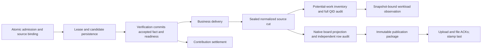

# Compute task modules

`worker/tasks.js` preserves the factory API and composes independent modules.
Business types register verbs and producers in `worker/factory.js`.

Ordinary queue reconciliation recovers only work already recorded in the
pending queue. Missing scores, newly added boards and library coverage do not
create tasks through reconciliation. It does not purge pending work. Complete
inventory capture requires an explicit `INVENTORY_ONLY=1` request. Operator
rescore remains an explicit source.

The legacy appraisal calibration endpoint acknowledges its disabled state
without scanning the library or creating work. Completed optimizer measurements
use the same observation entry as simulation.
A matching local simulation requests review only when its numeric result
differs; an engine identifier difference alone does not request review.

Official scoring claims overdue questions before reading inputs.
`fetch_score_inputs.mjs` resolves the claimed board references through indexed
queue, build and fact keys in one repeatable-read snapshot. Its disk spool
deduplicates aliases and preserves batch time/key order for every shard.
It retains at most 40,000 claimed questions, reads 256 calculation keys per
database call and exports only their builds and measurements. Cancelled batches
and missing builds do not enter the scoring input. The release job returns
unanswered leases even when preparation fails.

Scoring never enumerates the complete library or reconciles the queue.
Missing demand registration belongs to queue maintenance's backfill; it cannot
bypass leasing by being handed directly to a scorer. Complete backup remains
owned by `backup.yml` and the database backup service; the scoring artifact is
only the current run's input.

| Module | Owns |
| --- | --- |
| `task_contract.js` | Canonical identity, witness independence and lifecycle constants |
| `task_ledger.js` | Demand registration, deduplication, withdrawal and durable state access |
| `task_dispatch.js` | Selection, claims, leases, renewal and release |
| `task_usage.js` | Compute-cost accounting |
| `task_verification.js` | Answers, agreement and verified facts |
| `task_delivery.js` | Consumer delivery and retries |
| `task_credit.js` | Idempotent contribution settlement and repayment |
| `task_observation.js` | Read-only health observations |
| `task_inventory.js` | Validation and publication of complete workload snapshots |
| `task_pipeline.js` | Independent consumer controls, bounded backlog observations and progress |

The modules import common contracts, not business implementations or each
other. The composition root supplies explicit interfaces. Dispatch receives
lease metadata, demand eligibility, lease notification and usage charging;
it receives no registration, verification, credit or result-delivery interface.
An alternative dispatcher implements the same selection and lease API and is
supplied through the factory's `dispatcher` option.

Verb metadata declares official-producer restrictions. A new registered verb
or producer requires no type-name branch in dispatch. Business callbacks remain
owned by their producers. Lease-notification failure is observed without
discarding the lease returned to the witness.

## Computation identity and admission

A computation ID is the first 32 hexadecimal characters of SHA-256 over the
operation, a newline and canonical entity inputs. The operation declares the
required output: a board measurement, a best-build search or a complete report.
Inputs include the build, fight, seed, repetitions and search scope or budget.
Engine and release identifiers, review tokens, retention windows, upload
consent, source labels and executor thread counts do not participate.

`/api/computation/input` materializes calculation inputs through the actual
fight and search parsers. Simulation uses the existing build canonicalizer,
retaining element pairing and the exilus seat. A riven is identified by its
submitted stats, rolls, rank and polarity; local card names remain source
context. Optimization retains start order and slot positions because the
search algorithm consumes them. Missing mode retains its constructor semantics.
The page, bot and family intake use this same endpoint or Rust function.
`input_schema=1` identifies that admission contract without entering the hash.
An older request producer must reload before admitting persistent shared work;
older volunteers continue to execute compatible work.

`compute_admit_tasks` admits inputs, the current execution round, every trigger
snapshot and current consumer links in one transaction. A nonempty registered
producer, reference and trigger identity are required. Repeating a trigger is
idempotent; changing its payload is an identity conflict. A batch retains all
trigger snapshots while its last occurrence sets the current consumer link.
Deadlines and waiting priority may change without replacing a held lease.

`state_compute_scheduling.id` is the unique computation key. Taking a lease
keeps that entry occupied. Another source joins it and may promote its zone;
it cannot add another queue entry or replace the held lease. Independent
witnesses are execution attempts under that entry. Engine changes neither
reopen results nor recreate disputes.

The queue consists of zones `00` through `99`. Explicit human calculations use
`00`, matching-environment corrections use `01`, and ordinary intake uses `03`.
A system source may select any zone. Dispatch selects the first executable
entry by zone, then FIFO position within that zone. A source promotion joins
the destination tail. Dependencies, unsupported capabilities and held leases
are eligibility constraints. They do not block other executable entries.
Sustained earlier-zone work can delay later zones; producer usage and deadlines
do not reorder a zone.

A build workflow keeps every participating computation occupied until all its
required steps finish, including accepted output, durable delivery and derived
build intake. An ordinary source reuses a finished child while its parent remains active.
A fresh explicit recalculation can require another execution round within that
occupied entry; its input ID and active queue position remain held. Queued or
running requests merge their sources, highest priority and latest required
engine without replacing a held lease. After terminal closure, a new explicit
source may request a later execution under the same computation ID. A confirmed invalidation fences
an attempt within the occupied entry and records its system cause; the parent
continues to refer to its current attempt. Prior inputs and results remain
immutable history.

`relation_compute_task_sources` preserves each trigger snapshot separately from
`relation_task_consumers`, which owns current delivery. Workflow triggers retain
first intake, observations and system commands, even when they coalesce. Task
archives include source relations and immutable requirement snapshots. Delivery
binds the selected result and execution round, so an equal output from an older
round cannot acknowledge a newer request. Failed delivery retries the committed
result and keeps the computation occupied until every live consumer finishes. Missing initiator attribution never implies
a missing source.

Existing queued entries keep their original inputs, IDs, attempts and leases.
The code/schema rollout preserves retained queue entries. After live validation,
`compute_identity.mjs deduplicate-plan` prepares bounded equivalence groups for
retained report/search requests. `deduplicate-apply` merges only proven
duplicates, retaining sources, highest zone and original input/result history.
Running leases, active workflow bindings and pending verification are deferred
and checked again under the application lock. Opaque legacy board references
are deferred until their actual fights can be proven; source-less work is not
removed by duplicate consolidation. Normalization alone does not authorize
replacing a solitary old identity.
Local and offline queues deduplicate new work within their own store. Their
IDs remain held through pending completion deliveries; existing legacy local
entries are not rewritten or cancelled during startup.

## Build intake and captured scope

All legal submitted builds are retained independently of frontend rankings.
Native intake preserves canonical mod ranks, riven stat/roll pairing and exact
build identity. It captures the current boards, scenarios, modes and family
relationships without simulating a fight. `scope: "library"` on
`/api/board/check` checks storage legality; ordinary board checks retain each
ruler's eligibility rules.

`build_intake_batch` commits a build, its immutable captured workflow and all
sourced computation demands in one transaction. Every legal arrival checks
the build's current applicable coverage through indexed measurement keys.
Previously stored scores count independently of frontend rank. Only missing
measurements create ordinary work; an active equivalent computation is shared.
A newly added board is discovered by a later arrival from any board.
Already active expansions keep their captured scope.
A local observation creates correction work only after native normalization
matches the official fight and the database still holds the compared baseline.
Equal values, stale baselines and different environments create no correction.
The public review endpoint durably captures an observation in the same inbox;
it does not implement a second task expansion.

Hourly and live intake share `inbox_reader.mjs`. Existing waiting reviews and
active higher-priority workflow continuations are read first, using their
declared queue zones. Missing source rows are excluded before the priority
limit. Remaining capacity reads ordinary inputs in primary-key pages, with
scope enrichment limited to each selected input. Read connections enforce a
five-second statement timeout and are read-only.

The live reader saves its ordinary scan cursor only after every captured input
is acknowledged and its file hash still matches. Restart retains the cursor;
reaching the scan's end wraps it so newly arrived lower ids are included in a
later cycle. A scan ending is not proof that the inbox is empty. A failed later
read leaves its captured prefix processable and still reports a failed cycle.
Original source ids and observations remain unchanged through retries.

A correction observation's engine identifies its measurement. It does not pin
the workflow's future execution engine. Execution uses the factory's current
compatibility checks; explicit engine requirements and task-round and lease
guards still apply.

First intake and correction reuse the same expansion: measure the source on
its captured applicable boards, copy the complete build to current family
members, and measure legal copies. An incompatible target uses the existing
quick optimizer with compatible positions retained, then measures the accepted
result on that captured scope. Derived results continue their parent and never
start another family fanout. Intermediate family candidates can be retained
without advancing the accepted-result continuation.

| Table | Contents |
| --- | --- |
| `entity_build_workflow_scopes` | Interned immutable board/scenario/mode snapshots |
| `entity_build_workflows` | One logical expansion, its root build, scope and initial source |
| `entity_build_workflow_expansions` | Frozen compact node plans, including accepted optimizer continuations |
| `state_build_workflows` | Active/terminal state, zone and temporary initiator attribution |
| `state_build_workflow_nodes` | Current dependency, computation, attempt and delivery references |
| `record_build_workflow_triggers` | Every accepted intake, mismatch or explicit system source |

The snapshot is shared across builds; canonical build records remain in the
library rather than being copied into stored plans. Templates and patches
avoid repeating a complete fight inside one expansion. Queue admission is
independent of scope construction: equivalent nodes share the same physical
computation and deliver separately to every consumer.

## Optimization output and retained tasks

An ordinary optimization submits every encountered legal build through the
normal build inbox, including intermediate candidates and final results.
Collection uses library legality independently of board eligibility and retains
paired riven rolls. Upload consent and durable outbox delivery remain unchanged.
Intermediate search scores are not correction observations. New and known builds
check current coverage and enter missing ordinary work in zone `03`. Completed user-visible finalists also pass their frozen final replay and
measured number to the existing simulation review entry. Only an exact official
fight with the same runs and seed and a differing current baseline creates
correction work in zone `01`. Cancelled, rough and refused rows do not qualify.

Selecting an official scenario pins the optimizer's final round to that ruler's
run count. Candidate screening keeps its own budget. The request and precision
label use the same resolver; custom scenarios retain the chosen simulation
count. Review compares normalized actual inputs in the native engine, excluding
inert search controls and capacity layout, without rerunning a finalist.

Family fill is a special optimization whose source identifies its parent
workflow and node. Its accepted result advances that parent's captured scope;
intermediate candidates may enter the library but never start another family
expansion. It uses the same optimizer and execution queue as ordinary search. Purpose
belongs to source and delivery context, outside computation identity. When a
shared search has an ordinary source allowing upload, candidate authorization
uses ordinary submit; special-only sources retain their bounded purpose.

Previously queued and leased calculations continue with their original inputs,
identities and leases. Disabling an automatic producer stops future creation;
it does not cancel its retained tasks. Existing ordinary optimization outputs
use ordinary submit; retained family-fill outputs retain their special purpose.
No legacy task is rekeyed, reset or recreated for this classification.

## Verification and delivery

Registration, deduplication, source binding and lease acquisition remain atomic
synchronous operations. Candidate answers and verification readiness commit
together before reception is acknowledged. Local validation and canonicalization
remain direct calls. A handoff contains durable identifiers rather than another
copy of the calculation input or result.

Native verification commits accepted output, exact credit decisions and delivery
readiness, then releases its verification claim. Delivery and contribution
consumers run independently on dedicated database connections. An unavailable
consumer retains its readiness marker and does not occupy verification. The
compatibility settlement API can drain these consumers inline for its callers.

Committed readiness wakes the native consumer through a notification containing
only its stage name. PostgreSQL combines equal notifications within one
transaction. Notifications carry no task data and are not acknowledgements;
periodic indexed reads recover missed wakeups. A wake received during a pass
requests another pass without overlapping that consumer. Shutdown drains work
already running.

| Consumer | Durable input | Completion |
| --- | --- | --- |
| Verification | `state_pending_verifications` | Accepted result or waiting decision committed; claim acknowledged |
| Delivery | `relation_task_consumers.delivery_at` | Guarded consumer writes and served acknowledgement committed |
| Contribution | `record_candidate_answers.credit_work` | Selected credit and hourly totals committed exactly once |

The native delivery consumer executes registered SQL adapters. Edge delivery
also supplies callback adapters and historical recovery. Producer eligibility
is applied before the batch limit; handlers retain their own idempotency and
superseded-generation checks. Current consumers read readiness indexes rather
than scanning result history. Historical recovery retains its separate cursors.

`node scripts/task_pipeline.mjs status` reports each consumer's control, durable
backlog, oldest pending item and latest progress. Counts exceeding the observation
bound carry `at_least`. `pause <consumer>` and `resume <consumer>` change admission
to that consumer's next pass; in-flight transactions finish. `run <consumer>`
performs one bounded native pass and respects the control. Commands use the
configured library owner connection. The daemon can observe controls but cannot
change them. Pausing a consumer preserves its work and upstream facts.

Verified task state commits before consumer writes or contribution settlement.
Successful verification remains durable when either fails. Delivery batches
healthy consumers together; a failed batch is retried per consumer so one
failure does not hold successful consumers. Failed demands stay live for
redelivery. Failed contribution credits are repaid from durable answers.
The verifier commits `credit_work` and `credit_at` with its fact, preserving
its exact witness selection, corrected work and payment hour. Recovery consumes
these decisions without repeating verification or reconstructing its policy.
Unpaid decisions protect task detail from retention until payment completes.

Fact commitment marks live demands with `delivery_at` in the same transaction.
A request for an existing fact receives the same durable readiness marker,
regardless of that fact's age. Failed consumers retry after a minute; successful
delivery clears readiness and serves the demand. SQL consumers lock and check
the fact's engine and canonical result plus the demand's identity, registration
time and payload before applying writes. A superseded result or demand cannot
acknowledge replacement work. Pre-upgrade demands retain the bounded fact-time
cursor fallback. Each pass scans one time window, advancing through empty
windows and retaining failed facts for retry. Readiness delivery does not wait
for this historical cursor.

Consumers must make delivery idempotent by their stable demand identity.
Neither a delivery retry nor a repayment creates a new computation. Normal
pack delivery has a bounded number of database calls independent of its rows.
External callbacks must also reject superseded business generations when they
apply side effects; their preflight check cannot span an external service.

## Schema and rollout

Before deploying the Worker or factory daemon, apply the additive delivery
upgrade to the library database as its owner. Print it from the schema source:

```sh
node scripts/task_schema.mjs > task-delivery.sql
psql -d wfsim -X -v ON_ERROR_STOP=1 -f task-delivery.sql
node scripts/computation_schema.mjs accounts > computation-accounts.sql
psql -d wfsim_accounts -X -v ON_ERROR_STOP=1 -f computation-accounts.sql
```

The library upgrade also installs computation records, witness snapshots,
signature counters, score replacement cleanup and optimization retention. Apply
the account upgrade as its database owner and then the daemon grants. Existing
details are shortened only for optimization and appraisal. Public names must
not be enabled before both database upgrades have succeeded.

The output installs the captured-workflow tables, inbox view, bounded admission
functions and grants, and adds nullable zone/capability columns. It also adds
nullable delivery and payment readiness, creates their partial
indexes concurrently and installs delivery and retention guards. Run outside a transaction
and confirm `demands_delivery`, `answers_credit_pending` and `compute_scheduling_zone` are valid and ready
before deploying code. The same upgrade installs the restricted inventory reader
and grants its execution to the existing pipeline role. Existing binaries
ignore the additive schema. A lock timeout or failed index build must be
resolved before deployment; an invalid concurrent index must be removed before
retrying. Deploy the Worker and daemon from the same validated commit, then
run normal queue reconciliation only to recover existing pending registrations.
Complete inventory capture remains an explicit operation.
The compute page reads queued orders independently of that scan. Rolling back code
retains the additive schema and inventory; no task or score backfill is needed.

## Complete demand

The stable `calculation_id` is `build_id|ruler|mode` (`calculationId` in code).
Dates and batches are not part of it. Each pending calculation has one
`(build_id, ruler, mode)` queue row; the wire continues carrying this ID as `ref`.
Repeated batches and refresh rounds merge into its original batch and may fill
an absent initiator. Only newly inserted calculations increase a pipeline batch's total.
A unique index enforces the calculation key. Existing pending legacy rows
continue to execute. Periodic refresh does not create ordinary work.
Explicit board corrections retain their immediate independent-review path.

The demand projection gives a full background-read statement budget when queue
counts or compute-cost estimates need refreshing. The normal budget applies
only while both caches remain valid; their refresh intervals are independent.
`counts_at` retains the queue count's sampling time across file publications.
Pending queue keys and consumer keys are unique, so their counting join needs
no intermediate grouping of every build, ruler and mode.

Each order's `sources` partitions its total into `requested`, `system` and
`unattributed`, using its recorded initiator. Anonymous, account and bot request
tags count as requested; the explicit system tag counts as system; absent or
unrecognized tags remain unattributed. These counts describe recorded causes,
not distinct people, execution devices or complete historical derivation chains.
Report orders use their current scheduling producer, the earliest live demand,
so shared computations count once and family searches retain their own category.

### Durable board registration

Native intake commits each build and its captured workflow through
`build_intake_batch` before acknowledging its inbox rows. Legacy board writers
retain their existing computation identities. Their pending business rows own
the obligation; `board_admission_changed` records unfinished registration in
the same transaction, including source changes and deletion.

With `board_admission=1`, the daemon and `ship_queue.sh --admit` advance the same
service. Each pass claims at most 250 registrations. Task admission and claim
acknowledgement commit together, after rechecking the source revision. An
interrupted claim expires; a changed source remains retryable. Registration
reuses accepted results and preserves existing task rounds, positions and leases.
Missing source data and refreshes not yet due remain explicitly deferred.
With the dial at zero, the API reports `mode=disabled`, `paused=true` and
`complete=false`. Ordinary maintenance reports retained sources and incomplete
recovery, then leaves registration paused. This status neither fails a normal
maintenance run nor claims that pending calculations have finished.

Historical recovery seeks at most 2,000 existing pending keys after a durable
database cursor. It yields while registration is pending. New writes are captured
independently of that cursor, including keys below it after recovery completes.
`board_recovery_open_max` bounds historical lookahead against an indexed, limited
read of open scheduling rows. A full window leaves the cursor unchanged until
execution frees capacity; new-source registration continues. Concurrent live
admission may exceed this background target, which is not an allocation quota.
Routine maintenance does not export the pending table or restart a historical
scan. Recovery completion describes registration progress, not completed fights.
Full inventory requires an explicit request.

Official scoring exports the exact computation, task round and claim beside
its captured inputs. Its result goes through official task acceptance and
producer delivery, retaining native measurement timing and provenance. Receipt
validation and candidate recording share the scheduling lock. Superseded claims
and rounds cannot supply a replacement's result; matching acknowledged results
can be retried. The scorer advances its receipt cursor only after every result
is acknowledged as a fact or spot check. Older official audit clients retain
their unqualified answer contract.

Full reconciliation captures builds, scores, queue rows and task lifecycle in one
read-only repeatable-read transaction. A lost connection aborts the capture;
partial files never become a published inventory. The engine walks that
snapshot with the existing admission gate before scene pacing. Retired rulers
and refused orphan rows are excluded.

GitHub-hosted Linux full queue maintenance adds an ephemeral 24 GiB swap
file while preserving existing swap. Capture and classifier scratch retain at
least 60 GiB free after allocation; insufficient capacity releases only unused
Android, .NET and GHC SDKs, then stops preparation if the reserve is still short.
Each ruler's temporary output is removed after its ordered merge succeeds.
The swap and scratch reserve are checked again after cache restoration, builds
and intake, immediately before the full capture.
Full reconciliation defaults to two concurrent ruler walks;
`WFSIM_INVENTORY_WORKERS` overrides that budget. The standalone classifier
uses a quarter of available memory for its SQLite pager, capped at 4 GiB.
In-process callers retain the 16 MiB default unless they supply a validated
`cacheKiB` budget, at most 16 GiB. These settings change resources only.

The scan also emits current canonical build records through the engine's
existing normalization, preserving mod ranks, assembly, wielder and explicit
riven rolls. A stored record wins for an identity already in the snapshot.
An absent current identity is bound to its existing source input before its
rows are asked. These insert-only bindings preserve source timestamps and
use no arrival or family-search path. Orphan rows and retired rulers require
no binding. A binding with no canonical source rejects the inventory.

The board adapter derives each candidate's canonical `simulate` question id
from its stored record, ruler and mode. Equal questions count once across
batches, build aliases and consumers. Current-engine verified facts awaiting
delivery count as zero computation. A spot check counts once even when its
board result is still owed. Independent registered consumers and current
verification work join the same question-id union. A missing build record or
incomplete lifecycle export rejects publication.

`factory_inventory_rows` exposes ids, lifecycle, verbs and live consumer kinds;
it exposes no requests or witness identity. Its owner-controlled search path
is captured when the schema is installed. Only the pipeline role receives
execution permission; it receives no direct task-table grants. Business
registration, cancellation and eligibility remain owned by their producers.

The authenticated inventory endpoint stores the classified snapshot without
adding a later database reading. It records input time, source commit, engine
and database snapshot. An older scan cannot overwrite newer inputs, and an
engine change invalidates its cached goal. The snapshot is derived observation
and never task input.

The queue workflow's `inventory_only` input skips intake and publishes the same
complete snapshot, including insert-only canonical build bindings. It stops
before queue admission or cleanup and rejects rescore, weapons, why, day and
cancel inputs. These scans serialize in an independent concurrency group so a
queue mutation run cannot block a requested count. Normal scheduled
reconciliation keeps its existing path.

Each full-inventory phase reports progress every thirty seconds. Its process
RSS, peak RSS, swap, available host memory, scratch space, Linux memory/I/O
pressure and cgroup memory events are recorded when available. The final exit
report retains CPU time and peak RSS; periodic readings survive a lost runner.
Native enumeration retains source records as JSON text for refusal diagnostics;
parsed records are temporary, and validated builds are shared across rulers.
`--inventory-workers 1..8` bounds concurrent ruler walks without changing their
admission rules or ordered outputs. Library normalization retains its shared pool.

### Sealed source consumers

`live_board.sh` defaults to `split_board_pipeline.mjs` through
`inventory_pipeline.mjs --serve`. Intake, normalization, workload inventory,
board projection and remote publication have separate processes and controls.



Admission, deduplication, source capture, lease acquisition, candidate persistence
and each stage's output/readiness commit remain synchronous transactions.
Cheap validation and canonicalization are direct calls. Durable handoffs divide
independent retries or resource budgets. A batch carries references to committed
input versions; queue-only batches reference sealed input pages rather than
copying their rows into another message store. There is no event per simulated
hit or per small helper call.

The normalizer captures a repeatable-read database receipt, then normalizes
bounded pages through the native operator before opening its short SQLite write
transaction. Record interning, version references and the input cursor commit
together. A sealed cut pins engine, native adapter, normalizer contract, database
snapshot, input time and content digest. Its source invalidations are acknowledged
only after that handoff is durable. ACKs compare exact revisions, so later writes
stay pending. A lost response replays the same persisted receipt. Up to 128
256-key ACK chunks share one SQL call, targeting 4MiB of UTF-8 input.

Raw and canonical records share content-addressed compressed bodies. Source and
measurement versions retain validity intervals. Each consumer binds its own
sealed cut through read-only SQLite attachments and reads bounded pages without
an hours-long read transaction. Neither consumer writes canonical inputs or
copies their complete record bodies. Retention follows the minimum audited ACK;
a fast consumer cannot retire a slow consumer's input. History collection is
bounded and indexed. Protected inputs and unrelated generations remain retained.

Work inventory owns its compact candidate, score, leader, range, pending-work,
owner, membership and QID tables in a separate database. It retains the complete
potential question union, alias deduplication and lifecycle precedence. An
independent raw-input cursor reconstructs queue and task state, then the full
disk classifier checks every effective QID, category and registration flag.
Incremental audits retain their own input cursor and do not depend on board
completion. Workload publication uses the completed source snapshot, engine and
input time; expired output remains historical and cannot claim a fresh goal.

Board projection consumes actual source and measurement versions directly.
Its independent audit reconstructs native normalization, eligible measured modes,
first-alias ordering, shape winners, entry floors, carried bytes, weapon files,
indexes and state counts. It must finish before freezing a publication manifest.
The stamp includes the audited source engine, snapshot, input time and contract
hashes. Its assembly clock and each measurement's clock retain their own meanings.
Board output does not wait for potential-work enumeration or its audit.

The publisher consumes immutable packages in order and acknowledges changed
files durably, with the captured stamp last. Lost replies retry the same bytes.
Paused or unavailable publication retains packages while projection continues
within its outbox bound. Reaching a limit preserves the checkpoint and reports
backpressure; it never marks incomplete work complete.

`node scripts/board_pipeline.mjs status <work>` reports `intake`, `normalization`,
`inventory`, `projection` and `publication` controls and progress, pending packages
and retained blob bytes. `pause <work> <stage>` and `resume <work> <stage>` affect
that stage's next bounded pass. `deliver <work>` performs one publication pass.
Each consumer owns a kernel-held lock, durable cursor, audit and retry. Pausing
inventory permits audited board output; pausing projection permits inventory.

The source, work, independent work-audit and board databases have separate
`max_page_count` bounds. `WFSIM_BOARD_SOURCE_BYTES`, `WFSIM_BOARD_WORK_BYTES`,
`WFSIM_BOARD_AUDIT_BYTES` and `WFSIM_BOARD_PROJECTION_BYTES` select their bounds.
The work classifier's scratch database uses its audit bound.
`WFSIM_BOARD_OUTBOX_BYTES` bounds publication blobs. Work storage cannot allocate
inside the source or board databases. The filesystem retains an 8GiB reserve,
and the explicit rebuild growth budget covers its capture and generated state.
SQLite caches use 16MiB and disable memory mapping. Each native request contains
at most 256 items and 8MiB; input pages and work-only references keep that bound.

A missing catalog, changed engine, adapter or component contract requires an
explicit durable rebuild task. Startup cannot authorize a full capture, recreate
a missing initialized consumer or replace a retained generation. The controller
pins the expected PostgreSQL generation, filesystem, reason and growth budget.
An uncertain generation start or interrupted full capture requires operator
attention; a verified sealed cut resumes after restart.

```sh
node scripts/inventory_rebuild.mjs status --work "$WORK"
node scripts/inventory_rebuild.mjs request --work "$WORK" --bin "$BIN" \
  --mode board --reason "approved source and consumer rebuild" \
  --max-new-bytes "$INVENTORY_REBUILD_MAX_BYTES"
node scripts/inventory_rebuild.mjs cancel --work "$WORK" \
  --task "$REBUILD_TASK_ID" --reason "cancel this attempt"
```

`WORK` and `BIN` are absolute paths; requesting also requires `PG_URL`.
`INVENTORY_REBUILD_MAX_BYTES` has no default. Admission checks the assessed growth
budget plus reserve against current free space. These limits do not establish
full-population capacity. Cancellation retains partial inputs and task history.
Blocked preparation reports its required action while already sealed consumers
and audited publication packages remain independently runnable.

Explicit `INCREMENTAL_INVENTORY=0` selects the in-memory adapter. The classic
command-pipe inventory and relational inventory runners have separate explicit
rebuild modes. Select one source owner for a PostgreSQL generation. Engine
changes reuse legitimate facts and never request a rescore.

### Relational inventory runner

Both inventory runners write atomic phase status and bounded rotating events
under the work directory's `diagnostics/`. Source, engine, generation, epoch,
run id, row counts and process memory identify each attempt. Heartbeats update
`updated_at` without moving `last_progress_at`; a failed or interrupted run
retains its last phase and safe error code. Official scoring uses the same
diagnostics for claiming and input capture, uploaded even on failure with a
fourteen-day artifact lifetime. Diagnostic output goes to stderr so ranker
command pipes remain intact.

`inventory_relational_pipeline.mjs` is an alternative, explicitly selected
inventory runner. It requires the existing inventory schema and a binary
directory containing `wfsim-board`, `ENGINE` and `VERSION`:

```sh
mkdir -p /path/to/work
flock -n /path/to/work/inventory.lock node --max-old-space-size=192 \
  scripts/inventory_relational_pipeline.mjs /path/to/work /path/to/bin
```

Invoke another cycle while the returned `pending` is true; otherwise wait at
least a minute. The runner does not install a service or change `live_board.sh`.
Select exactly one inventory coordinator for a database generation. The
ranker coordinator and this runner must not run concurrently, even in separate
work directories. Board publication and queue admission remain separate
consumers; a published inventory count never creates or cancels work.

The native `--inventory-operator` supplies canonical records, admitted ruler
bits, modes, default dependencies, ruler families and the authoritative entry
decision. It holds no library. Requests are limited to 256 items and 8MiB.
The board adapter stores these relationships in SQLite and maintains group
maxima, reverse dependencies and score intervals through indexes. Semantic
comparison keys come from the engine; they do not define execution batches.
Unchanged maxima propagate nothing. Changed maxima visit the conservative
threshold-crossing interval, then ask the engine for the exact final decision.
Parents also invalidate their dependent rank and roll variants.

The first generation streams a complete source snapshot into disk indexes.
Subsequent cuts capture changed identities and lifecycle records without
expanding them into weapon cohorts. Adaptive input pages target 100ms within
the operator's item limit. Byte offsets, pending ranges, candidate jobs and
revision receipts survive process restart. A completed projection precedes
acknowledgment, and source updates after the cut retain their own dirty token.
Publication keeps the captured database clock. An expired cut retains its
baseline and takes a new delta cut; it does not renormalize history.

Engine, binary or algorithm changes require an explicit new rebuild task.
Compatible sealed input and relational checkpoints resume in the same
generation after a stateless native operator restart.
Bootstrap audits the question union with the disk classifier; CI independently
compares membership with the complete native walk. This is a board adapter
with explicit dependencies, not a general incremental SQL planner. A change
affecting every membership still requires proportional output work. The
indexed maximum query may examine multiple high scores when target admission
filters them; the time budget bounds cycles softly, not individual SQL calls.

Apply the additive task schema before enabling this path. When recovery is
required, preserve source tables, checkpoints and the last published inventory
and resolve the reported action before resuming. The legacy
`INCREMENTAL_INVENTORY=0` mode performs full library reads; switching modes is
an explicit operational decision and does not restore an inventory checkpoint.

The community goal sums `demand.json`'s `orders` and displays its update time.
These counts describe actual pending queue entries; admission owns which work
enters them. Leased work remains pending until completion. The page does not
expand the library into prospective work or require an inventory scan. Missing,
expired and different-engine inventory fields cannot hide queued orders.
An empty order list is zero; an unavailable reading is unknown. Failed refreshes
retain the previous reading and its original update time.

The page displays the demand producer's optional queue `clear_hours` estimate
at the last 24 hours' average compute. Missing cost samples or capacity leave
that estimate unknown without hiding the order count. The inventory's separate
clearance observation remains bound to its engine, snapshot and input time.

The queue pipeline bounds intake independently of maintenance. A failed or
timed-out intake retains unacknowledged arrivals and still permits bounded
registration of committed data. The workflow reports
the intake failure after reconciliation; a published inventory does not turn
a failed intake into a successful run.

`check_task_modules` holds dependency boundaries, a new verb and producer,
substituted dispatch, failed consumers, failed credit and idempotent recovery.
`check_task_inventory` holds the full union, admission invariance, completion,
orphan/retired exclusion, extensibility, freshness and older-scan rejection.
`check_incremental_inventory` covers the catalog, frozen cuts, replay and exact
full-classifier audit. `check_incremental_inventory_pg` covers transactional
invalidation, restricted source reads, receipt-only writes and cut publication.
`check_inventory_pipeline` uses the actual ranker and an independent full engine
walk across source changes, retirement, alias deletion and durable processing.
