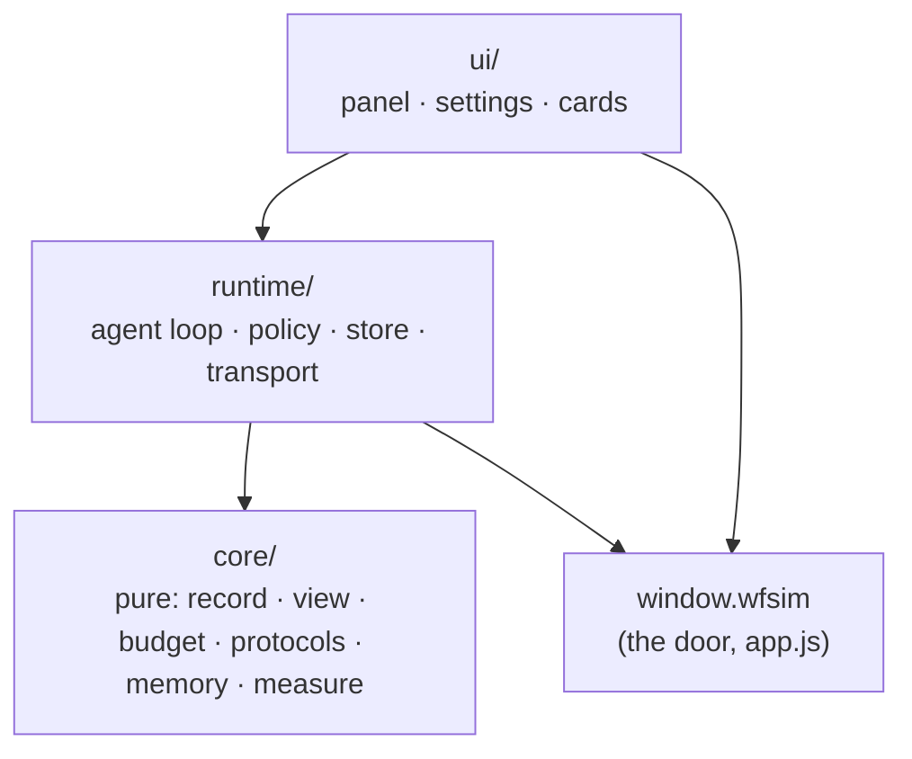

# Nona (九九), the in-page agent

Nona is a model the reader brings their own key for, driving the page through
the agent door (`docs/AGENT.md`). The door is the page's side of the contract;
this document is hers. It states what must stay true, where each piece lives,
what is stored and in what shape, and how a new capability is added without
eroding any of it.

## The invariants

Each one is enforced by something that fails. A rule with no enforcement is a
wish.

| # | Invariant | Enforced by |
| --- | --- | --- |
| 1 | **She touches the page only through `window.wfsim`.** A capability she needs that the door lacks is added to the door first, where the reader's own control calls it too. | `check_nona_boundary` — no file under `nona/` names an identifier of `app.js` |
| 2 | **Every number she states comes from a tool result.** The prompt asks; the panel marks any number no tool returned. | `test_nona_core` (the checker), `nona_eval` (the count, target 0) |
| 3 | **The reader's documents are never edited in place.** The agent loop branches a build, fight, search, riven or target before her first write to it — policy in code, not in the prompt. Taking her copy back is a reader's click. | `check_nona` (reader's build asserted untouched) |
| 4 | **The key goes only to the address the reader chose**, and is kept past the tab only if they ask. | `check_nona` (storage assertions); one `fetch` in the module (`runtime/transport.js`) |
| 5 | **The record is whole and append-only.** Everything sent to a model is a pure function of the record, the settings, the memory and the tool table. Compaction writes marks into the record; it never rewrites or drops a message. | `test_nona_core` (view is deterministic; record unchanged by building it) |
| 6 | **The prefix is stable.** Rules, memory and tools are byte-identical from one request to the next between two summaries, so a provider's prompt cache keeps matching. | `test_nona_core` (two consecutive views share their prefix byte for byte) |
| 7 | **Every stored shape is versioned, and a name that ships is frozen.** Conversations, memory and settings live in readers' browsers; they are a wire. | `test_nona_core` (each old fixture migrates; no shipped name leaves `FROZEN`) |
| 8 | **Every door action reaches her through a skill generated from the table at request time**, by seven fixed tools. Nothing in her code lists what the page can do. | `check_agent_door` (every action in exactly one skill); `check_nona` (seven tools; the catalogue names every action) |
| 9 | **A request fits the window after at most one compaction, and nothing is estimated** — however long the conversation; the budget acts only on what a provider stated. | `test_nona_core`: over a thousand generated turns sent to stand-in providers of five tokenizer weights and windows; T and one skill's size by `check_nona` |

## The layers

Four layers, each depending only on those below it. The arrows are imports;
nothing imports upward.



| Layer | Owns | May use | May not |
| --- | --- | --- | --- |
| `core/` | the record and message shapes, migrations, the request view, the budget and compaction decisions, the summary's input, the number checker, both protocols' encoders and stream decoders, memory operations, the rules text | nothing but itself | `window`, `document`, `fetch`, storage, time, randomness — each is passed in. Imports without side effects, so Node can load it |
| `runtime/` | the agent loop, the branch policy, the loop guard, persistence, the one `fetch` | `core/`, `window.wfsim`, browser storage | the DOM; any `app.js` identifier |
| `ui/` | the panel, settings, the change card, the memory chips | `runtime/` (by its events), `core/` (pure helpers), `window.wfsim`, the DOM | calling a model; writing storage directly |
| the door | everything the page can do or answer | — | knowing Nona exists |

A pure function that needs "now" or an id takes them as arguments. That is
what makes the whole of `core/` testable in Node in milliseconds, and it is the
line between the two lower layers: if a function needs the browser, it is
`runtime/`.

## Files

```
web/src/static/nona/
  index.js                 mount: waits for the page's boot, builds the runtime, mounts the ui
  core/
    record.js              Conversation, Message, Settings, Memory shapes; migrate(); FROZEN
    size.js                the caps; clip()
    skills.js              the catalogue and a skill's document, from the door's table
    calc.js                arithmetic on numbers she was sent
    view.js                each message as sent; view(record, parts) -> { system, tools, turns }
    budget.js              pressed(record, window) from the billed usage; plan() -> what to set aside, where to summarise
    summary.js             summaryInput(); applySummary(), cut to its cap; SUMMARY_RULES
    measure.js             numbersIn(record); markNumbers(text, numbers)
    memory.js              set / forget / undo / block over a Memory value
    prompt.js              RULES(settings) — the byte-stable system text
    tools.js               her seven fixed tools
    protocols/
      sse.js               chunks -> events
      openai.js            encode(view, settings) -> body; decode(events | json) -> reply
      anthropic.js         the same, with cache breakpoints
  runtime/
    transport.js           the only fetch: request, stream, abort
    store.js               conversations (IndexedDB), memory and settings (localStorage), key (sessionStorage)
    policy.js              branch-before-write, from the door's observation and actions
    agent.js               ask(): the loop; emits events
  ui/
    kit.js                 the page's tr, dropdown and escaping (`wfsim.ui`), the reply markup
    panel.js  settings.js  cards.js  chips.js
```

**Loading.** Native ES modules, no bundler and no dependencies, as everywhere
else in the page. `index.html` loads `nona/index.js` with `type="module"`
after `app.js`, and it mounts on the page's `wfsim:ready`. The site build publishes the whole directory as
`site/asset/nona.<digest>/`, the digest taken over every file in it, so relative
imports keep working and a new release is a new directory; the dev server
serves the embedded files at `/nona/…`. A file added under `nona/` and missing
from either list fails `check_nona_boundary`.

## What is stored

Every shape carries `v`. `migrate()` in `core/record.js` takes any version this
code has ever written to the current one; a version newer than the code is left
untouched and read-only rather than guessed at.

| Key | Where | Shape (v1) |
| --- | --- | --- |
| `wfsim-nona` | localStorage | `{ v, base, proto, model, context, remember, concise, key? }` — `key` only when `remember` |
| `wfsim-nona-key` | sessionStorage | the key, when not remembered |
| `wfsim-nona-memory` | localStorage | `{ v, paused, items: MemoryItem[], archive?: {at, items}[] }` — `archive`, the versions before the last tidies |
| `wfsim-nona-launcher` | localStorage | `{ v, side, y }` — where the launcher was dragged: the edge it settled on, and its bottom's height as a share of the screen's; absent, it sits where the stylesheet puts it |
| `wfsim-nona` / `conversations` | IndexedDB | `Conversation` |

```
Conversation { v, id, title, pinned, created_at, updated_at, weapon,
               made: string[], pairs: {copy, from}[], summary: {upto, text} | null,
               memory: {text, at} | null,   // M, frozen until the next summary
               usage: {input, output, cached, cost}, messages: Message[] }
Message = { role: "user", text, page, at, pageMasked? }
        | { role: "assistant", text, calls: {id, name, args}[], usage? }
        | { role: "tool", id, name, ok, line, result, masked? }
        | { role: "check", text }                     // the page, in the reader's place: a turn she ended in silence, sent back once
        | { role: "note", text }                      // shown, never sent
        | { role: "card", pair: {copy, from, state} } // shown, never sent
        | { role: "memory", id }                      // shown, never sent
        | { role: "memory", merged: [before, after] } // the profile was tidied; shown with its undo
MemoryItem { id, kind: "profile" | "note", key?, value, status: "active" | "proposed",
             source: {conversation, quote, by: "user" | "inferred"},
             created_at, updated_at, history: {value, until}[] }
```

An incognito conversation is never written. `FROZEN` lists every field name
above; renaming one is a new version with a migration, never an edit.

## One turn

```mermaid
sequenceDiagram
  participant UI as ui
  participant A as runtime/agent
  participant C as core
  participant T as runtime/transport
  participant D as window.wfsim
  UI->>A: ask(text)
  A->>D: observe()
  A->>A: append user message + page snapshot
  loop until no tool calls, at most 24 steps
    A->>C: decide(record) — marks to set aside; wantsSummary?
    A->>C: view(record, settings, memory, tools)
    A->>T: send(encode(view)) — streamed
    T-->>A: events → decode → reply
    A->>A: append assistant message
    A->>A: policy: branch before a write
    A->>D: do(id, args)
    A->>A: append tool result
  end
  A-->>UI: events: text, call, result, card, memory, usage, done
```

**One writer.** The agent owns the conversation being run and is the only thing
that appends to it; it persists after every append, so a closed tab loses at
most the reply in flight. The ui never writes the record — it renders events
while a turn runs and the record when a conversation is opened, through the
same functions, so the two cannot drift.

## Skills, and her fixed tools

The door's table is too large to send whole on every request, and most of it is
not needed for any one question. So it reaches her the way a skill does: a
catalogue she always sees, and the full text of a part only once she asks
for it.

- **A skill is a door module** — the door's `skills`, one line each of what it
  is for (`AGENT_SKILLS` in `app.js`), its actions read off their ids. Nothing
  in her code lists them, so an action added to the door is in its skill with
  no edit here, and `check_agent_door` fails an action in no skill.
- **The catalogue** is one line per skill: what it is for, and its actions'
  names. It rides in `skill_load`'s description, in zone T.
- **`skill_load(skills)`** returns the named skills' documents: each action,
  what it does, and its arguments one per line, generated from the door's
  `tools()` at the moment of the call and recorded as they were. An argument
  that is one of a long list says how many, not which: the finders find them.
  A skill already in view is not loaded twice.
- **`act(id, args)`** calls any door action. It runs through the same path a
  named tool did — branch before a write, the loop guard, the trail line with
  the real action id — and the door refuses a `hand` action to it as to
  anything else. There is no second way in.
- **`calc(expression)`** does arithmetic on measured numbers: `+ − × ÷`,
  brackets and percentages, parsed, never `eval`'d. Every number in the
  expression must be one she was sent in this request (§"What measured means",
  below); whole numbers under 100 and powers of ten are constants. A difference
  between two measured scores is then itself measured, and a figure she made up
  cannot be laundered through it.

Her fixed tools are then seven, in this order, and they do not change within a
release: `observe`, `history_search`, `memory_set`, `memory_forget`,
`skill_load`, `act`, `calc`.

Two costs are taken on knowingly. A question about a part she has not loaded
takes one more request — which is why the skill of the module the reader is on
is preloaded with their message. And a generic `act` gives the provider no
schema to guide the arguments; the door's refusals name the argument and its
alternatives, and `nona_eval` measures whether a model copes. One that does not
is a reason to keep a few actions as named tools again, not to guess.

## The context budget

The code is `core/size.js` (the caps), `core/budget.js` (when and how to
compact) and `core/summary.js`.

A conversation may go on for ever. What makes that possible is two stores of
different kinds: **the record**, whole and append-only, in the reader's
browser, and **the request**, rebuilt from the record for every call. The
record grows without bound; the request is compacted when the provider says it
has to be. Anything that has left the request is still in the record, and
`shell_history_search` reaches it.

### Nothing is estimated

The page never guesses how many tokens a text is. Every number the budget acts
on is one a provider stated:

- **the window**, from the address's model list (`context`); an address that
  does not state one has none, and is compacted only when it says too long;
- **what the last request cost**, the `usage` the provider billed for it —
  input and reply, since the next request carries both;
- **too long**, the provider's own refusal of a request.

There is no cost budget. The reader chose the model and pays for it; what a
request holds is bounded by the window alone. A refused model is never refused
by the page: a window too small is the provider's error, in its words.

### When to compact

1. **Pressed**: the last reply was billed at 70% of the window or more. The
   rest is the room for what the next request adds, which is at most one
   message or result, each under its cap. Compacted before the request.
2. **Too long**: the provider refused the request. Compacted, and sent once
   more; refused again, its words are what the reader sees.

### What compacting does

One step, the same either way. This turn's tool results but the newest two are
set aside, each replaced by one line saying what it was and that the call can
be repeated. Every turn before this one is summarised by the model, which keeps
every measured number only with its source. Compacting a conversation with
nothing left to compact does nothing, so a turn that alone fills the window
reaches the provider and its answer stands.

**A SUMMARY IS THE MOMENT FOR EVERYTHING ELSE.** Summarising breaks the cache
anyway, so M's snapshot is refreshed then, and memories written since take
effect in the prefix. The skill documents in view before the cut are carried
into the summary as they were loaded — the same bytes, with no call from her —
up to K, the most recently loaded kept. Between compactions the prefix does
not move.

`test_nona_core` holds the rule over generated conversations of hundreds of
turns sent to stand-in providers of several tokenizer weights and windows:
after one compaction a request always fits, and the record never loses a
message.

### The caps

Each piece of a request has a cap in characters — a length, measured, not a
token count. They bound what one message or result can add, which is what
makes the 70% rule safe.

| Piece | Holds | Cap | Kept under it by |
| --- | --- | --- | --- |
| **S** rules | who she is, what she may do | 4,500 | a build-time check: over it, CI fails and the rules are rewritten |
| **T** tools | her fixed tools and the skill catalogue | 6,000 | `check_nona`: a door that outgrows it fails CI until the catalogue is shortened |
| **M** memory | the reader's profile, as frozen for this stretch | 1,500 | memory compaction |
| **K** skills | the skill documents a summary carries; one load | 15,000, one skill ≤ 7,500 | the summary keeps the most recently loaded; a skill over its cap fails `check_nona` |
| summary | the summary's text | 2,000 | cut, whatever the model wrote |
| text, page, result | the reader's words, the page, one result | 4,500, 1,500, 6,000 | cut where sent, saying how much is missing |

S and T are fixed for a release and M for a stretch of conversation, so they
form a prefix that a provider's cache keeps matching. **M over its cap**: a
memory is at most 120 characters and a slot is written over in place;
unconfirmed items are never sent. A profile past its cap is handed to the model
to rewrite shorter — merging notes, dropping what a later one contradicts — as
lines that each name the memories they come from. The page takes the result
only if every source exists, every slot is still there and nothing is new, and
it fits the cap; anything else is thrown away and the profile stays. The reader
is told, and the version before is one tap away (`archive`, the last three).
Until a tidy succeeds, the notes least recently touched are left out of what is
sent. This runs when the conversation starts and at each summary, where M is
taken anyway.

### What measured means

A number counts as measured when it is in the request she was sent — a tool
result still in view, the page, or the summary with its source. A number that
has left the request is no longer something she can see, so it is not
something she can state without reading it again.

### The record, for ever

The record is never trimmed, because it is the reader's and because it is what
`shell_history_search` and a reopened conversation read. It is kept in
segments, so a long conversation is not rewritten whole on every save, and the
panel draws the latest ones and loads earlier ones on scroll. A result is
already capped at 6,000 characters when it is recorded, which bounds what one round
can add.

## The page's side

Everything she reads or changes is on the door:

| She needs | On the door |
| --- | --- |
| which build, scenario, search, riven and target are open; whether the fight is an official ruler | `observe().open`, `observe().official_scenario` |
| whether an action writes, and what it writes | `actions[i].query` and a declared `writes` (build, scenario, search, riven, target, prefs, bar, none) |
| a build's contents, named, to compare her copy with the reader's | the query `shell.preset.read` |
| the reader taking her copy back | `shell.preset.adopt`, an action marked **`hand`**: offered to the page's own controls, never in `tools()` — a model cannot call it |
| the leaderboard, for suggestions | `builder.board.read` |
| the page's translation, dropdown and escaping, for her own ui | `wfsim.ui` |
| when the page has booted | `observe().ready` and the `wfsim:ready` event |
| her usage points | `wfsim.usage` — `count` passes `nona.*` only (docs/ANALYTICS.md) |

`hand` is the rule `docs/AGENT.md` already states for outward actions —
"a reader's gesture" — made checkable: an action a model must never call is
not in `tools()`, whatever it does.

## Tests

| Kind | What | Runs |
| --- | --- | --- |
| `test_nona_core` | Node, no browser: migrations from every fixture version; the view is deterministic and leaves the record unchanged; two consecutive views share their prefix; compaction on the billed usage, over generated conversations sent to stand-in providers; the summary's input; the number checker; both protocols encode to their golden bodies and decode recorded streams; memory set / forget / undo / block | CI, seconds |
| `check_nona_boundary` | static: no `nona/` file names an `app.js` identifier; imports point down; each layer keeps to what it may touch; every file is in the site build and the dev server lists | CI, seconds |
| `check_nona` | the browser, against a stand-in provider: the loop end to end, the branch policy, storage, the ui | CI |
| `nona_eval` | a real model, by hand: behaviour graded per case | after prompt, tool or door changes |

A new test is trusted once it has failed on the broken input (`AGENTS.md`).

## Her voice

Her manner is `VOICE` in `core/prompt.js`. A kaomoji goes only at the end of a
sentence: never one inside a number, a table, a comparison, a verdict or the
correction of her own mistake, never an emoji, and the aside never adds a line.
Concise mode drops the manner. The bot's lines (`bot/answer.mjs`) use the same
voice, through the language overlay.

## Adding something

One capability at a time, each landing with its checks green: a short design
note first, then the code, then the case that fails without it.

| To add | Do this | Never |
| --- | --- | --- |
| a thing she can do or read on the page | a row in the door's table, called by the page's own control too | code in `nona/` that reaches the page |
| a provider protocol | `core/protocols/<name>.js` with `encode`/`decode`, golden fixtures, and detection in `runtime/transport.js` | a branch on the provider inside the loop |
| a stored field | bump `v`, write the migration, add the old fixture, extend `FROZEN` | rename or drop a shipped field |
| one of her own tools | `core/tools.js`, appended at the end (the prefix stays stable), its handler in `runtime/agent.js` | a tool that duplicates a door action |
| a rule of behaviour | enforce it in `runtime/policy.js` where code can; the prompt only where it cannot, with an `nona_eval` case | a prompt sentence standing in for a check |
| something on screen | `ui/`, driven by the agent's events | ui that writes the record or calls a model |

## What she does not do

- **Nothing leaves the browser** but the requests to the reader's own address.
  No server of ours sees a key, a conversation or a memory.
- **No outward action**: sharing, submitting to the board, opening a link.
- **No hand action**: she proposes, the reader takes.
- **No framework, bundler or dependency** — the page has none.
