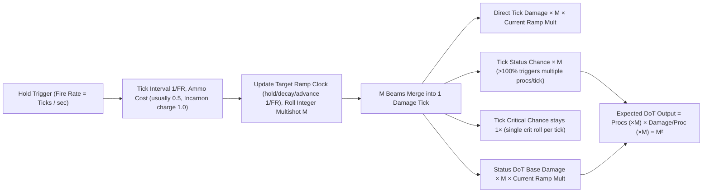
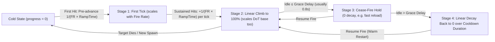

# [Warframe] Beam Weapons (Continuous) Mechanics & Damage Calculation Guide

> **Author & Attribution**: WFSim | [wfsim.app](https://wfsim.app)  
> **Scope**: Damage resolution, ramp-up timing, merged multishot, and spread mechanics of Warframe continuous (beam) weapons, calibrated against in-game Simulacrum measurements. Unresolved edge cases are noted in place.

---

## Key Formulas & Verified Constants {#key-formulas}

| Quantity | Formula / Constant | Verified Scope |
| --- | --- | --- |
| **Tick Rate & Ammo** | `Ticks/sec = Fire Rate`; typical ammo cost `0.5 / tick` (`1.0 / tick` on select beams) | All `Held` continuous weapons |
| **First-Tick Ramp Share** | `R(1) = Floor + (1 - Floor) × min(1, 1 / (Fire Rate × T_rise))` (`Floor` typically `0.20`, `T_rise = 0.6 s`) | Pre-advance before Tick 1; `Floor = 1.0` skips ramp |
| **Cooldown Hold & Decay** | Hold `0.8 s` after ceasing fire, then decay linearly to `Floor` over `2.0 s` | Warm restart resumes from current level |
| **Merged Multishot** | Direct hit `× M`, status procs/tick `× M`, crit roll `1×` → **DoT DPS scales as `M²`** | Outer-only scaling on multi-beam shotguns (`1 + (B - 1) × (1 + MS)`) |
| **Punch Through Gate** | Any beam with terminal impact radius `radius > 0` clamps Punch Through depth to `0` | Applies to Ignis Wraith, Torid Incarnon, Gaze, etc. |

---

## 1. What Is a "Beam Weapon"? {#definition}

In Warframe, **beam weapons** are firearms whose trigger type is **Held (Continuous)**.

Unlike standard rifles or pistols that fire discrete projectiles per trigger pull, beam weapons resolve damage ticks at fixed intervals while the trigger is held. Under the hood, beam weapons differ from standard hitscan/projectile weapons in **6 fundamental ways**:

1. **Fire Rate equals damage ticks per second**, and most beams consume only **0.5 ammo per tick**.
2. **Full Damage Ramp-Up Lifecycle**: **First-tick pre-advance (scales with Fire Rate) → linear ramp-up → grace-period hold on cease-fire → linear cooldown decay → per-target independent timers & death reset**, and the ramp-up multiplier **also scales the base damage of damage-over-time (DoT) status procs**.
3. **Merged Multishot Resolution**: Multiple beams hitting the same target merge into a single damage tick — direct damage scales by `M` and status chance scales by `M`, while **critical chance remains 1×** (one crit roll for the merged tick). Consequently, DoT statuses (**Heat, Toxin, Electricity, Gas, Slash**) scale **quadratically (`M²`)** with multishot.
4. **Center-Beam Exception**: Innately multi-beam shotguns (**Phantasma**, **Phage**) only apply multishot bonuses to their **outer beams**, leaving the 1 center beam unscaled.
5. **Hard Range Cutoff & Punch Through Gate**: Most beams drop immediately to 0 damage beyond max range, and any beam with a terminal damage radius (`radius > 0`) has its Punch Through depth hard-clamped to `0` by the game.
6. **Distinct Area-Spread Archetypes**: Terminal damage spheres, geometric chains, fixed-ratio chains, fan-fork chains, auto-targeting multi-beams, and kill-spawned tendrils — each responds differently to **multishot, headshots, Punch Through, and blast radius mods**.



---

## 2. Damage Ramp-Up Lifecycle & Multi-Enemy Resolution {#ramp-up}

Damage ramp-up is the single most overlooked — and most frequently miscalculated — beam mechanic. It is not simply "starts at 20% and climbs to 100%": it is a **5-stage state machine running independently on every enemy**.



### Stage 1: Initial Contact & Why the First Tick Scales with Fire Rate (Pre-Advance) {#first-tick}

When a beam touches a fresh target, the game initializes the first-tick countdown to **`1 ÷ Fire Rate`** and **advances the ramp clock by `1 ÷ Fire Rate` seconds before reading the multiplier for Tick 1**.

Therefore, on consecutive tick `k` (`k = 1, 2, 3, ...`), the exact ramp-up multiplier is:
```text
Tick k Ramp Progress   = min(1, k ÷ (Fire Rate × Ramp Duration))
Tick k Ramp Multiplier = Base Floor + (1 - Base Floor) × min(1, k ÷ (Fire Rate × Ramp Duration))
```

Plugging in `k = 1` gives the **Fire-Rate-dependent First-Tick Multiplier**:
```text
First-Tick Multiplier = Base Floor + (1 - Base Floor) × min(1, 1 ÷ (Fire Rate × Ramp Duration))
```

#### Example A: Same Weapon, Different Fire Rates (Torid Incarnon Form)
Take **Torid (Incarnon Form)** (base ramp floor **20%**, ramp duration **0.6 s**):

* **Low Fire Rate `6.4 ticks/s`** (interval `0.156 s`):  
  First-tick progress `1 ÷ (6.4 × 0.6) = 26.04%` → **Tick 1 = `20% + 80% × 26.04% =` 40.8%**
* **Base Fire Rate `8.0 ticks/s`** (interval `0.125 s`):
  * Tick 1 (`0.125 s`): progress `20.83%` → **36.7%**
  * Tick 2 (`0.250 s`): progress `41.67%` → **53.3%**
  * Tick 3 (`0.375 s`): progress `62.50%` → **70.0%**
  * Tick 4 (`0.500 s`): progress `83.33%` → **86.7%**
  * Tick 5 (`0.625 s` onward): progress `100%` → **100.0%** full damage
* **High Fire Rate `15.2 ticks/s`** (+90% Fire Rate, interval `0.0658 s`):  
  First-tick progress `1 ÷ (15.2 × 0.6) = 10.96%` → **Tick 1 = `20% + 80% × 10.96% =` 28.8%** (hits 100% on Tick 10 at `0.658 s`)

> **Intuition**: Raising Fire Rate lowers the *percentage* on Tick 1 simply because **Tick 1 lands earlier** (`0.0658 s` vs `0.156 s`). Over the full 0.6 s ramp window, higher Fire Rate still delivers far more ticks and far more total damage.

#### Example B: Phantasma Prime's 2% Base Floor and 15.6% First Tick
* **Phantasma / Phantasma Prime** actually has a base ramp floor of **`2%`** (`0.02`) and a `0.6 s` ramp duration.
* At its base Fire Rate of **`12 ticks/s`**, Tick 1 advances `1 ÷ (12 × 0.6) = 13.89%`:  
  `Tick 1 = 2% + 98% × 13.89% =` **15.61%** — which explains why base-fire-rate testing commonly observes a ~15% opening tick.
* Double its Fire Rate to **`24 ticks/s`**, and Tick 1 advances only `6.94%`:  
  `Tick 1 = 2% + 98% × 6.94% =` **8.81%**.

---

### Stage 2: Linear Climb & Permanent Status DoT Snapshotting {#dot-snapshot}

On each sustained tick, ramp progress rises by `(1 ÷ Fire Rate) ÷ Ramp Duration`, capped at `1.0` (100%).

**Status DoT snapshotting (verified in-game)**: The ramp multiplier does not just scale direct hits — it **multiplies straight into the base damage of any DoT status (Heat / Toxin / Electricity / Gas / Slash) procced on that tick**, and **each status stack permanently snapshots the ramp multiplier of the tick that created it**. Old stacks applied during ramp-up are never upgraded once the beam reaches 100%.

> **Example C (Phantasma Prime stacking Heat across the ramp window — base 12 FR, 2% floor, 90 total base damage, +90% Heat)**:
> * Tick 1 (`0.083 s`): **15.6%** → Heat stack base `90 × 15.6% = 14.05`
> * Tick 2 (`0.167 s`): **29.2%** → Heat stack base `26.30`
> * Tick 3 (`0.250 s`): **42.8%** → Heat stack base `38.55`
> * Tick 4 (`0.333 s`): **56.4%** → Heat stack base `50.80`
> * Tick 5 (`0.417 s`): **70.1%** → Heat stack base `63.05`
> * Tick 6 (`0.500 s`): **83.7%** → Heat stack base `75.30`
> * Tick 7 (`0.583 s`): **97.3%** → Heat stack base `87.55`
> * Tick 8+ (`0.667 s`): **100.0%** → Heat stack base `90.00`
>
> Because Ticks 1–7 permanently lock their low ramped bases, in-game testing shows the first 10 Heat stacks applied from cold deal only **669–690** per tick (far below the fully-ramped 10-stack value of `855`), whereas the *next* 10 Heat stacks applied at 100% ramp add **+855** (`687 → 1,542`) to the dot.

---

### Stages 3 & 4: Grace-Period Hold, Linear Cooldown Decay, and "Warm Restart" {#cooldown-decay}

When a beam leaves a target or stops firing (repositioning, dodging, reloading), ramp progress does **not** instantly reset. Instead it evaluates the **idle gap `idle`**:

```text
idle = Current Hit Time - Last Hit Time - Tick Interval (1 ÷ Fire Rate)

Case 1 (Grace Period): if idle ≤ Decay Delay (typically 0.8 s)
    decayed_progress = previous_progress   (100% preserved, zero decay)

Case 2 (Linear Cooldown Decay): if idle > Decay Delay
    decay_duration = Ramp Duration × Decay Divisor (typically 0.6 × 2 = 1.2 s; 2.0 s total to fully reset including the 0.8 s delay)
    decayed_progress = max(0, previous_progress - (idle - Decay Delay) ÷ decay_duration)

When the beam hits again, advance one tick before reading:
    new_progress   = min(1, decayed_progress + 1 ÷ (Fire Rate × Ramp Duration))
    new_multiplier = Base Floor + (1 - Base Floor) × new_progress
```

#### Example D: Reload Time vs. the 0.8 s Decay Delay
* **Phantasma Prime (`0.5 s` reload)**: Empty an 11-round mag into a tough elite (~1.83 s, progress = `1.0`) → reload for **0.5 s** → resume firing at the same target. Because `idle ≈ 0.5 s ≤ 0.8 s`, **Tick 1 after reload continues seamlessly at 100% full ramp**.
* **Tenet Glaxion (`2.0 s` reload)**: `idle ≈ 2.0 s > 0.8 s`, exceeding the grace window by `1.2 s` (exhausting the entire `1.2 s` decay duration) → progress drops all the way from `1.0` to `0`, forcing Tick 1 after reload to restart cold at **31.1%**.

---

### Stage 5: Per-Target Timers, Multi-Chain Deduplication & Full Multi-Enemy Timeline {#multi-target}

In real combat with multiple enemies, beam ramp-up enforces **4 strict rules**:
1. **One clock per enemy**: Almost every beam tracks ramp progress independently on each enemy (rare exceptions such as **Tazicor** and **Panthera Alt-Fire** share one beam-wide clock).
2. **Main beam, terminal sphere, Punch Through, and chains all share that enemy's clock**: Any part of the weapon hitting Enemy X advances Enemy X's single ramp timer.
3. **Simultaneous chain hits in the same tick advance the clock once**: Even if 3 chains from different origins strike Enemy B on the same tick, Enemy B's ramp advances by only one `1 ÷ Fire Rate` step — never 3×.
4. **Enemy death destroys the clock**: Newly spawned enemies always start cold at `progress = 0`.

#### Multi-Enemy Combat Timeline (4 Targets: Enemy A, B, C, D)

* **Setup**: **Torid (Incarnon Form)** at base Fire Rate `8 ticks/s` (interval `0.125 s`, progress `+20.83%/tick`), `20%` floor, `0.6 s` ramp, `0.8 s` decay delay, `1.2 s` decay duration.
* **Positions**:
  * **Enemy A**: Main beam direct target (gets multishot).
  * **Enemy B**: 2 m from A, inside the 2.3 m terminal sphere (acts as a 2nd chain origin and is also struck by A's 1st-hop 75% chain on the same tick).
  * **Enemy C**: 5 m from A, hit only by B's 1st-hop 75% chain.
  * **Enemy D**: Starts 12 m away (unhit), then walks into chain range at `t = 0.750 s` (hit as B's 2nd-hop 56.25% chain target).

| Timestamp & Event | Enemy A (Main Direct) | Enemy B (Sphere + Chain) | Enemy C (75% Chain) | Enemy D (Late Arrival) |
| --- | --- | --- | --- | --- |
| **`t = 0.125s` (Tick 1)**<br>Begin firing on A | Advances once<br>prog `20.8%` → **36.7%** | Hit by sphere & chain simultaneously; **advances once**<br>prog `20.8%` → **36.7%**<br>(chain yields `75% × 36.7% = 27.5%`) | Advances once<br>prog `20.8%` → **36.7%**<br>(yields `75% × 36.7% = 27.5%`) | Unhit<br>(no clock) |
| **`t = 0.375s` (Tick 3)**<br>Sustained fire | 3 consecutive ticks<br>prog `62.5%` → **70.0%** | 3 consecutive ticks<br>prog `62.5%` → **70.0%** | 3 consecutive ticks<br>prog `62.5%` → **70.0%** | Unhit |
| **`t = 0.625s` (Tick 5)**<br>Sustained fire | Full ramp reached<br>prog `100%` → **100.0%** | Full ramp reached<br>prog `100%` → **100.0%** | Full ramp reached<br>prog `100%` → **100.0%** | Unhit |
| **`t = 0.750s` (Tick 6)**<br>**A dies, aim shifts to B; D enters range** | **Dead**<br>(new spawn A' starts cold) | Now main direct target;<br>**retains 100.0% ramp** | Still on 75% chain<br>maintains **100.0%** ramp<br>(yields `75.0%`) | **First hit (56.25% chain)**<br>Starts own cold clock → **36.7%**<br>(yields `56.25% × 36.7% = 20.6%`) |
| **`t = 1.250s` (0.500s pause)**<br>`idle = 0.375s ≤ 0.8s` | — | **Zero decay**, stays **100.0%** | **Zero decay**, stays **100.0%** | **Zero decay**; Advances `20.8% → 41.7%` → **53.3%** |
| **`t = 2.750s` (1.500s pause)**<br>`idle = 1.375s > 0.8s`; `0.575s` over delay → `-47.92%` progress | — | `100% - 47.92% = 52.08%`<br>`+20.83% → 72.92%`<br>**Warm restart: 78.3%** | Same as B<br>**Warm restart: 78.3%** | `41.67% - 47.92%` → bottoms at **`0%`**<br>`+20.83%` → **Cold restart: 36.7%** |

> Notice the divergence in the final row: after the exact same `1.5 s` pause, fully ramped Enemies B and C only dip to a **78.3% warm restart** (back to 100% in 2 ticks), while Enemy D (which only had 2 ticks of progress) bottoms out completely back to a **36.7% cold restart**.

### Measured Ramp-Up Floors Across Beam Weapons {#ramp-floors}

| Base Floor | Representative Weapons | Special Curve Parameters (Default: 0.6s ramp / 0.8s delay / 1.2s decay) |
| :---: | --- | --- |
| **100% (No Ramp)** | **Furis / MK1-Furis (Incarnon)**, **Vermisplicer (Secondary)**, **Onos (Incarnon)** | Full 100% damage starting on Tick 1 |
| **2%** | **Phantasma / Phantasma Prime** | Base 12 FR → **15.6%** Tick 1; 24 FR → **8.8%** Tick 1 |
| **10%** | **Panthera / Panthera Prime (Alt-Fire Saw)** | 0.8s ramp, 0s decay delay, shared beam-wide timer |
| **20%** | **Torid (Incarnon)**, **Boar (Incarnon)**, **Amprex**, **Kuva Nukor**, **Nukor**, **Spectra / Vandal**, **Tenet Glaxion**, **Tenet Cycron**, **Ignis / Wraith**, **Ocucor**, **Athodai / Prime (Alt-Fire)**, **Larkspur / Prime**, **Verglas / Prime**, and most standard beams | Basmu Alt-Fire uses **0.5s** ramp (1.0s decay); Tazicor uses a shared beam-wide timer |
| **30%** | **Embolist** | Standard 0.6s curve |
| **40%** | **Enkaus** | Standard 0.6s curve |
| **50%** | **Tenet Quanta** | **1.0s ramp**, **2.0s decay delay**, **2.0s decay** |
| **60% / 80%** | **Convectrix (Primary 60% / Alt-Fire 80%)** | Standard 0.6s curve |
| **70%** | **Phage** | Highest floor among beams that still have ramp-up |

---

## 3. The Other 5 Core Beam Rules (with Worked Math) {#core-rules}

### Rule 1: Fire Rate = Ticks/sec, Ammo Cost Usually 0.5/Tick {#fire-rate}

* **Core Relations**:
  * `Ticks per second = Modded Fire Rate`
  * `Ticks per magazine = Magazine Size ÷ Ammo per Tick`
  * `Continuous fire duration = Ticks per magazine ÷ Modded Fire Rate`
* **Ammo Cost Rules**:
  * **Most standard beams**: **0.5 ammo per tick**.
  * **Common 1.0 ammo/tick exceptions**: Base **Ignis** (note: **Ignis Wraith** is 0.5), **Atomos**, base **Nukor**, **Basmu** (Alt-Fire), **Athodai / Athodai Prime** (Alt-Fire), Sentinel **Verglas / Verglas Prime**, and **all Incarnon beam charge bars**.
  * **Secondary beams & chains**: Extra hits from chains, terminal spheres, or auto-lock beams **consume zero extra ammo**.

> **Worked Examples**:
> * **Tenet Glaxion (0.5 ammo/tick)**: 90 mag, 12 FR → `90 ÷ 0.5 = 180` ticks → `180 ÷ 12 = 15.0 s`.
> * **Verglas Prime (measured 1.0 ammo/tick)**: 80 mag, 12 FR → `80 ÷ 12 ≈ 6.67 s` (not 13.33 s).
> * **Torid Incarnon (1.0 charge/tick)**: 170 charge, 8 FR → `170 ÷ 8 = 21.25 s`. Incarnon charge bars are separate from ammo: **Magazine Capacity and Ammo Efficiency (e.g., the ammo efficiency portion of Primary Crux) do not apply to Incarnon charge** (Primary Crux's status chance bonus still applies).

---

### Rule 2: Merged Multishot Mechanics {#multishot}

* **Standard weapons**: `3.0` multishot fires 3 separate pellets that each roll crit and status independently.
* **Beam weapons (on the same target)**: Extra beams merge into a single damage tick. Given integer multishot `M` rolled from the fractional multishot (e.g. `2.8` rolls `M = 2` 20% of the time and `M = 3` 80% of the time):
  * **Merged Direct Tick Damage** = `Single-Beam Damage × M`
  * **Merged Tick Status Chance** = `Single-Beam Status Chance × M` (>100% triggers multiple stacks in one tick)
  * **Tick Critical Chance** = **Unchanged (1×)** (not multiplied by `M`; one crit roll applies to the whole tick)
  * **Status DoT Base Damage** = `Single-Beam Base Damage × M`

#### Example A: Quadratic (`M²`) Scaling of DoT Statuses
Compare a standard rifle and a beam weapon, both with `100` base damage, `+100% Heat` (`2.0×` Heat multiplier), `30%` status chance, and **`3.0` multishot (`M = 3`)** (ignoring crits):
* **Standard Rifle**: 3 bullets average `3 × 30% = 0.9` Heat stacks, each ticking for `100 × 0.5 × 2.0 = 100` → expected Heat tick `0.9 × 100 =` **90** (**3×** of 1× multishot).
* **Beam Weapon**: Merged status chance `3 × 30% = 90%` (same `0.9` expected stacks), but merged base is `100 × 3 = 300`, so each stack ticks for `300 × 0.5 × 2.0 = 300` → expected Heat tick `0.9 × 300 =` **270** (**9×** of 1× multishot — **3×** the rifle).

For damaging DoT statuses (**Heat, Toxin, Electricity, Gas, Slash**), beam multishot amplifies both **proc count (`×M`)** and **damage per proc (`×M`)**, yielding **`M²`** scaling.

#### Example B: Forced-Proc Triggers (Hunter Munitions, Internal Bleeding) on Beams
Bonus proc triggers roll **after** merging — only **once per tick**. At 100% crit chance, `100` base damage, **`M = 3`**, and 30% Slash chance:
* **Standard Rifle**: 3 bullets roll 30% each → `0.9` expected stacks × `100` base = **90**.
* **Beam Weapon**: 1 merged tick rolls 30% once → `0.3` expected stacks × `300` merged base = **90**.  
Long-run expected DPS is **identical**; beams simply produce fewer, larger, higher-variance Slash procs.

#### Example C: Center-Beam Multishot Formula (Measured)
**Phantasma / Phantasma Prime** and **Phage** consist of 1 fixed center beam plus outer beams; multishot bonuses **scale only the outer beams**:
```text
Actual Beam Count = (Base Beams - 1) × (1 + Multishot Bonus) + 1
```
* **Phantasma Prime (5 outer + 1 center)** at `+120%` multishot: `5 × 2.2 + 1 =` **12.0 beams** (not `13.2`).
* **Phage (6 outer + 1 center)** at `+120%` multishot: `6 × 2.2 + 1 =` **14.2 beams** (not `15.4`).

#### Example D: Which Secondary Hits Scale with Multishot?
* **Scales with multishot**: Main-beam direct hits, Punch-Through direct hits, chains originating from direct hits, **Boar Incarnon's auto-lock beams & their chains**, and **Ocucor's active tendrils**.
* **Does NOT scale with multishot**: Non-direct targets caught inside a terminal **damage sphere (`radius > 0`)**, and **any chains spawned from those sphere-edge targets**.

---

### Rule 3: Complete Single-Tick Direct & Status DoT Formulas {#formulas}

#### (1) Merged Direct Tick Damage
```text
Direct Tick = Single-Beam Panel Damage (base + elements)
            × M (rolled integer multishot)
            × Current Ramp Multiplier
            × Crit Multiplier [1 + Crit Tier × (Crit Damage - 1)]
            × Body-Part Multiplier (standard head 3×; headshot crit doubles crit damage: 1 + k × (2×CD - 1))
            × Faction Multiplier (1 + Faction Mods + Roar, etc.)
            × Final Multiplier (e.g. Eclipse)
            × Target Armor & Resistances
```

#### (2) Single-Stack DoT Damage (Heat / Toxin / Electricity / Gas / Slash)
```text
DoT Tick = (Single-Beam Base Damage × M × Current Ramp Mult × Crit Mult × Part Mult × Faction Mult + 1)
         × Status Coefficient
         × (1 + Matching Element %)    ← Slash ignores element mods (factor = 1)
         × Faction Multiplier          ← Faction double-dips here
         × (1 + Status Damage %)
```
* **Status Coefficient**: **0.35** for Slash; **0.50** for Heat, Toxin, Electricity, and Gas.
* **The `+ 1` accumulator**: The engine initializes DoT accumulators at `1` (merged pools like Heat/Electricity/Gas add `+1` once for the whole pool; independent-stack DoTs like Slash/Toxin add `+1` per stack).
* **Base Damage** includes base damage and base-damage modifiers only (no elemental mod damage) and **bypasses the `1/32` quantization** used on direct hits.

---

### Rule 4: Range, Falloff, Punch Through Gates & Headshots {#range-punch-through}

* **Hard Range Wall**: Almost all beams deal 100% damage up to max range and 0 beyond it.
  * **Rare beams with distance falloff**: **Furis (Incarnon Form)** (linear falloff across 10–16 m), **Catabolyst / Coda Catabolyst** (9–19 m falloff down to ~1.88%).
  * **Beam Length mods (Sinister Reach / Ruinous Extension)**: Extend main beam length (and Ocucor tendril length) only — **never chain hop range**.
* **Two Separate Punch Through Mechanisms**:
  1. **Any beam with a terminal damage radius (`radius > 0`) hard-clamps Punch Through depth to `0`**: Whenever `radius > 0`, the game clamps Punch Through to `0`, overriding both innate and modded Punch Through — this covers **Torid (Incarnon), Catabolyst / Coda Catabolyst, Glaxion Vandal, Embolist, Gaze (Primary), Ignis / Wraith, and Cortege**. Additionally, **Boar / Boar Prime (Incarnon)** ignores Punch Through (verified in-game).
  2. **"Infinite Body Punch Through" is a separate flag**: **Ignis / Wraith, Cortege, Phantasma / Prime, Onos (Incarnon), and Athodai / Prime (Alt-Fire)** use an independent "ignore enemy body collision" flag to pierce unlimited enemies without consuming Punch Through depth, still stopping at walls (unless `radius == 0` with innate terrain Punch Through, like Athodai Alt-Fire's 2 m).
  3. **Multi-Origin Stacking on Punch-Through Chains**: Humanoid torsos are ~**0.5 m** thick. On **Amprex, Tenet Glaxion, Tenet Cycron, Kuva Nukor, and Larkspur / Prime**, every enemy pierced by the main beam counts as a **direct hit (gets multishot, can headshot)** and **spawns its own independent chain set**.
* **Headshot Boundary**: **Only main-beam direct hits (including Punch Through) can headshot** (**Athodai / Prime Alt-Fire** is locked to 1×); terminal spheres, chains, auto-lock secondary beams, and tendrils all lock to body.

---

### Rule 5: Chain Pathfinding Rules (Verified) {#chain-rules}

1. **Ignores terrain and line-of-sight**: Only checks 3D distance between enemies against chain hop range.
2. **"Fresh target" first, then "nearest"**: When multiple origins chain on the same tick, each chain prioritizes enemies not yet hit by any chain that tick (closest first); only if no fresh target is in range may it re-hit an already-struck enemy.
3. **A single chain never doubles back**: Repeat hits on the same enemy can only come from **different origins**.
4. **Static positions produce deterministic paths**.

---

## 4. Complete Taxonomy of Beam Weapons (6 Mechanical Types) {#taxonomy}

### Type 1: Pure Single-Target Direct Beams (Including Wide Beams) {#type-single}
* **Traits**: Single main beam, no terminal sphere, no chains, no auto-lock beams (some have wide sweep volumes or infinite body pierce).
* **Representative Weapons**:
  * **Primary**: Synapse / Coda Synapse, Flux Rifle, Glaxion (base), Enkaus
  * **Secondary**: **Furis / MK1-Furis (Incarnon)** (2 m wide beam + 10–16 m falloff, **no ramp-up**), **Athodai / Athodai Prime (Alt-Fire)** (1.6 m / 4.0 m wide mag-dump + 2 m terrain PT + infinite body pierce, 1× headshot), Gammacor / Synoid Gammacor, Spectra / Spectra Vandal, Cycron (base, battery), Nukor (base)
  * **Sentinel / Archgun**: Verglas / Verglas Prime, Artax, Cortege (innate infinite body pierce)

---

### Type 2: Innate Multi-Beam Merged Weapons {#type-multi-beam}
* **Traits**: Innately fire `2–7` beams that merge when aimed at one target:
  * **2A. Full-Beam Scaling**:
    * **Quanta / Quanta Vandal / Tenet Quanta**: 2 base beams, 50 m (longest standard beam range).
    * **Convectrix**: 2 Slash-heavy converging beams, 60% / 80% ramp floor, 45% base status.
    * **Vermisplicer (Secondary Kitgun)**: 5 innate auto-seeking tendrils, innate 1 m PT, **no ramp-up (100% floor)**; **the 5 tendrils split the base status budget evenly** (e.g. 39% total → 7.8% per tendril; added multishot does not dilute per-tendril status).
  * **2B. Center-Beam Exception (Multishot Scales Outer Beams Only)**:
    * **Phantasma / Phantasma Prime**: 5 outer + 1 center = **6 beams**, innate infinite body pierce, `2%` base floor (15.6% Tick 1 at 12 FR).
    * **Phage**: 6 outer + 1 center = **7 beams**, innate Viral, `70%` floor.

---

### Type 3: Terminal Damage-Sphere Beams {#type-terminal-sphere}
* **Traits**: Generates a spherical damage zone (`radius > 0`) at the contact point (or max range).
  1. Not a separate explosion, no radial falloff, direct target is hit only once;
  2. Sphere-edge targets do not get multishot and cannot headshot;
  3. Punch Through depth is hard-clamped to `0` (Ignis / Wraith pierces bodies via the separate collision-ignore flag);
  4. Scales with blast radius mods (Firestorm / Primed Firestorm), but **Primary Compression has 0% effect**.
* **Representative Weapons**: **Ignis / Ignis Wraith** (3.0 m sphere + infinite body pierce), **Glaxion Vandal** (2.0 m sphere), **Gaze (Primary)** (3.0 m sphere), **Catabolyst / Coda Catabolyst** (0.7 m sphere + steep falloff + reload grenade), **Embolist** (1.0 m sphere, 30% floor).

---

### Type 4: Chaining Beams {#type-chaining}

| Subtype | Decay & Chaining Rule | Representative Weapons & Parameters |
| --- | --- | --- |
| **4A. Geometric-Decay Serial Chain** | Relay hops; hop `k` deals `decay^k` of the origin hit | **Amprex**: 3 hops / 10 m / 50% geometric (50% → 25% → 12.5%)<br>**Tenet Glaxion**: 3 hops / 8 m / 50% geometric<br>**Atomos**: 3 hops / 7 m / 75% geometric (75% → 56.25% → 42.19%)<br>**Larkspur / Prime**: Ground 3 hops / 6 m / 80% geometric (40 m / Prime 50 m range; 30 m chain in Archwing)<br>**Gaze (Secondary)**: 2 hops / 5 m / 20% geometric (20% → 4%, innate 1 m PT)<br>**Basmu (Alt-Fire)**: 2 base beams + 5 hops / 7 m / 50% geometric<br>**Tazicor (Sentinel)**: 3 hops / 5 m |
| **4B. Fixed-Ratio Serial Chain** | Relay hops, but **every hop deals a fixed % of the main beam (non-compounding)** | **Kuva Nukor**: 2 hops / 9 m / fixed **50%** each hop (50%, 50%)<br>**Tenet Cycron**: 2 hops / 8 m / fixed **60%** each hop (60%, 60%, innate 1 m PT + battery) |
| **4C. Fan-Fork Chain** | Does not relay; **forks simultaneously** from the primary target | **Vermisplicer (Primary Kitgun)**: Forks up to **3 beams** within 6 m of primary target, each fixed at **70%** (non-compounding) |

---

### Type 5: Hybrid Multi-Origin Chaining Beams {#type-hybrid-chain}
* **5A. Terminal Sphere Multi-Origin + Chain**: **Torid (Incarnon Form)** — every enemy inside the 2.3 m sphere becomes an independent 5-hop chain origin.
* **5B. Auto-Lock Multi-Beam + Chain**: **Boar / Boar Prime (Incarnon Form)** — auto-locks up to **3 distinct targets** within 10° of the reticle, each chaining **2 hops** (10 m, 80% geometric), covering up to **9 enemies** per tick.

---

### Type 6: Kill-Spawned Independent Secondary-Beam Weapons {#type-kill-spawned}
* **Traits**: Kills spawn extra auto-seeking energy tendrils; each tendril is a **full 100% independent beam instance** (independent crit & status rolls, **scales with weapon multishot, cannot headshot**), cleared on reload or empty magazine.
* **Representative Weapon**: **Ocucor** — up to 4 tendrils (40° acquire / 60° hold, 20 m range, scales with Ruinous Extension); against a single target, tendrils curving onto the main target are purely visual with 0 extra damage or status.

> **Note (Atypical Continuous-Trigger Weapons)**: **Onos (Incarnon Form)** (continuously fires physical projectiles with 5 m PT + infinite body pierce, no ramp-up) and **Panthera / Panthera Prime Alt-Fire** (hovering sawblade, 10% floor, 0.8 s ramp, shared beam clock) do not follow standard beam chain/sphere rules.

---

## 5. Comprehensive Worked Weapon Examples {#worked-examples}

### Example 1 (Deep Dive): Torid — Both Forms in Full Detail {#torid-incarnon}

#### 1. Dual-Form Base Stats & Charging Rules
* **Base Form (Grenade Launcher)**: 100 pure Toxin direct hit; sticks and spawns a 3 m Toxin cloud (40 Toxin/s for 10 s = 10 ticks). Multiple grenades on the same target **stack independently** (3 shots = 3 clouds ticking simultaneously), rather than refreshing.
* **Incarnon Charging**: **5 direct hits in Base Form fill the bar completely** (no headshots required; each multishot pellet counts as 1 hit; clouds do not charge), granting 34 charge/hit up to **170 max charge**. Transform in: 1.4 s; transform out: 0.6 s (scales with Reload Speed).
* **Incarnon Form (Continuous Beam)**: Base damage **51 Toxin** | Crit Chance **29%** | Crit Damage **3.1×** | Status **39%** | Fire Rate **8 ticks/s** | Cost **1 charge/tick** (21.25 s full bar) | Range **37 m** | Ramp floor **20%** (**36.7%** Tick 1 at base 8 FR, 100% on Tick 5) | Punch Through **disabled**.

#### 2. Geometry Math: "2.3 m Sphere × Independent 5-Hop Chains"
1. Contact creates a **2.3 m damage sphere** (not a separate blast, no falloff, direct target hit once).
2. **Every enemy inside the sphere spawns its own independent 5-hop serial chain** (7 m hop range, **75% geometric decay**). One full 5-hop path totals:
   ```text
   1 + 0.75 + 0.75² + 0.75³ + 0.75⁴ + 0.75⁵ = 3.288× (6 damage instances)
   ```
3. Taking enemy torso radius as `0.25 m` (sphere reach `= sphere radius + 0.25 m`):
   * **Single target**: Always 1 instance (**1.00×**); blast radius mods give 0 benefit.
   * **3×3 grid at 3.0 m spacing (no radius mod)**: Sphere `2.30 m`, reach `2.55 m < 3.0 m` → **1 origin** → 6 instances, total **3.29×**.
   * **3×3 grid at 3.0 m spacing (+24% Firestorm / +44% Primed Firestorm)**: Reach `3.10 m` / `3.56 m > 3.0 m` → captures front-center, left, right, and back-center = **4 origins** → 24 instances, total `4 × 3.288 =` **13.15×** (exact **4.00×** gain). At ~**2.34 m** spacing, +44% radius reaches **6 origins** → 36 instances, total **19.73×** (**6.00×** gain).

#### 3. Torid Incarnon Multishot & Headshot Split
In that 4-origin, 24-instance scenario at **3× multishot**:
* **The 1 direct-hit origin + its 5-hop primary chain (6 instances)**: Receive **3× merged multishot** (direct ×3, status ×3, DoT ×9), and the main target can headshot.
* **The other 3 sphere-edge origins + their 15 chain hops (18 instances)**: **Do NOT get multishot (1× only)**, and all lock to body.

> **Open Edge Case (Do chain nodes spawn secondary spheres?)**: WFSim currently models **one 2.3 m sphere at the main-beam contact point only (chain hops do not spawn secondary spheres)**; an isolated single-tick cluster test remains open for final confirmation.

#### 4. Five Specific Torid Quirks
1. **Gun Condition Overload (e.g. Galvanized Aptitude) behaves oppositely in the two forms (verified in-game)**:
   * **Base Form (Grenade + Cloud)**: **Multiplicative** GunCO, applies to the cloud too, and **includes Evolution II flat base damage**.
   * **Incarnon Form (Beam)**: **Additive** GunCO, and **excludes Evolution II flat base damage**.
   * **In-Game Verification**: With Evo II **Final Fusillade (+51 base)**, Incarnon panel reads `102`, naked crit (`3.1×`) = `316`. With 1 stack (+40%) and 1 status type, in-game damage reads **`380`**, matching `(102 + 51 × 0.4) × 3.1 = 379.44 → 380` (not `443` from including Evo II base) — effectively halving GunCO's percentage gain against the post-Evo panel.
2. **Evo II "Plentiful Mayhem (+31 base, multishot consumes charge & +60% damage per extra multishot)"**: In Incarnon beam mode, the bonus multishot portion scales by `1.6×`. Example: at `3.3` panel multishot (`+2.3` bonus), effective merged multishot becomes `1 + 2.3 × 1.6 =` **4.68** (~×1.42 direct/status, ~×2.01 expected DoT), while each tick consumes ~`3.3` charge — emptying 170 charge in ~`51` ticks (~`6.4 s`).
3. **Punch Through disabled**: Locked to `0` by the `radius > 0` gate; cannot add chain origins via Punch Through.
4. **Mod/Arcane exclusions**: Cannot equip **Sinister Reach / Combustion Beam**; **Primary Compression** works at 100% effectiveness on Base Form clouds (up to +240%), and **0%** in Incarnon beam mode.
5. **Incarnon charge ignores magazine perks**: Evo II Final Fusillade's last-shot `+3` multishot and Evo III **Extended Volley**'s `+9` magazine apply to Base Form only.

---

### Example 2: Phantasma Prime — 2% Floor, 0.5 s Warm-Reload & Center Beam {#phantasma-prime}

* **Stats**: Innate **6 beams** (**5 outer + 1 center**), 15 damage/beam (90 total), **22.2% status/beam**, **12 ticks/s**, 0.5 ammo/tick (11 mag = 22 ticks ≈ 1.83 s, **0.5 s reload**), infinite body pierce, **2% base ramp floor**.
* **Worked Walkthrough (verified in-game)**:
  1. **Fire-rate Tick 1**: At 12 FR, Tick 1 advances `1 ÷ 7.2 = 13.89%` → **15.61%**. With +90% Heat, Tick 1 Heat proc ticks for `(90 × 0.1561 + 1) × 0.5 × 1.9 = 14.30 →` **14** (versus **+85.5/stack** at full ramp).
  2. **Adding +120% Multishot (Hell's Chamber)**: Center beam does not scale → `5 × 2.2 + 1 =` **12 beams** (exact ×2). Tick status doubles to `266.4%` (×2), full-ramp Heat per stack doubles to `+171.0` (×2), and total full-ramp Heat DPS becomes **4.0×**.
  3. **Seamless 0.5 s Reload**: Emptying a mag into an elite and reloading takes `0.5 s ≤ 0.8 s` grace delay, so **Tick 1 after reload continues at 100% ramp**. Ramp resets to `15.6%` only when switching to a fresh enemy.

---

### Example 3: Kuva Nukor vs. Amprex — Fixed vs. Geometric Chains & Punch Through {#kuva-nukor-amprex}

* **Kuva Nukor (Fixed-Ratio Chain)**: 2 hops / 9 m / fixed **50%** per hop → 3-target total `100% + 50% + 50% =` **200%** (Hop 2 does *not* drop to 25%); paired with 5.0× crit damage, 50% status, and hidden permanent **Microwave** status (counts for GunCO).
* **Amprex (Geometric Chain + Punch-Through Stacking)**: 3 hops / 10 m / **50% geometric** → single-origin 4-target total `100% + 50% + 25% + 12.5% =` **187.5%**. With **+2.2 m Punch Through** against 3 lined-up humanoids (0.5 m thick each), the main beam pierces all 3, each counting as a direct hit and spawning its own 3-hop chain → total multiplier jumps to `3 × 187.5% =` **562.5%** (**Tenet Glaxion, Tenet Cycron, and Larkspur / Prime** follow the same rule).

---

### Example 4: Boar Prime (Incarnon) vs. Ocucor — Auto-Lock Multi-Beams vs. Kill Tendrils {#boar-ocucor}

| Dimension | Boar Prime (Incarnon Form) | Ocucor |
| --- | --- | --- |
| **Activation** | Immediate on firing; zero kill ramp required | Starts with 1 main beam; each qualifying kill spawns 1 tendril (max 4), cleared on reload or empty mag |
| **Single Target** | 1 main beam only (auto-lock does not multiply single-target damage) | 1 main beam only (tendrils bending onto the primary target are purely visual — **0 extra damage, 0 extra status**) |
| **Multi-Target** | Auto-locks up to 3 targets within 10°, each chaining 2 hops (10 m, 80% geometric) → up to **9 targets**, peak total `3 × (1 + 0.8 + 0.64) = 7.32×` | At 4 tendrils, hits **5 targets** within 40° simultaneously; each tendril is a **100% independent beam instance** (no chains) |
| **Multishot & Headshots** | All 3 lock-on beams and their chains **scale with multishot**; **only the reticle target can headshot** | All 4 tendrils roll crit/status independently, **scale with weapon multishot, cannot headshot**; tendril direct kills do not spawn new tendrils, while main-beam or any status kills do |
| **Punch Through** | **Disabled** (verified in-game) | Works normally on the main beam |

---

### Example 5: Ignis Wraith vs. Vermisplicer (Primary / Secondary) {#ignis-vermisplicer}

* **Ignis Wraith**: Infinite body pierce across its 27 m beam (all pierced targets receive multishot) plus a 3 m falloff-free terminal sphere (reaching 30 m); sphere-edge targets ignore multishot and headshots; Punch Through depth is clamped to `0` by the 3 m radius gate (no wall-piercing, no benefit from PT mods).
* **Vermisplicer (Primary vs. Secondary)**:
  * **Primary (Type 4C Fan-Fork)**: 20% ramp floor (0.6 s ramp); forks up to 3 beams at fixed 70% within 6 m of the primary target.
  * **Secondary (Type 2A Innate Multi-Beam)**: **No ramp-up (100% floor)**, 5 auto-seeking tendrils + 1 m PT; the 5 tendrils **split the base status budget evenly** (e.g. 39% total → 7.8% per tendril, verified in-game; added multishot does not dilute per-tendril status).

---

## 6. Mainstream Beam Weapons Quick-Reference Table {#quick-reference}

> Note: "Base Tick 1" uses `Floor + (1 - Floor) × min(1, 1 ÷ (Base FR × Ramp Time))` and shifts dynamically with modded Fire Rate.

| Weapon | Type | Base FR (ticks/s) | Ammo / Tick | Floor → Base Tick 1 | Area Spread Mechanic | PT Mods Work? | Key Quirk |
| --- | --- | :---: | :---: | :---: | --- | :---: | --- |
| **Torid (Incarnon)** | 5A. Sphere+Chain | 8 | 1.0 (charge) | 20% → **36.7%** | 2.3 m sphere; each enemy chains 5 hops (7 m, 75% geo) | **No** | Sphere scales with radius mods; additive GunCO excludes Evo II base |
| **Boar Prime (Incarnon)** | 5B. Lock+Chain | 8 | 1.0 (charge) | 20% → **36.7%** | 10° auto-lock 3 targets, each chains 2 hops (10 m, 80% geo) | **No** | All 3 beams & chains get multishot; reticle target only headshots |
| **Ocucor** | 6. Kill Tendrils | 12 | 0.5 | 20% → **31.1%** | Up to 4 × 100% kill tendrils (40°, 20 m) | Yes | Tendrils scale with multishot, no headshots; clears on reload/empty |
| **Phantasma Prime** | 2B. Center-Beam | 12 | 0.5 | **2%** → **15.6%** | Innate infinite body pierce | Yes (walls) | 5 outer + 1 center = 6 beams; 0.5 s reload ≤ 0.8 s delay keeps 100% ramp |
| **Phage** | 2B. Center-Beam | 12 | 0.5 | **70%** → **74.2%** | Converging beams on aim | Yes | 6 outer + 1 center = 7 beams; innate Viral; highest ramp floor |
| **Convectrix** | 2A. Multi-Beam | 12 / 16 | 0.5 | **60%/80%** → **65.6%/82.1%** | None (innate 0.6 m PT) | Yes | 2 Slash-heavy beams, 45% base status |
| **Tenet Quanta** | 2A. Multi-Beam | 10 | 0.5 | **50%** → **55.0%** | None (50 m longest standard range) | Yes | 2 beams; 1.0 s ramp, 2.0 s grace delay before decay |
| **Kuva Nukor** | 4B. Fixed Chain | 10 | 0.5 | 20% → **33.3%** | 2 hops / 9 m / fixed **50%** (non-compounding) | Yes | 5.0× crit damage; hidden Microwave status counts for GunCO |
| **Tenet Cycron** | 4B. Fixed Chain | 12 | 0.5 | 20% → **31.1%** | 2 hops / 8 m / fixed **60%** (non-compounding) | Yes (1 m innate) | Rechargeable battery; supports PT multi-origin chaining |
| **Amprex** | 4A. Geo Chain | 12 | 0.5 | 20% → **31.1%** | 3 hops / 10 m / 50% geometric | Yes | Supports PT multi-origin chaining |
| **Tenet Glaxion** | 4A. Geo Chain | 12 | 0.5 | 20% → **31.1%** | 3 hops / 8 m / 50% geometric | Yes | Supports PT multi-origin chaining; 2.0 s reload drains full ramp |
| **Larkspur Prime** | 4A. Geo Chain | 12 | 0.5 | 20% → **31.1%** | Ground 3 hops / 6 m / 80% geo (50 m range) | Yes | Archgun (30 m chain in Archwing); supports PT multi-origin |
| **Ignis Wraith** | 3. Terminal Sphere | 8 | 0.5 | 20% → **36.7%** | 3.0 m sphere + infinite body pierce | **No** | Separate body-pierce flag; radius mods work; Primary Compression 0% |
| **Catabolyst / Coda** | 3. Terminal Sphere | 12 | 0.5 | 20% → **31.1%** | 0.7 m sphere + 9–19 m falloff + reload grenade | **No** | 0.7 m radius clamps PT depth to 0 |
| **Furis (Incarnon)** | 1. Direct (Wide) | 12 | 1.0 (charge) | **100% (No Ramp)** | 2 m wide beam (no sphere/chain, 10–16 m falloff) | Yes | 100% damage on Tick 1; additive GunCO excludes Evo II base |
| **Athodai Prime (Alt)** | 1. Direct (Wide) | 12 | 1.0 | 20% → **31.1%** | 4.0 m wide beam + infinite body pierce (16 m) | Yes (2 m innate) | Mag-dump; headshot multiplier locked at 1× |
| **Vermisplicer (Pri/Sec)** | 4C Fork / 2A Multi | 12 | 0.5 | Pri 20%→31.1% / Sec **100%** | Pri: 3 × 70% forks (6 m); Sec: 5 tendrils | Yes (Sec 1 m) | Secondary has no ramp-up; 5 tendrils split base status budget |
| **Verglas Prime (Sent.)** | 1. Direct | 12 | **1.0** | 20% → **31.1%** | None | Yes | Verified 1.0 ammo/tick; aims continuously with 0 headshots |

---

## 7. Common Misconceptions {#misconceptions}

1. **Myth: "Tick 1 is always a fixed 20% (or 15% on Phantasma), and stopping fire resets ramp instantly."**  
   → **Reality**: The ramp clock pre-advances by `1 ÷ Fire Rate` before Tick 1 resolves, so **Tick 1 scales dynamically with Fire Rate** (Phantasma's true floor is `2%`, yielding `15.6%` only at 12 FR). Ceasing fire preserves 100% ramp during the `0.8 s` grace delay before decaying linearly, independently per target.
2. **Myth: "Multishot scales beams linearly like normal rifles."**  
   → **Reality**: Direct hits and status chance scale linearly, but merged multishot boosts both proc frequency and per-proc base damage, causing DoT statuses (Heat/Toxin/Electricity/Gas/Slash) to scale **quadratically (`M²`)**. Note that Phantasma/Phage's center beam and terminal-sphere edge targets (plus their chains) do not scale with multishot.
3. **Myth: "Hunter Munitions is weaker on beams because it only rolls once per tick."**  
   → **Reality**: Each tick rolls 30% once, but any Slash proc inherits the merged `M×` base damage — giving identical long-run expected DPS to standard weapons.
4. **Myth: "Beam length or blast radius mods extend chain hop distance."**  
   → **Reality**: Sinister Reach / Ruinous Extension only extend main beam (and Ocucor tendril) length; Firestorm only enlarges terminal damage spheres. **Neither extends chain hop range.**
5. **Myth: "Adding Punch Through lets any beam pierce multiple enemies to multiply chain origins."**  
   → **Reality**: Any beam with a terminal damage radius (`radius > 0`) hard-clamps Punch Through depth to `0` (overriding innate and modded PT — including Torid Incarnon, Catabolyst, Ignis), and Boar Incarnon also ignores PT. Only `radius == 0` chaining beams (Amprex, Tenet Glaxion, Tenet Cycron, Kuva Nukor, Larkspur) gain extra chain origins via Punch Through.
6. **Myth: "Torid's Base Form and Incarnon Form use the same Condition Overload rule."**  
   → **Reality**: They are exact opposites: Base Form (grenade + cloud) is **multiplicative** and includes Evo II flat base damage, whereas Incarnon Form (beam) is **additive** and excludes Evo II flat base damage.

---

*Published by **WFSim** — feel free to share with attribution intact. Explore exact weapon mechanics and damage simulation at [wfsim.app](https://wfsim.app).*
