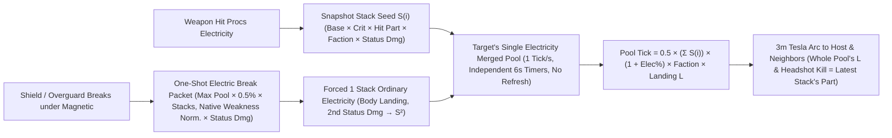
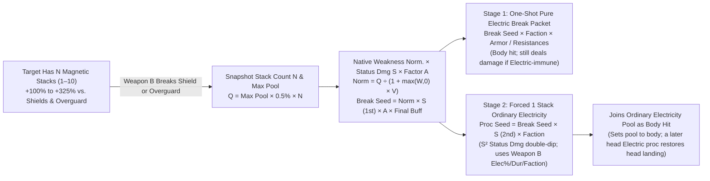

# [Warframe] Magnetic & Electricity Status Mechanics & Calculation Guide

> **Author & Attribution**: WFSim | [wfsim.app](https://wfsim.app)  
> **Scope**: Calculation rules for Warframe **Magnetic** and **Electricity** status effects (plus **Gas**, which shares the same radial pool model), native weapon weakpoint tiers, and worked numeric examples.

---

## Key Formulas & Constants {#key-formulas}

| Quantity | Formula / Constant | Scope |
| --- | --- | --- |
| **Electricity Stack Seed** | `Seed_i = 0.5 × ModdedBaseDmg × Crit × BodyPart_i × Faction × (1 + ElecMod) × S` | Snapshotted per proc; 6 ticks over 6 s (3 m AoE) |
| **Electricity / Gas Tick** | `Tick(t) = (∑ Seed_i) × Faction × L_latest × Mitigation(t)` | `L_latest` uses the **most recently applied** stack's hit part (e.g. `3.0×` head vs `1.0×` body) |
| **Magnetic Disrupt (Pre-Break)** | `+100%` damage to Shields & Overguard at 1 stack, `+25%` per extra stack up to **`+325%` at 10 stacks** | Multiplicative against Shield & Overguard pools |
| **Magnetic Break Stage 1** | `Q = MaxPool × 0.5% × N`, `Packet1 = Q ÷ (1 + max(W, 0) × V) × S × A` | `N ∈ [1, 10]`; humanoid `(V=1, A=2)` → net `2 ÷ (1 + W)` |
| **Magnetic Break Stage 2** | Forced 1-stack Electricity (`Body`, resets `L_latest = 1.0`): `Tick = 0.5 × Packet1 × S × (1 + ElecMod)` | **`S²` double-dip** on `+Status Damage` across Stages 1 & 2 |

---

## 1. Why Cover Magnetic and Electricity Together? {#overview}

In Warframe's elemental system, **Electricity** is a primary element and **Magnetic** (Cold + Electricity) is a combined element — yet under current game mechanics, the two are tightly coupled at the engine level:

1. **Breaking Shields or Overguard under Magnetic spawns Electricity directly**: It deals an immediate one-shot pure Electricity break packet **and forces an ordinary Electricity status proc**.
2. **Magnetic break procs share the exact same Electricity pool**: The forced Electricity proc joins the target's existing Electricity consolidated pool, sharing its clock and accumulator — and **rewriting the entire pool's body-part landing multiplier and headshot-kill classification**.
3. **Electricity and Gas share the same "second headshot landing layer"**: They are the only two status DoTs in the game whose ticks themselves *land on a specific body part*. Mastering Electricity's pool and landing-anchor rules explains Gas at the same time.



---

## 2. Core Mechanic I: Electricity Status (Tesla Chain) Full Calculation {#electricity}

### 1. Base Properties & the "Third DoT Resolution Model" {#electricity-base}

Warframe's damage-over-time statuses follow **three** distinct engine architectures; Electricity (and Gas) use the third:

* **Model 1 (Independent ticks, independent timers)**: Slash (Bleed), Toxin. Each stack displays its own tick number and expires independently after 6 s.
* **Model 2 (Merged tick, refreshes all timers)**: Heat. All stacks merge into one tick per second, and every new stack **refreshes the duration of all existing stacks**.
* **Model 3 (Merged tick, independent timers — NO refresh)**: **Electricity** and **Gas**. All active stacks on a target merge into a single damage number ticking once per second, **yet each stack keeps its own independent 6-second timer and never refreshes older stacks**.

Five hard parameters of Electricity:
* **Base Duration**: **6 seconds** (scales with Status Duration).
* **0-Second Delay (Instant First Tick)**: Tick 1 fires the instant the proc is applied (`t = 0 s`), then once per second (`t = 0, 1, 2, 3, 4, 5 s` — **6 ticks** at base duration; unlike Slash/Heat/Toxin, there is no 1-second wait, and even extremely negative duration still fires the `t = 0` tick).
* **Stack Cap**: **Unlimited**.
* **Area Propagation**: Every tick arcs to all enemies within a **3-meter radius** of the host.
* **Stun Crowd Control**: Only the directly afflicted host suffers the ~**3-second** electric stun (neighbors hit by the 3 m arc take damage only, no stun). Furthermore, **the electric stun cannot be refreshed while running** — it must finish completely before a new Electricity proc can stun again (unaffected by Status Duration), unlike Heat's continuously refreshed panic.

---

### 2. Exact Electricity Damage Formula {#electricity-formula}

#### (1) Single-Stack Seed (Snapshotted Individually)
Each Electricity proc creates an independent damage seed inside the merged pool, locking in the triggering hit's offensive multipliers:
```text
Stack Seed S(i) = Modded Base Damage × Crit Multiplier × Hit-Part Multiplier × Faction Multiplier × Status Damage Multiplier
```
* **Modded Base Damage** includes base damage and base-damage modifiers only (no elemental mod damage; beam weapons also multiply by merged multishot `M` and current ramp-up multiplier).
* **Hit-Part Multiplier**: `1` on body; `3 × (1 + Headshot Damage%)` on standard heads. Headshot crits fold `1 + Crit Tier × (2 × Crit Damage - 1)` into the seed.

#### (2) Consolidated Pool Tick Formula
On each tick, all living seeds in the pool are summed and scaled by the Electricity coefficient, elemental mod, and faction multiplier:
```text
Base Tick Damage  = 0.5 × (Σ S(i)) × (1 + Electricity Mod%) × Faction Multiplier
Final Tick Damage = Base Tick Damage × Landing Multiplier L × Live Armor / Resistances / Viral
```
* **Electricity Mod Scaling**: Electricity ticks scale directly with `(1 + Electricity Mod%)`.
* **Faction Double-Dip**: Faction multipliers apply once inside each seed `S(i)` and a second time on the pooled tick output (quadratic scaling).
* **Status Damage**: Applies once on the seed side.

---

### 3. Second Headshot Landing Layer `L` & Latest-Application Anchor {#headshot-anchor}

Electricity and Gas ticks carry an additional body-part landing multiplier:

#### (1) Why Electricity Headshots Outscale Toxin/Heat by an Extra Layer
* Toxin, Heat, Slash, and Blast ticks do **not** land on a specific body part — headshot damage applies only once inside the initial seed `S(i)`.
* **Only Electricity and Gas** ticks themselves **land on a body part**.
* When the pool's tick lands on the **head**, the entire consolidated tick receives a second headshot-damage multiplier (Deadhead arcanes, Incarnon evolution headshot bonuses, etc.; excludes weakpoint-acuity mods):
  ```text
  Head Landing Multiplier L = 1 + Headshot Damage%    (L = 1.0 on body)
  ```
* **Numeric Example**: Suppose a weapon has `+80%` headshot damage (e.g. +50% Evolution + 30% Secondary Deadhead):
  * Standard headshot hit multiplier = `3 × (1 + 0.8) =` **5.4×**
  * **Toxin / Heat headshot** vs. body: **5.4×**
  * **Electricity (and Gas) headshot** vs. body: `5.4 × (1 + 0.8) =` **9.72×** — headshot damage applies twice on Electricity and Gas.

#### (2) "The Latest Application Anchors the Entire Pool's `L` and Headshot-Kill Credit"
When a target holds both body-applied and head-applied Electricity stacks, two rules govern the pool:
1. **Every old seed stays intact**: Earlier headshot (or headshot-crit) seeds are never overwritten or shrunk by later body hits.
2. **However, the entire pool's landing multiplier `L` — and whether a lethal DoT tick counts as a "headshot kill" — is determined solely by the body part of the most recently applied Electricity stack.**
   * Apply 10 head Electricity procs, then accidentally land 1 body Electricity proc → **the entire pool instantly drops to body landing (`L = 1.0`)**, and if the tick kills the target, **it does NOT count as a headshot kill**.
   * Conversely, apply 10 body Electricity procs, then finish with 1 head Electricity proc → **the entire pool (including all 10 earlier body seeds) switches to head landing (`L = 1 + Headshot Damage%`)**, and a lethal tick **counts as a headshot kill**.

#### (3) How Does the 3 m Arc Hit Neighbors?
* When a host's head-seeded Electricity arcs to neighbors within 3 m, **the arc carries the host's full headshot seed** (neighbors receive the `5.4×` head-seeded arc).
* Whether the arc also triggers the second head landing multiplier `L` on a neighbor depends on geometry: in most positions it lands on the neighbor's body (`L = 1.0`), with only ~**5%** of angles landing on the neighbor's head.

---

## 3. Comparison: Gas vs. Electricity {#gas-vs-electricity}

Gas (Heat + Toxin) belongs to the exact same radial-pool + body-part-landing family as Electricity. Remember **4 similarities** and **4 differences**:

* **4 Identical Rules**:
  1. **0-second delay, instant first tick** (`0..5 s`, 6 ticks at base duration);
  2. **Merged tick, independent timers (no refresh)**;
  3. **Same second landing multiplier `L`**, governed by the exact same **"latest Gas stack decides the whole pool's `L` and headshot-kill credit"** rule;
  4. Gas cloud kills are credited to the applying weapon.
* **4 Key Differences**:
  1. **No elemental mod scaling**: Electricity ticks scale with `(1 + Electricity%)`; Gas is a combined element and **scales with neither Heat nor Toxin mods**.
  2. **Stack cap & growing radius**: Electricity has **no stack cap and a fixed 3 m radius**; Gas caps at **10 stacks**, starting at 3 m and expanding by `+0.3 m` per additional stack up to **6 m**.
  3. **Persists after host death**: Electricity arcs vanish immediately when the host dies; **Gas clouds remain anchored in space and finish ticking their remaining duration**, damaging enemies who walk through.
  4. **No stun**: Electricity stuns its host for ~3 s; Gas has no crowd-control effect.

---

## 4. Core Mechanic II: Magnetic Status (Disrupt) & Magnetic Break Procs {#magnetic}

Magnetic (Cold + Electricity) must be calculated in two distinct phases: **before the break** and **at the moment of break**.



### 1. Phase 1: Before the Break (Magnetic Disrupt Stacks) {#magnetic-disrupt}

* **Duration & Cap**: **6 seconds** per stack, capped at **10 stacks** (shared FIFO slots across all sources; new stacks beyond 10 replace the oldest).
* **Bonus Damage to Shields & Overguard**:
  * 1st stack: **+100%** (`2.00×`)
  * Each additional stack: **+25%**
  * Max **10 stacks**: `100% + 9 × 25% =` **+325%** (**4.25×**)
* **Secondary Effect**: Prevents natural shield regeneration.
* *Boundary*: Magnetic's damage amplification applies strictly to **Shields** and **Overguard** — never Health.

---

### 2. Phase 2: The Break Moment — Two-Stage Magnetic Break Formula {#magnetic-break}

The instant a target carrying `N` Magnetic stacks (`1 ≤ N ≤ 10`) has its **Shield** or **Overguard** broken, the game **snapshots `N`** (later Magnetic decay or stacks do not alter the break) and runs **two consecutive stages**:

1. **Stage 1: One-Shot Pure Electricity Break Damage Packet** (fixed body hit, cannot crit, ignores headshot bonuses, ignores `+Magnetic%`; even if the target is immune to Electricity *procs*, Stage 1 direct damage still lands).
2. **Stage 2: Forced 1 Stack of Ordinary Electricity Status** (pushed straight into the target's ordinary Electricity merged pool: 6 s duration, 0 s first tick, 3 m arc).

#### Attribution Rule: All Modifiers Come from the Breaking Weapon
Even if Weapon A stacked 10 Magnetic procs beforehand, whichever **Weapon B lands the breaking blow** supplies the entire modifier context for both stages — **native weakpoint bonus `W`, Electricity mod%, Status Damage, Status Duration, and Faction multipliers** all come from Weapon B.

#### 4-Step Calculation

* **Step 1: Raw Pool Source `Q`**  
  Each Magnetic stack contributes **0.5%** of maximum Shield or Overguard (**5%** at 10 stacks):
  ```text
  Q = Max Shield or Overguard × 0.5% × Magnetic Stacks N
  ```
* **Step 2: Native Weakness Normalization & Target Weakpoint Factor**  
  Using the target's weakpoint factors `(V, A)` (`V = 1.0, A = 2.0` on standard humanoids), divide `Q` by **`1 + max(W, 0) × V`** using the **breaking weapon's innate weakpoint bonus `W`**, then multiply by Status Damage `S` (1st pass), weakpoint factor `A`, and any final buff:
  ```text
  Normalized Source = Q ÷ (1 + max(W, 0) × V)
  Break Base Seed   = Normalized Source × Status Damage S × Target Factor A × Final Buff (e.g. Eclipse)
  ```
  * *Boundary*: Targets without weakpoint normalization (such as Acolytes and Techrot Babau) skip both normalization and `A`: `Break Base Seed = Q × S × Final Buff`, making all `W` tiers deal identical break damage.
* **Step 3: Stage 1 — One-Shot Pure Electricity Break Packet**
  ```text
  Stage 1 Direct Packet = Break Base Seed × Faction Multiplier × Live Armor / Resistances
  ```
  * **Cascading Breaks**: If this direct packet breaks the next protective layer underneath (e.g. breaking Overguard triggers a Stage 1 packet that immediately shatters Shields below it), it **cascades into a second Magnetic break proc**.
* **Step 4: Stage 2 — Forced Ordinary Electricity Proc (Status Damage `S²`)**  
  The break packet forces 1 stack of ordinary Electricity into the shared Electricity pool:
  ```text
  Forced Electricity Seed = Break Base Seed × Status Damage S × Faction Multiplier
  ```
  * **Status Damage Double-Dip (`S²`)**: `Break Base Seed` already received Status Damage `S` in Step 2, and the forced Electricity child proc multiplies by `S` a **second time** in Step 4 — scaling the resulting Electricity DoT ticks by **`S²`**. At `+90%` Status Damage (`S = 1.9`), the ticks scale by `1.9² =` **3.61×**.
  * **Everything else follows ordinary Electricity**: Uses Weapon B's **`1 + Electricity%`**, **Status Duration**, **Faction double-dip**, and **3 m area chain**; **ignores `+Magnetic%`**.

---

### 3. Understanding Native Weakpoint Bonus `W`: All 5 Weapon Tiers & Representative Weapons {#weakpoint-tiers}

#### (1) What Exactly Is the Innate Weakpoint Bonus `W`?
* **`W` is an innate hidden property built into each weapon's base profile** — completely independent of equipped headshot mods, Deadhead arcanes, or Incarnon headshot evolutions (stacking headshot damage never changes `W`).
* **Incarnon forms and alt-fires inherit their base weapon's `W`**: e.g. Torid & Torid Incarnon are both `W = 0.2`; Laetum & Laetum Incarnon are both `W = 0.5`; Miter & Miter Incarnon are both `W = 1.0`.
* **Why does a LOWER `W` deal MORE Magnetic break damage?**  
  In Step 2, `W` sits in the **denominator** `1 + max(W, 0) × V`, followed by multiplying by the target's generic proxy multiplier `A`. Against standard humanoids (`V = 1.0, A = 2.0`), the net multiplier is **`2 ÷ (1 + W)`**. Thus a `W = 0` weapon gets the full `2.00 × Q`, whereas a `W = 1.0` weapon gets divided by `2` and multiplied back by `2`, ending at `1.00 × Q` — half of a `W = 0` weapon.

#### (2) Complete Table of All 5 `W` Tiers in Warframe

| Native `W` | Humanoid Net Mult `2÷(1+W)` | 10-Stack Equiv. % of Max Pool | Weapon Class Pattern | Representative Weapons |
| :---: | :---: | :---: | --- | --- |
| **`0.0`** | **`2.00 × Q`** | **10.00%** | **All Melee weapons**, most Archguns & companion claws; plus non-weakpoint beams, wave guns, launchers, and thrown/bubble secondaries | **Melee**: Every melee weapon (Glaive Prime, Xoris, Harmony, Hate, Okina Prime, etc.)<br>**Primary**: Amprex, Ignis Wraith, Tenet Arca Plasmor, Kuva Ogris, Kuva Tonkor, Tenet Envoy, Stahlta, Scourge Prime<br>**Secondary**: Kuva Nukor, Atomos, Gammacor / Synoid Gammacor, Kompressa Prime, Spectra Vandal, Coda Pox, Prisma Angstrum<br>**Archgun**: Grattler, Imperator Vandal, Kuva Ayanga, Corvas Prime |
| **`0.2`** | **`1.67 × Q`** | **8.33%** | Most automatic rifles, shotguns, full-auto pistols, Sentinel guns, and several beam/AoE weapons | **Primary**: Torid (incl. Incarnon), Tenet Glaxion, Phantasma Prime, Boar Prime, Strun Prime, Felarx, Cedo Prime, Kuva Sobek, Kuva Bramma, Kuva Zarr, Kuva Chakkhurr, Braton Prime, Boltor Prime, Soma Prime<br>**Secondary**: Tenet Cycron, Ocucor, Furis, Dual Toxocyst, Epitaph / Epitaph Prime<br>**Sentinel**: Verglas Prime, Helstrum |
| **`0.4`** | **`1.43 × Q`** | **7.14%** | **Exactly 6 classic sniper rifles** | Vectis / Vectis Prime, Vulkar / Vulkar Wraith, Snipetron / Snipetron Vandal |
| **`0.5`** | **`1.33 × Q`** | **6.67%** | Semi-auto / burst rifles, precision pistols, most throwing knives, and several Incarnon guns | **Primary**: Phenmor, Burston Prime, Latron Prime, Sybaris Prime, Tiberon Prime, Lenz / Prisma Lenz, Ferrox<br>**Secondary**: Laetum (incl. Incarnon), Lex Prime, Sicarus Prime, Knell Prime, Tenet Plinx, Coda Catabolyst, Athodai Prime, Grimoire, Marelok<br>**Archgun**: Mausolon, Cyngas |
| **`1.0`** | **`1.00 × Q`** | **5.00%** | Traditional bows, high-tier snipers / rail cannons, and select explosive outliers (half of `W = 0`) | **Primary**: Lanka, Rubico / Rubico Prime, Perigale Prime, Opticor / Opticor Vandal, Nataruk, Dread, Paris Prime, Cernos Prime, Daikyu Prime, Cinta, Miter (incl. Incarnon), Acceltra / Acceltra Prime<br>**Secondary**: Akarius / Akarius Prime |

#### (3) How Target Weakpoint Factors `(V, A)` Change the Outcome
Besides the weapon's `W`, the enemy's weakpoint factors `(V, A)` shape Step 2:
* **Standard Humanoids** (Corrupted Heavy Gunner, Corrupted Crewman, Thrax Centurion, Legacyte, etc.): **`V = 1.0, A = 2.0`** → net `2 ÷ (1 + W)` (full 2× spread between `W = 0` and `W = 1.0`).
* **Demolisher Devourer**: **`V = 0.05, A = 2.0`** → net `2 ÷ (1 + 0.05W)` (denominator stays `1.00–1.05`, so all 5 `W` tiers stay close to `2.00 × Q`).
* **Techrot Babau** and **Acolytes**: Skip weakpoint normalization → all weapons receive a flat **`1.00 × Q`**, regardless of `W`.

---

### 4. Two-Way Interaction Between Magnetic Break Procs & Headshot Electricity Pools {#headshot-pool-interaction}

Because the forced Electricity proc from a Magnetic break **always enters the shared Electricity pool as a body hit**, two interactions follow:

1. **Breaking drops an existing head-anchored pool back to body**: If you built a head-anchored Electricity pool (`L = 1.8`) before the break, the forced body proc becomes the latest stack at the break instant → **temporarily pulling the whole pool down to `L = 1.0`** (old head seeds remain intact).
2. **A post-break headshot Electricity proc moves the Magnetic break seed onto head landing:** If you proc ordinary Electricity on the target's head before the next tick, the pool flips back to `L = 1.8` — **multiplying even the huge Shield/Overguard-derived Magnetic break seed by `1 + Headshot Damage%`.**

---

## 5. Worked Calculation Examples {#worked-examples}

### Example 1: Electricity (& Gas) Mixed Hit-Order Walkthrough {#example-mixed-order}

* **Setup**: Laetum base form (modded base `160`, base crit multiplier `2.2×`), `+80%` headshot damage (head seed part mult `P = 3 × 1.8 = 5.4`, second landing mult `L = 1.8`), `+200%` Electricity (`×3`), unarmored target.
* **Per-Stack Contribution (after `× 0.5`)**:
  * Body non-crit: `0.5 × 160 =` **80**
  * Head non-crit: `0.5 × 160 × 5.4 =` **432**
  * Head yellow crit: `0.5 × 160 × 5.4 × (2 × 2.2) =` **1,900.8**

| Sequence of Electricity Procs | Pooled Tick Formula | Displayed Tick | Counts as Headshot Kill? |
| --- | --- | :---: | :---: |
| **Head(non-crit) → Head(non-crit) → Body(non-crit)** | `(432 + 432 + 80) × 3 × 1.0` | **2,832** | **No** (last hit = body) |
| **Body(non-crit) → Head(non-crit) → Head(non-crit)** | `(80 + 432 + 432) × 3 × 1.8` | **5,098** | **Yes** (last hit = head) |
| **Head(crit) → Head(non-crit) → Body(non-crit)** | `(1,900.8 + 432 + 80) × 3 × 1.0` | **7,238** | **No** (keeps crit seed, loses 1.8× landing) |
| **Body(non-crit) → Body(non-crit) → Head(crit)** | `(80 + 80 + 1,900.8) × 3 × 1.8` | **11,128** | **Yes** (whole pool gets 1.8× landing) |

> Compare Rows 1 and 2: identical hit counts (2 heads, 1 body), yet merely changing whether the **final** proc hit the head or body shifts the tick by a full **1.8× (2,832 vs. 5,098)**. Gas follows the exact same math.

---

### Example 2: Magnetic Overguard Break Step-by-Step — Naked, Electricity Mod, `S²` Double-Dip, Armor & Post-Break Head Pull {#example-overguard-break}

* **Target**: Level 50 Steel Path Corrupted Heavy Gunner Eximus (armor stripped, max Overguard = **`103,623`**, standard humanoid `V = 1.0, A = 2.0`) with **10 Magnetic stacks** at break.
* **Breaking Weapon**: **Laetum** (native **`W = 0.5`**, `+80%` headshot damage, `+200%` Magnetic).
* **Step-by-Step Calculation**:
  1. **Step 1 (Raw Source `Q`)**:  
     `Q = 103,623 × 0.5% × 10 =` **5,181.15**
  2. **Step 2 (Native Weakness Normalization — independent of mods)**:  
     `Normalized = 5,181.15 ÷ (1 + 0.5 × 1.0) =` **3,454.1**
  3. **Progression as Each Multiplier Is Added**:
     * **① No Electricity mod, no Status Damage, no Faction (baseline)**:
       * Break Base Seed = `3,454.1 × 1.0 × 2 =` **6,908.2** → **Stage 1 One-Shot Break Packet ≈ 6,908**
       * Stage 2 Forced Electricity Tick = `0.5 × 6,908.2 =` **3,454** (6 ticks = **20,724** total)
       * *(Both body and head breaking shots produce **3,454** — `+80%` headshot and `+200%` Magnetic do not affect the break packet itself.)*
     * **② Add `+165%` Electricity to the breaking weapon**:
       * Stage 1 Direct Packet (unaffected by Electricity%): still **6,908**
       * Stage 2 Electricity Tick = `0.5 × 6,908.2 × (1 + 1.65) ≈` **9,153**
     * **③ Add `+90%` Status Damage (`S = 1.9`)**:
       * Break Base Seed (1st `S`) = `3,454.1 × 1.9 × 2 =` **13,125.58** → **Stage 1 Direct Packet ≈ 13,126**
       * Forced Electricity Seed (2nd `S` → **`S²`**) = `13,125.58 × 1.9 =` **24,938.60**
       * Stage 2 Electricity Tick = `0.5 × 24,938.60 × 2.65 ≈` **33,044** (`1.9² = 3.61×` over 9,153)
     * **④ Add `+55%` Faction Multiplier (`1.55`)**:
       * Stage 1 Direct Packet (1× faction) = `13,125.58 × 1.55 ≈` **20,345**
       * Forced Electricity Seed (1st faction) = `24,938.60 × 1.55 = 38,654.83`
       * Stage 2 Electricity Tick (2nd faction) = `0.5 × 38,654.83 × 2.65 × 1.55 ≈` **79,387**
     * **⑤ If target still has `900` Armor** (`DR = 0.9 × √(900/2700) = 51.96%`, multiplier `0.4804`):
       * Stage 1 Direct Packet = `20,345 × 0.4804 ≈` **9,774**; Stage 2 Body Tick = `79,387 × 0.4804 ≈` **38,138**.
     * **⑥ Armor-stripped, then land 1 headshot Electricity proc after break (pulls pool to `L = 1.8`)**:
       * The Magnetic break seed's own tick contribution increases to `79,387 × 1.8 ≈` **142,897** (before adding the follow-up headshot's own Electricity seed).

---

### Example 3: All 5 `W` Tiers Breaking the Same Shield Side-by-Side {#example-five-w-tiers}

#### Scenario A: Level 100 Steel Path Corrupted Crewman (Max Shield `19,157`, 10 Magnetic Stacks, `V = 1.0, A = 2.0`)
* **Shared Raw Source `Q`**: `19,157 × 0.5% × 10 =` **957.85**
* Comparing all **5 native `W` tiers** both naked and with `+165%` Electricity + `+90%` Status Damage (`S = 1.9`, unarmored):

| Breaking Weapon Tier & Examples | Normalized `Q÷(1+W)` | Naked Stage 1 Packet (`×2`) | Naked Elec Tick (`0.5×Pkt`) | +165% Elec +90% Status: Stage 1 | +165% Elec +90% Status: Elec Tick (`S²`) | Ratio vs. `W=1.0` |
| --- | :---: | :---: | :---: | :---: | :---: | :---: |
| **`W = 0.0`**: Kuva Nukor / Glaive Prime | `957.85 ÷ 1.0 ≈` **958** | **1,916** | **958** | **3,640** | **9,163** | **2.00×** |
| **`W = 0.2`**: Torid / Tenet Cycron | `957.85 ÷ 1.2 ≈` **798** | **1,596** | **798** | **3,033** | **7,636** | **1.67×** |
| **`W = 0.4`**: Vectis Prime / Vulkar Wraith | `957.85 ÷ 1.4 ≈` **684** | **1,368** | **684** | **2,600** | **6,545** | **1.43×** |
| **`W = 0.5`**: Laetum / Burston Prime | `957.85 ÷ 1.5 ≈` **639** | **1,277** | **639** | **2,427** | **6,109** | **1.33×** |
| **`W = 1.0`**: Lanka / Rubico Prime / Nataruk | `957.85 ÷ 2.0 ≈` **479** | **958** | **479** | **1,820** | **4,582** | **1.00×** |

#### Scenario B: Cross-Level, Shield Disruption & 1-Stack Examples
The same 4-step formula applies across enemy levels, shield reduction, and stack counts:
* **Kuva Nukor (`W = 0`), 10 Magnetic stacks, Steel Path Corrupted Crewman**:
  * Level 80 (max Shield `16,128`) → `Q = 806.4` → tick **806**
  * Level 80 + Shield Disruption `-18%` (max Shield `13,225`) → `Q = 661.3` → tick **661**
  * Level 100 (max Shield `19,157`) → `Q = 957.9` → tick **958**
  * Level 120 (max Shield `21,948`) → `Q = 1,097.4` → tick **1,097**
* **1 Magnetic stack — Gammacor (`W = 0`) vs. Lanka (`W = 1.0`)**:
  * Crewman (max Shield `14,789`, `Q = 73.95`): Gammacor tick **74**; Lanka tick **37**.
  * Elite Crewman (max Shield `18,486`, `Q = 92.43`): Gammacor tick **92**; Lanka tick **46**.

---

### Example 4: Comparing Target Weakpoint Factors `(V, A)` Under Full Modifiers & 900 Armor {#example-proxies-armor}

* **Uniform Setup**: **`100,000`** max Shield or Overguard broken at **10 Magnetic stacks** (`Q = 5,000`); breaking weapon carries **`+165%` Electricity**, **`+90%` Status Damage (`S = 1.9`)**, **`+55%` Faction (`1.55`)**, and **`+80%` Headshot Damage (`L = 1.8`)**; exposed Health underneath has **`900` Armor** (`51.96%` DR, `0.4804` health multiplier).
* **Full Walkthrough (Standard Humanoid, `W = 0.0`)**:
  1. Normalized = `5,000 ÷ (1 + 0 × 1) = 5,000`
  2. Break Base Seed = `5,000 × 1.9 × 2 = 19,000`
  3. **Stage 1 Direct Packet (post-armor)** = `19,000 × 1.55 × 0.4804 ≈` **14,148**
  4. **Stage 2 Electricity Seed** = `19,000 × 1.9 × 1.55 = 55,955`
  5. **Stage 2 Body Tick (post-armor)** = `0.5 × 55,955 × 2.65 × 1.55 × 0.4804 ≈` **55,206** (6 ticks = **331,236**)
  6. **After Follow-Up Headshot Electricity Proc (`L = 1.8`, post-armor)** = `55,206 × 1.8 ≈` **99,372** (~**596k** over 6 ticks from the break seed alone)

Full comparison across **3 target classes** and **3 weapon `W` tiers** (all post-armor):

| Target Class & Weakpoint Factor `(V, A)` | Weapon `W` | Normalized | Stage 1 Packet (Post-Armor) | Stage 2 Body Tick (Post-Armor) | Post-Break Head-Pull Tick (`L=1.8`, Post-Armor) |
| --- | :---: | :---: | :---: | :---: | :---: |
| **Standard Humanoid (Heavy Gunner / Crewman / Thrax)**<br>`V = 1.0, A = 2.0` | `W = 0.0` | 5,000 | **14,148** | **55,206** | **99,372** |
| Same | `W = 0.5` | 3,333 | **9,432** | **36,804** | **66,248** |
| Same | `W = 1.0` | 2,500 | **7,074** | **27,603** | **49,686** |
| **Demolisher Devourer**<br>`V = 0.05, A = 2.0` | `W = 0.0` | 5,000 | **14,148** | **55,206** | **99,372** |
| Same | `W = 0.5` | 4,878 | **13,803** | **53,860** | **96,948** |
| Same | `W = 1.0` | 4,762 | **13,474** | **52,578** | **94,640** |
| **Techrot Babau / Acolytes**<br>No weakpoint normalization (`1.0 × Q`) | Any `W` (0 / 0.5 / 1.0) | 5,000 *(×1)* | **7,074** | **27,603** | **49,686** |

> Summary: ① On standard humanoids, `W = 0` weapons deal **2.0×** the Magnetic break damage of `W = 1.0` weapons; ② On `V = 0.05` targets like Demolisher Devourer, all 5 `W` tiers stay within **5%** of one another; ③ On Techrot Babau or Acolytes, every weapon resolves at a uniform `1.00 × Q`.

---

## 6. Magnetic / Electricity / Gas Quick-Reference Comparison {#quick-reference}

| Dimension | Magnetic (Disrupt + Break Proc) | Electricity (Tesla Chain) | Gas (Gas Cloud) |
| --- | --- | --- | --- |
| **Elements** | Cold + Electricity | Primary (Electricity) | Heat + Toxin |
| **Base Duration** | 6 s (forced Electricity proc gets its own 6 s) | 6 s | 6 s |
| **First-Tick Delay** | Instant break packet + 0 s forced Electricity tick | **0 s delay** (`0..5 s`, 6 ticks) | **0 s delay** (`0..5 s`, 6 ticks) |
| **Stack Cap** | 10 stacks (FIFO replacement) | **Unlimited** | **10 stacks** |
| **Pool & Refresh Model** | Snapshots count on break; forced proc joins Elec pool | Merged tick, independent timers (no refresh) | Merged tick, independent timers (no refresh) |
| **Elemental Mod Scaling** | Ignores Magnetic%; **scales with breaker's Electricity%** | **Yes** `(1 + Electricity%)` | **No** (ignores Heat & Toxin mods) |
| **Status Damage Scaling** | Packet 1×, forced Electricity proc **double-dips (`S²`)** | 1× (`S`) | 1× (`S`) |
| **Native Weakpoint `W`** | **Inverse normalization**: `2÷(1+W)` on humanoids (lower `W` = higher dmg) | None (uses normal hit part & `L`) | None (uses normal hit part & `L`) |
| **2nd Landing Layer `L`** | Forced proc enters as body; anchored by latest Elec stack | **Yes** (latest stack decides whole pool's `L` & HS kill) | **Yes** (latest stack decides whole pool's `L` & HS kill) |
| **Area Radius** | Forced proc inherits Electricity's 3 m arc | Fixed **3 m** (neighbors keep head seed, ~5% head land) | **3 m base**, `+0.3 m`/stack (max **6 m**) |
| **Persists After Death** | Vanishes with Electricity host | Vanishes on host death | **Cloud stays in place and finishes ticking** |
| **CC / Utility** | +100%–+325% vs. Shield/Overguard, blocks shield regen | ~3 s host stun (**cannot refresh while active**) | None |

---

## 7. Common Misconceptions {#misconceptions}

1. **Myth: "Magnetic break always deals 3%/stack of max Shield/Overguard, identically across all weapons."**  
   → **Reality**: The base coefficient is **0.5%/stack**, normalized by `÷ (1 + max(W, 0) × V)` and scaled by target weakpoint factor `A`. Consequently, **lower native `W` yields higher Magnetic break damage** — on humanoids, `W = 0` weapons (all melee, Kuva Nukor, etc.) deal **2×** the break damage of `W = 1.0` weapons (Lanka, Rubico Prime, etc.).
2. **Myth: "Equipping Deadhead or headshot damage increases `W` and hurts Magnetic break damage."**  
   → **Reality**: `W` is an inherent base weapon property completely unaffected by headshot mods, arcanes, or evolutions. Headshot damage never lowers Magnetic breaks — and actually boosts them once a post-break headshot Electricity proc pulls the pool onto head landing `L`.
3. **Myth: "Magnetic break uses the Magnetic applier's mods and scales with `+Magnetic%`."**  
   → **Reality**: Every stat comes from the **weapon that breaks the Shield or Overguard**. The forced Electricity proc ignores `+Magnetic%` and scales with the breaking weapon's **`+Electricity%`**, Status Duration, Faction, and Status Damage.
4. **Myth: "Magnetic break only receives Status Damage once."**  
   → **Reality**: The Stage 1 break packet receives `S` once, and the forced Stage 2 Electricity proc inherits that scaled source and receives `S` a second time — giving **`S²` quadratic scaling** on the DoT ticks.
5. **Myth: "Electricity refreshes duration and stun indefinitely like Heat."**  
   → **Reality**: Electricity merges into one tick number, but **every stack expires on its own 6 s timer without refreshing**, and its ~3 s stun **cannot be refreshed while active**.
6. **Myth: "Hitting body after headshots won't affect earlier headshot Electricity (or Gas) stacks."**  
   → **Reality**: Old headshot seeds remain intact, but **the body part of the latest proc immediately rewrites the entire pool's second landing multiplier `L` and headshot-kill classification** (causing "Head→Head→Body" vs. "Body→Head→Head" to differ by a full `1 + Headshot Damage%`).

---

*Published by **WFSim** — feel free to share with attribution intact. Explore exact weapon mechanics and damage simulation at [wfsim.app](https://wfsim.app).*
