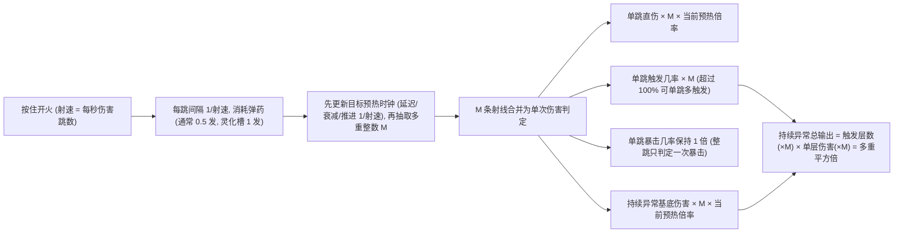
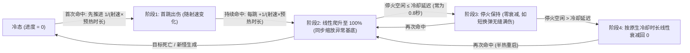

# 【Warframe｜星际战甲】射线武器（持续型武器）计算机制全解析

> **整理与署名**：WFSim（WF模拟）｜[wfsim.app](https://wfsim.app)  
> **严谨性说明**：本文仅客观阐述 Warframe 射线武器的底层伤害计算机制与分类，不涉及任何配卡或 Mod 推荐。文中公式、特例与算例均基于幻影装置游戏内实测、公开资料对照及 WFSim 数学模型校准；个别尚待进一步独立实测确认的边界细节已在文中明确标注。

---

## 一、什么是“射线武器”？

在 Warframe 中，**射线武器**指触发方式为**“持续”**的枪械。

与普通步枪、手枪“按一次打出一发子弹”不同，射线武器在按住开火键时，会按照固定时间间隔连续判定伤害。在底层结算上，射线武器与普通子弹/投射物武器存在 **6 项根本差异**：

1. **射速等于每秒伤害跳数**，且多数射线每跳只消耗 **0.5 发弹药**。
2. **完整的伤害预热（爬坡）生命周期**：包含**首跳随射速预推进 → 线性爬升 → 停火延迟保持 → 超时线性衰减 → 多敌人独立计时与死亡重置**，且预热倍率**同步缩放持续异常伤害的基底**。
3. **多重射击合并判定**：命中同一目标的多条射线合并为单次伤害跳——直伤相加、触发几率相加，但**暴击几率保持 1 倍不变**；由此使**火焰、毒素、电击、毒气、切割**等持续异常伤害呈现**多重平方级**缩放。
4. **中心主射线特例**：**幻离子**、**噬菌者**等天生多射线霰弹，多重加成**仅缩放外圈射线，不缩放中心那 1 条**。
5. **射程为硬性截止边界**，且所有带末端伤害半径（`半径 > 0`）的射线在底层均锁死穿透深度为 0。
6. **群体扩散形态分化**：末端球体、累乘连锁、固定比例连锁、扇形分叉、自瞄多光束、击杀触须——不同扩散方式对**多重、爆头、穿透、范围加成**的响应规则各有不同。



---

## 二、核心中的核心：射线伤害预热（爬坡）全流程与多敌人推演

预热机制是绝大多数玩家最容易忽视、也最容易算错的射线核心机制。它并不是一句简单的“从 20% 涨到 100%”，而是一套**按每个目标独立运行的 5 阶段状态机**。



### 阶段 1：首次接触与“首跳随射速变化”（预推进机制）

射线接触一个全新目标时，游戏会将首跳倒计时初始化为 **`1 ÷ 射速`**，并且**在结算第 1 跳伤害之前，先将预热时钟推进 `1 ÷ 射速` 秒，再读取预热倍率**。

因此，连续命中第 `k` 跳（`k = 1, 2, 3, ...`）的预热倍率精确公式为：
```text
第 k 跳预热进度 = min(1, k ÷ (射速 × 预热总时长))
第 k 跳预热倍率 = 基础起始下限 + (1 - 基础起始下限) × min(1, k ÷ (射速 × 预热总时长))
```

代入 `k = 1`，即得到**随射速动态变化的首跳倍率公式**：
```text
首跳倍率 = 基础起始下限 + (1 - 基础起始下限) × min(1, 1 ÷ (射速 × 预热总时长))
```

#### 算例 A：同一把武器，不同射速下首跳倍率怎么变？（托里德灵化形态）
以 **托里德（灵化形态）** 为例（基础起始下限 **20%**，预热总时长 **0.6 秒**）：

* **低射速 `6.4 跳/秒`**（单跳间隔 `0.156 秒`）：  
  首跳推进进度 `1 ÷ (6.4 × 0.6) = 26.04%` → **首跳倍率** = `20% + 80% × 26.04% =` **40.8%**
* **基础射速 `8.0 跳/秒`**（单跳间隔 `0.125 秒`）：
  * 第 1 跳（`0.125 秒`）：进度 `20.83%` → **36.7%**
  * 第 2 跳（`0.250 秒`）：进度 `41.67%` → **53.3%**
  * 第 3 跳（`0.375 秒`）：进度 `62.50%` → **70.0%**
  * 第 4 跳（`0.500 秒`）：进度 `83.33%` → **86.7%**
  * 第 5 跳（`0.625 秒` 起）：进度 `100%` → **100.0%** 满伤
* **高射速 `15.2 跳/秒`**（+90% 射速，单跳间隔 `0.0658 秒`）：  
  首跳推进进度 `1 ÷ (15.2 × 0.6) = 10.96%` → **首跳倍率** = `20% + 80% × 10.96% =` **28.8%**（第 10 跳即 `0.658 秒` 达到满伤）

> **直观理解**：射速提高时，首跳单跳倍率变低是因为**第 1 跳出伤时刻提前了**（`0.0658 秒` 时的预热进度自然低于 `0.156 秒`）；在 0.6 秒窗口内，高射速打出的总跳数与累计总伤害依然远高于低射速。

#### 算例 B：揭秘幻离子 Prime “2% 底层下限 → 15.6% 首跳”
* **幻离子 / 幻离子 Prime** 的真实基础起始下限实际上是 **`2%`**（0.02），预热时长 `0.6 秒`。
* 在基础射速 **`12 跳/秒`** 下，首跳推进 `1 ÷ (12 × 0.6) = 13.89%`：  
  `首跳倍率 = 2% + 98% × 13.89% =` **15.61%**（这也是常规 12 射速实测中常见“约 15% 起步”数值的真实来源）。
* 若将射速翻倍至 **`24 跳/秒`**，首跳推进减半为 `6.94%`：  
  `首跳倍率 = 2% + 98% × 6.94% =` **8.81%**！

---

### 阶段 2：持续命中爬升与持续异常“快照锁定”

持续命中期间，每跳进度累加 `(1 ÷ 射速) ÷ 预热总时长`，封顶 `1.0`（100% 满伤）。

**极其关键的联动规则（经幻影装置游戏内实测验证）**：预热倍率不仅缩放直击伤害，还**直接乘入该跳触发的持续异常（火/毒/电/毒气/切割）基底伤害**，并且**每一层异常永久快照锁定“挂上那一跳”的预热倍率**，后续即使射线达到 100% 满预热，旧层数的低基底也不会被补满！

> **算例 C（幻离子 Prime 跨预热窗口叠火，基础 12 射速、2% 下限、总基伤 90、+90% 火焰）**：
> * 第 1 跳（`0.083 秒`）：倍率 **15.6%** → 挂火单层基底 `90 × 15.6% = 14.05`
> * 第 2 跳（`0.167 秒`）：倍率 **29.2%** → 挂火单层基底 `26.30`
> * 第 3 跳（`0.250 秒`）：倍率 **42.8%** → 挂火单层基底 `38.55`
> * 第 4 跳（`0.333 秒`）：倍率 **56.4%** → 挂火单层基底 `50.80`
> * 第 5 跳（`0.417 秒`）：倍率 **70.1%** → 挂火单层基底 `63.05`
> * 第 6 跳（`0.500 秒`）：倍率 **83.7%** → 挂火单层基底 `75.30`
> * 第 7 跳（`0.583 秒`）：倍率 **97.3%** → 挂火单层基底 `87.55`
> * 第 8 跳起（`0.667 秒`）：倍率 **100.0%** → 挂火单层基底 `90.00`
>
> 正因前 7 跳的火层各自锁定了当时的低基底，游戏实测中幻离子 Prime 跨过预热期叠出前 10 层火时，总火跳只有 **669–690**（远低于满预热 10 层的 `855`）；而进入满预热后再叠接下来的 10 层火，总火跳恰好精准增加 **+855**（`687 → 1542`）。

---

### 阶段 3 与阶段 4：停火保持（冷却延迟）、超时衰减与“半热重启”

当射线离开某个目标或停止开火（如走位、躲技能、换弹）时，预热进度并不会立刻清零，而是按**停火空闲时间 `idle`** 分段结算：

```text
停火空闲时间 idle = 本次命中时刻 - 上次命中时刻 - 单跳间隔 (1 ÷ 射速)

情况 ①（停火保持期）：若 idle ≤ 冷却延迟 (常规 0.8 秒)
    衰减后进度 = 原进度（100% 原地保持，零衰减！）

情况 ②（超时线性衰减）：若 idle > 冷却延迟
    衰减总时长 = 预热总时长 × 冷却除数（常规 0.6 × 2 = 1.2 秒；加上 0.8 秒延迟后共 2.0 秒完全归零）
    衰减后进度 = max(0, 原进度 - (idle - 冷却延迟) ÷ 衰减总时长)

再次命中时，先推进本次单跳间隔再取值：
    本次进度 = min(1, 衰减后进度 + 1 ÷ (射速 × 预热总时长))
    本次倍率 = 基础起始下限 + (1 - 基础起始下限) × 本次进度
```

#### 算例 D：换弹时长 vs 0.8 秒冷却延迟（为什么有的射线换弹不掉预热，有的直接清零？）
* **幻离子 Prime（换弹仅 `0.5 秒`）**：持续照同一只高血量精英怪打空 11 发弹匣（约 1.83 秒，此时进度已满 `1.0`）→ 经历 **0.5 秒换弹** → 重新照回同一只精英怪。由于停火空闲约 `0.5 秒 ≤ 0.8 秒冷却延迟`，**换弹结束后第 1 跳直接延续 100% 满预热，零损失**！
* **信条·冷冻光束步枪（换弹 `2.0 秒`）**：换弹空闲约 `2.0 秒 > 0.8 秒`，超出延迟 `1.2 秒`（刚好耗尽 `1.2 秒` 完整衰减时长）→ 原进度从 `1.0` 彻底跌回 `0`，换弹后第 1 跳只能从冷态首跳 **31.1%** 重新预热。

---

### 阶段 5：多目标独立计时、并发连锁去重与复杂多敌人实战全景推演

在多怪实战中，射线预热遵循 **4 条严格的底层规则**：
1. **一怪一表（按目标独立计时）**：绝大多数射线都会为场上每一名敌人分别维护独立的预热计时器（极少数如 **泰瑟步枪**、**猎豹次要** 为全光束共用计时）。
2. **主射线、球体、穿透、连锁共用该敌人的同一张预热表**：只要某个敌人被本武器任意扩散部分命中，推进的都是它自己的那张预热表。
3. **同一跳内被多条连锁同时劈中，只推进 1 次预热计时**：即使同一瞬间有 3 条不同起点的连锁同时命中怪 B，怪 B 本跳的预热也只推进 1 次 `1 ÷ 射速`，绝不会单跳叠加 3 倍预热进度。
4. **敌人死亡（含刷新出的新怪）即刻销毁旧表**：新生成的敌人实体从 `进度 = 0` 冷态重新起步。

#### 复杂多敌人完整实战时间轴（4 名不同敌人：怪 A、怪 B、怪 C、怪 D）

* **设定**：**托里德（灵化形态）**，基础射速 `8 跳/秒`（单跳间隔 `0.125 秒`，每跳推进进度 `1 ÷ 4.8 = 20.83%`），下限 `20%`，`0.6 秒` 满预热，`0.8 秒` 冷却延迟，`1.2 秒` 衰减总时长。
* **场上站位**：
  * **怪 A**：主射线直击目标（吃多重）。
  * **怪 B**：距怪 A 2 米，处于 2.3 米球体内（自身是第 2 个起点，且同一跳还会被怪 A 的第 1 跳 75% 连锁重复劈中）。
  * **怪 C**：距怪 A 5 米，仅被怪 B 的第 1 跳 75% 连锁命中。
  * **怪 D**：起初在 12 米外未被波及，在 `t = 0.750 秒` 走近进入连锁范围（作为怪 B 连锁的第 2 跳 56.25% 目标）。

| 时刻与战场事件 | 怪 A（主直击） | 怪 B（球体 + 连锁双命中） | 怪 C（75% 连锁） | 怪 D（迟到入场） |
| --- | --- | --- | --- | --- |
| **`t = 0.125s`（第 1 跳）**<br>开火瞄准怪 A | 首跳推进 1 次<br>进度 `20.8%` → **36.7%** | 球体与连锁同跳双命中，**仅推进 1 次**<br>进度 `20.8%` → **36.7%**<br>（连锁项实得 `75% × 36.7% = 27.5%`） | 首跳推进 1 次<br>进度 `20.8%` → **36.7%**<br>（实得 `75% × 36.7% = 27.5%`） | 未命中<br>（无记录） |
| **`t = 0.375s`（第 3 跳）**<br>持续按住开火 | 连续受击 3 跳<br>进度 `62.5%` → **70.0%** | 连续受击 3 跳<br>进度 `62.5%` → **70.0%** | 连续受击 3 跳<br>进度 `62.5%` → **70.0%** | 未命中 |
| **`t = 0.625s`（第 5 跳）**<br>持续按住开火 | 达到满预热<br>进度 `100%` → **100.0%** | 达到满预热<br>进度 `100%` → **100.0%** | 达到满预热<br>进度 `100%` → **100.0%** | 未命中 |
| **`t = 0.750s`（第 6 跳）**<br>**怪 A 阵亡，准星切到怪 B；怪 D 走入链距** | **已阵亡**<br>（若刷新新怪 A'，从冷态重开） | 切为主射线直击目标，<br>**无缝继承 100.0% 满预热！** | 继续受 75% 连锁<br>延续 **100.0%** 满预热<br>（实得 `75.0%`） | **首次被 56.25% 连锁命中**<br>独立冷态起表 → **36.7%**<br>（实得 `56.25% × 36.7% = 20.6%`） |
| **`t = 1.250s`（短停火 `0.500s` 后重开）**<br>`idle = 0.375s ≤ 0.8s` | — | **零衰减**，继续保持 **100.0%** | **零衰减**，继续保持 **100.0%** | **零衰减**！从第 1 跳进度 `20.8%` 接着推进至 `41.7%` → **53.3%** |
| **`t = 2.750s`（长停火 `1.500s` 后重开）**<br>`idle = 1.375s > 0.8s`，超时 `0.575s`，全体衰减 `47.92%` 进度 | — | `100% - 47.92% = 52.08%`<br>推进 `+20.83%` → `72.92%`<br>**半热重启：78.3%**！ | 同怪 B 过程<br>**半热重启：78.3%**！ | `41.67% - 47.92%` → 扣底归 **`0%`**<br>推进 `+20.83%` → **跌回冷态 36.7%**！ |

> 从最后一行可以看到一个极容易被忽略的实战分化：经历同样一次 `1.5 秒` 的停火，原本已经满预热的怪 B、怪 C 只是**半热回落到 78.3%**（2 跳即回满），而原本只叠了 2 跳的怪 D 进度已经**彻底归零、跌回 36.7% 冷态**。

### 实测校准清单：各武器预热基础起始下限

| 底层预热下限 | 代表武器 | 特殊曲线参数（默认均为 0.6s 预热 / 0.8s 延迟 / 1.2s 衰减） |
| :---: | --- | --- |
| **100%（无预热）** | **盗贼 / MK1-盗贼（灵化）**、**虫置（副手）**、**赘骨（灵化）** | 第 1 跳起即造成 100% 全额伤害 |
| **2%** | **幻离子 / 幻离子 Prime** | 基础 12 射速下首跳 **15.6%**；24 射速下首跳 **8.8%** |
| **10%** | **猎豹 / 猎豹 Prime（次要锯片）** | 0.8s 预热、无冷却延迟、光束共用计时 |
| **20%** | **托里德（灵化）**、**野猪（灵化）**、**安培克斯**、**赤毒·努寇**、**普通努寇**、**光谱切割器/破坏者**、**信条·冷冻**、**信条·循环**、**伊格尼斯/亡魂**、**视使之触**、**阿索代/Prime（次要）**、**翠雀/Prime**、**冰凇/Prime** 等绝大多数射线 | 巴什穆次要射线预热为 **0.5s**（衰减 1.0s）；泰瑟步枪为光束共用计时 |
| **30%** | **安柏勒斯** | 常规 0.6s 曲线 |
| **40%** | **恩考斯** | 常规 0.6s 曲线 |
| **50%** | **信条·量子切割器** | **1.0s 预热**、**2.0s 冷却延迟**、**2.0s 衰减** |
| **60% / 80%** | **导热聚焦枪（主射 60% / 次要 80%）** | 常规 0.6s 曲线 |
| **70%** | **噬菌者** | 带预热衰减射线中的最高下限 |

---

## 三、射线武器的其余 5 大核心计算规则（附手算实例）

### 规则 1：射速 = 每秒伤害跳数，弹药消耗通常为 0.5 发/跳

* **计算关系**：
  * `每秒伤害判定次数 = 面板射速`
  * `满弹匣总跳数 = 弹匣容量 ÷ 每跳弹耗`
  * `满弹匣连续射击时长 = 满弹匣总跳数 ÷ 面板射速`
* **弹耗规则**：
  * **绝大多数普通射线武器**：每跳消耗 **0.5 发弹药**。
  * **每跳消耗 1.0 发的常见例外**：普通 **伊格尼斯**（注意 **伊格尼斯·亡魂** 为 0.5）、**原子矿融炮**、普通 **努寇微波枪**、**巴什穆**（次要射线）、**阿索代 / 阿索代 Prime**（次要射线）、守护武器 **冰凇 / 冰凇 Prime**，以及**所有灵化形态射线的独立充能槽**。
  * **副射线与连锁**：由连锁、末端球体或自瞄副光束产生的额外命中**均不消耗额外弹药**。

> **算例演示**：
> * **信条·冷冻光束步枪（0.5 弹耗）**：90 发弹匣、12 射速 → `90 ÷ 0.5 = 180` 跳 → 持续 `180 ÷ 12 = 15 秒`。
> * **冰凇 Prime（实测 1.0 弹耗）**：80 发弹匣、12 射速 → `80 ÷ 12 ≈ 6.67 秒`（而非 13.33 秒）。
> * **托里德灵化形态（1.0 充能）**：170 充能、8 射速 → `170 ÷ 8 = 21.25 秒`；充能槽独立于弹药系统，**弹匣容量加成与弹药效率加成（如主要·准星的弹药效率部分）均对灵化充能槽无效**（其触发几率部分依然生效）。

---

### 规则 2：多重射击的“合并判定”机制

* **普通武器**：面板多重 3.0 表示单次开火发射 3 颗独立弹丸，各自独立判定暴击与触发。
* **射线武器（对同一目标）**：多出来的射线合并为单次伤害跳。设本跳按面板多重的小数部分抽取出整数 `M`（如 `2.8` 有 20% 概率 `M = 2`、80% 概率 `M = 3`）：
  * **单跳合并直伤** = `单射线伤害 × M`
  * **单跳合并触发几率** = `单射线触发几率 × M`（超过 100% 可单跳触发多层异常）
  * **单跳暴击几率** = **保持 1 倍不变**（不乘以 `M`，整跳共享同一次暴击判定结果）
  * **持续异常基底伤害** = `单射线基底伤害 × M`

#### 算例 A：持续异常伤害“双吃多重”（平方级缩放）
设两把武器单发基础伤害均为 `100`、带 `+100% 火焰`（火焰乘区 `2.0`）、触发几率 `30%`（暂不计暴击），两者均叠至 **3 倍多重（`M = 3`）**：
* **普通步枪**：3 颗子弹期望挂火 `3 × 30% = 0.9` 层，每层单跳 `100 × 0.5 × 2.0 = 100` → 期望总火伤 `0.9 × 100 =` **90**（为 1 倍多重的 **3 倍**）。
* **射线武器**：合并后触发几率 `3 × 30% = 90%`（期望同样 `0.9` 层），但合并基底放大为 `100 × 3 = 300`，每层单跳变为 `300 × 0.5 × 2.0 = 300` → 期望总火伤 `0.9 × 300 =` **270**（为 1 倍多重的 **9 倍**，即普通步枪的 **3 倍**）。

对于**火焰、毒素、电击、毒气、切割**等伤害型持续异常，射线多重同时放大**触发层数（×M）**与**单层伤害（×M）**，呈 **`M²`** 增长。

#### 算例 B：额外触发机制（如 猎人 战备、内部出血）在射线上如何结算？
额外触发机制在**合并之后**判定，每跳只判 **1 次**。以 100% 暴率、基础伤害 `100`、**3 倍多重（`M = 3`）**、30% 流血触发为例：
* **普通步枪**：3 颗子弹各判 1 次 → 期望 `0.9` 层 × 基底 `100` = **90**。
* **射线武器**：合并后只判 1 次 → 期望 `0.3` 层 × 合并基底 `300` = **90**。  
两者长期数学期望完全等价，差异仅在于射线表现为**层数更少、单层数值更高、单跳方差更大**。

#### 算例 C：“中心主射线”的多重折损公式（已实测验证）
**幻离子 / 幻离子 Prime** 与 **噬菌者** 底层为“1 条固定中心射线 + 若干条外圈射线”，相对多重加成**仅缩放外圈**：
```text
实际总射线数 = (基础射线数 - 1) × (1 + 多重加成) + 1
```
* **幻离子 Prime（5 外圈 + 1 中心）** 在 `+120%` 多重下：`5 × 2.2 + 1 =` **12.0 条**（而非 `13.2` 条）。
* **噬菌者（6 外圈 + 1 中心）** 在 `+120%` 多重下：`6 × 2.2 + 1 =` **14.2 条**（而非 `15.4` 条）。

#### 算例 D：哪些副命中吃多重，哪些不吃多重？
* **吃多重缩放**：主射线直击目标、穿透直击目标、由直击目标发出的连锁，以及**野猪灵化的自动锁定副光束（含连锁）**、**视使之触激活的能量触须**。
* **不吃多重缩放**：射线末端**伤害球体（`半径 > 0`）**圈中的非直击目标，以及**从这些球体边缘目标衍生出的连锁**。

---

### 规则 3：完整单跳直伤与持续异常公式

#### （1）单跳合并直伤
```text
单跳直伤 = 单射线面板伤害(含基伤与元素)
         × M (本跳实际多重整数)
         × 当前预热倍率
         × 暴击倍率 [1 + 暴击等级 × (暴伤 - 1)]
         × 部位倍率 (常规爆头基础 3 倍；暴击爆头时暴伤额外翻倍：1 + k × (2×暴伤 - 1))
         × 歧视倍率 (1 + 歧视类加成 + 咆哮等)
         × 独立终伤倍率 (如月蚀等)
         × 目标护甲与抗性结算
```

#### （2）单层持续异常伤害（火 / 毒 / 电 / 毒气 / 切割）
```text
单层异常每跳伤害 = (单射线结算基伤 × M × 当前预热倍率 × 暴击倍率 × 部位倍率 × 歧视倍率 + 1)
                 × 异常系数
                 × (1 + 对应元素加成%)   ← 切割流血不吃元素加成，此项为 1
                 × 歧视倍率              ← 歧视二次乘算（双吃）
                 × (1 + 异常伤害加成%)
```
* **异常系数**：切割流血为 **0.35**；火焰、毒素、电击、毒气为 **0.50**。
* **关于 `+ 1`**：游戏底层持续异常累加器的初始值为 1（火/电/毒气等合并结算池整个池子只加一次 `+1`，切割/毒素等独立层数异常每层各自 `+1`）。
* **结算基伤**仅由基础伤害与基伤乘区构成，不含元素 Mod 的数值部分，且**不经过游戏直伤的 `1/32` 量化**。

---

### 规则 4：射程、距离衰减、穿透门控与爆头

* **射程为硬性空气墙**：绝大多数射线射程内 100% 伤害，超出射程直接为 0。
  * **带距离衰减的极少数射线**：**盗贼（灵化形态）**（10–16 米线性衰减）、**异化者 / 终幕·异化者**（9–19 米衰减至约 1.88%）。
  * **射线射程加成（凶恶延伸 / 毁灭扩展）**：仅延长主射线（及视使之触触须）长度，**不延长连锁跳跃距离**。
* **穿透的两套独立底层机制**：
  1. **末端带伤害半径（`半径 > 0`）的射线，底层统一锁死穿透深度为 0**：只要武器带有末端伤害半径（`半径 > 0`），游戏会直接将穿透深度归零，同时屏蔽自带穿透深度与所有穿透 Mod——覆盖 **托里德（灵化）、异化者 / 终幕·异化者、冷冻光束步枪·破坏者、安柏勒斯、凝目（主手）、伊格尼斯 / 亡魂、送葬者**；此外 **野猪 / 野猪 Prime（灵化）** 经实测亦不吃穿透。
  2. **“无限身体穿透”是独立的底层开关**：**伊格尼斯 / 亡魂、送葬者、幻离子 / Prime、赘骨（灵化）、阿索代 / Prime（次要）** 靠底层独立的“忽略敌人实体碰撞”标记实现无限穿怪，不消耗穿透深度，遇墙仍停（除非 `半径 == 0` 且自带地形穿透，如阿索代次要带 2 米地形穿透）。
  3. **可穿透连锁射线的叠加效应**：人形敌人躯干厚约 **0.5 米**。对 **安培克斯、信条·冷冻光束步枪、信条·循环离子枪、赤毒·努寇微波枪、翠雀 / Prime**，主射线每穿透 1 人即视为一次**直接命中（吃多重、可爆头）**，且**各自独立衍生一套全新连锁**。
* **爆头判定边界**：**仅主射线直接命中的目标（含穿透直击）可爆头**（**阿索代 / Prime 次要**固定 1x）；球体溅射、连锁、自瞄副光束、触须均锁躯干。

---

### 规则 5：连锁射线的寻路规则（已实测确认）

1. **无视地形与视线阻挡**：仅判定两名敌人之间的空间距离是否处于链距内。
2. **“新鲜目标”优先 + “距离最近”优先**：多起点并发连锁时，各路径优先跳向本跳尚未被任何路径命中的敌人（取最近者）；仅当链距内无新鲜目标时，才允许重复命中已中招目标。
3. **单条路径绝不回头**：重复命中只能来自**不同的起点**。
4. **站位不变则路径固定**。

---

## 四、射线武器的完整分类（6 大机制类型）

### 第 1 类：纯单体直击型射线（含宽束射线）
* **机制特征**：单条主射线，无末端伤害球体、无连锁、无额外自瞄光束（部分自带宽扫描体积或无限身体穿透）。
* **代表武器**：
  * **主武器**：突触生化枪 / 终幕·突触生化枪、通量步枪、冷冻光束步枪（基础版）、恩考斯
  * **副武器**：**盗贼 / MK1-盗贼（灵化形态）**（2 米宽光束 + 10–16 米衰减，**无预热**）、**阿索代 / 阿索代 Prime（次要开火）**（1.6 米 / 4.0 米宽光束倾泻整匣 + 2 米地形穿透 + 无限身体穿透，爆头 1x）、咖玛腕甲枪 / 枢议·咖玛腕甲枪、光谱切割器 / 破坏者、循环离子枪（基础版，电池充能）、努寇微波枪（基础版）
  * **守护 / 空战重武器**：冰凇 / 冰凇 Prime、阿塔克斯、送葬者（天生无限身体穿透）

---

### 第 2 类：先天多射线合并型
* **机制特征**：基础自带 `2~7` 条射线，瞄准同一目标时合并结算：
  * **2A. 全射线缩放型**：
    * **量子切割器 / 破坏者 / 信条·量子切割器**：基础 2 条射线，50 米全游戏最长射程。
    * **导热聚焦枪**：基础 2 条高切割射线（开火汇聚），起始下限 60% / 80%，基础触发 45%。
    * **虫置（副手组装枪）**：基础 5 条自瞄触须，自带 1 米穿透，**无预热衰减（100% 下限）**；**5 条触须均分基础触发预算**（如 39% 总预算 → 每条 7.8%，后续多重加成不稀释单条触发）。
  * **2B. 中心主射线特例（多重仅缩放外圈）**：
    * **幻离子 / 幻离子 Prime**：5 外圈 + 1 中心 = **6 条射线**，天生无限身体穿透，基础下限 `2%`（12 射速首跳 15.6%）。
    * **噬菌者**：6 外圈 + 1 中心 = **7 条射线**，原生病毒，下限 `70%`。

---

### 第 3 类：末端球体溅射型射线
* **机制特征**：主射线接触点（或最大射程终点）生成球形伤害区（`半径 > 0`）。
  1. 非独立爆炸、无衰减、直接命中的主目标只结算 1 次；
  2. 球体边缘目标不吃多重、不爆头；
  3. 底层锁死穿透深度为 0（伊格尼斯/亡魂靠独立的“忽略敌人实体碰撞”开关穿怪）；
  4. 受范围半径加成（烈焰风暴）放大，但**主要·压缩均为 0% 效果**。
* **代表武器**：**伊格尼斯 / 伊格尼斯·亡魂**（3.0 米球 + 无限穿怪）、**冷冻光束步枪·破坏者**（2.0 米球）、**凝目（主手）**（3.0 米球）、**异化者 / 终幕·异化者**（0.7 米球 + 剧烈衰减 + 换弹手雷）、**安柏勒斯**（1.0 米球，30% 下限）。

---

### 第 4 类：连锁跳跃型射线

| 子类 | 衰减与连接规则 | 代表武器与参数 |
| --- | --- | --- |
| **4A. 累乘衰减串行连锁** | 接力跳跃，第 `k` 跳伤害为 `衰减率^k`（逐跳递减） | **安培克斯**：3 跳 / 10 米 / 50% 累乘（50% → 25% → 12.5%）<br>**信条·冷冻光束步枪**：3 跳 / 8 米 / 50% 累乘<br>**原子矿融炮**：3 跳 / 7 米 / 75% 累乘（75% → 56.25% → 42.19%）<br>**翠雀 / Prime**：地面 3 跳 / 6 米 / 80% 累乘（主射程 40 米 / Prime 50 米；空战链距 30 米）<br>**凝目（副手）**：2 跳 / 5 米 / 20% 累乘（20% → 4%，自带 1 米穿透）<br>**巴什穆（次要射线）**：2 基础射线 + 5 跳 / 7 米 / 50% 累乘<br>**泰瑟步枪（守护）**：3 跳 / 5 米 |
| **4B. 固定比例串行连锁** | 接力跳跃，但**每一跳固定为主射线的指定百分比（不累乘）** | **赤毒·努寇微波枪**：2 跳 / 9 米 / 每跳固定 **50%**（50%、50%）<br>**信条·循环离子枪**：2 跳 / 8 米 / 每跳固定 **60%**（60%、60%，自带 1 米穿透 + 电池充能） |
| **4C. 扇形分叉连锁** | 不接力跳跃，从主射线末端目标**同时呈扇形分叉** | **虫置（主手组装枪）**：从主目标向 6 米内最多分叉 **3 条**，每条固定为主射线的 **70%**（不累乘） |

---

### 第 5 类：复合多起点连锁型射线
* **5A. 末端球体多起点 + 连锁**：**托里德（灵化形态）** —— 2.3 米球体内**每名敌人各自独立起链 5 跳**。
* **5B. 自动索敌多光束 + 连锁**：**野猪 / 野猪 Prime（灵化形态）** —— 准星 10° 内自动锁定最多 **3 个不同目标**，每条再链 **2 跳**（10 米，80% 累乘），单跳最多覆盖 **9 名敌人**。

---

### 第 6 类：击杀衍生独立副射线型
* **机制特征**：击杀敌人生成额外自动锁敌的能量触须，每条触须为**完整的 100% 主射线独立伤害实例**（独立判暴击与触发，**吃武器多重缩放、不能爆头**），换弹或打空弹匣清零。
* **代表武器**：**视使之触** —— 最多 4 条触须（准星 40° 索敌、60° 保持、20 米射程，吃毁灭扩展）；对单目标时触须弯向主目标仅为视觉效果，0 额外伤害与触发。

> **补充说明（非典型持续触发武器）**：**赘骨（灵化形态）**（持续发射带 5 米穿透与无限身体穿透的实体投射物，无预热衰减）与 **猎豹 / 猎豹 Prime 次要开火**（近距离悬浮锯片持续切割，10% 下限、0.8 秒预热、光束共用计时）不适用上述标准射线的连锁与球体规则。

---

## 五、具体武器综合手算实例

### 实例 1（重点拆解）：托里德（Torid）—— 双形态机制全景

#### 1. 双形态基础参数与充能规则
* **普通形态（榴弹发射器）**：纯毒 100 直击榴弹，黏附后生成 3 米残留毒云（40 毒素/秒，持续 10 秒共 10 跳）；同一目标上的多发毒云**叠加共存**（3 发 = 3 朵毒云同时跳），而非刷新。
* **灵化充能**：**普通形态直接命中 5 次即充满**（不要求爆头；多重弹丸每颗计 1 次，毒云不充能），每次给 34 点，上限 **170 充能**。变形切入 1.4 秒、切出 0.6 秒（受装填速度缩放）。
* **灵化形态（持续射线）**：基础伤害 **51 毒素**｜暴率 **29%**｜暴伤 **3.1 倍**｜触发 **39%**｜射速 **8 跳/秒**｜弹耗 **1 充能/跳**（满槽 21.25 秒）｜射程 **37 米**｜预热下限 **20%**（基础 8 射速首跳 **36.7%**，第 5 跳满 100%）｜穿透加成 **无效**。

#### 2. “2.3 米球体 × 独立 5 跳连锁”几何手算
1. 接触点形成 **2.3 米伤害半径球**（非独立爆炸、无衰减、直击目标只算 1 次）。
2. **球内每名敌人都是独立起点，各自向外串行连锁 5 跳**（链距 7 米，每跳 **75% 累乘**）；单条完整 5 跳路径总倍率：
   ```text
   1 + 0.75 + 0.75² + 0.75³ + 0.75⁴ + 0.75⁵ = 3.288 倍（共 6 个伤害实例）
   ```
3. 敌人身体半径按 `0.25 米` 计（球体触及距离 `= 球半径 + 0.25 米`）：
   * **单目标**：恒为 1 个实例（**1.00 倍**），半径加成 0 收益。
   * **3 米间距 3×3 方阵（无半径加成）**：球半径 `2.30 米`，触及 `2.55 米 < 3 米` → **1 个起点** → 6 个实例，总倍率 **3.29 倍**。
   * **3 米间距 3×3 方阵（+24% 半径如烈焰风暴 / +44% 如烈焰风暴 Prime）**：触及 `3.10 米` / `3.56 米 > 3 米` → 覆盖前中、左、右、后中共 **4 个起点** → 24 个实例，总倍率 `4 × 3.288 =` **13.15 倍**（精准提升 **4.00 倍**）。若怪间距压至 **2.34 米**附近，+44% 半径可覆盖 **6 个起点** → 36 个实例，总倍率 **19.73 倍**（提升 **6.00 倍**）。

#### 3. 托里德灵化形态的多重与爆头分界
在 4 起点、24 个实例的场景下，设多重射击为 **3 倍**：
* **主射线直击的 1 个起点及其 5 跳主链（6 个实例）**：享受 **3 倍合并多重**（直伤 ×3、触发 ×3、持续异常期望 ×9），且主目标可爆头。
* **球体边缘圈中的其余 3 个起点及其 15 跳连锁（18 个实例）**：**不吃多重（按 1 倍算）**，且全部锁躯干（不爆头）。

> **边界注明（关于连锁节点是否二次生球）**：WFSim 当前采用**仅主射线接触点有 1 个 2.3 米球、连锁节点不再二次生球**的模型；该项目前尚待孤立集群单跳实测进一步确认。

#### 4. 托里德的 5 项特殊机制细节
1. **枪械异况超量（如 镀层 步枪才能）双形态完全相反（经游戏内实测验证）**：
   * **普通形态（榴弹 + 毒云）**：**独立乘算异况**，毒云也生效，且基底**包含进化二固定基伤**。
   * **灵化形态（射线）**：**普通加法异况**，且基底**不包含进化二固定基伤**。
   * **游戏内实测算例**：选进化二 **终结齐发（+51 基伤）**，灵化面板变为 `102`，裸暴击（3.1 倍）为 `316`。在异况 1 层（+40%）、1 种异常时，游戏实测跳字 **`380`**，对应算式 `(102 + 51 × 0.4) × 3.1 = 379.44 → 380`（而非计入进化基伤算出的 `443`），等效异况增幅相对进化后面板折半。
2. **进化二“丰饶混乱（+31 基伤，多重耗弹且增伤 +60%）”**：在灵化射线形态转为**额外多重加成部分放大 1.6 倍**。例：面板多重 `3.3`（额外 `+2.3`）时，有效合并多重变为 `1 + 2.3 × 1.6 =` **4.68**（单跳直伤/触发约 ×1.42、持续异常期望约 ×2.01），同时每跳按原始多重约消耗 `3.3` 点充能，170 充能可射击约 `51` 跳（约 `6.4 秒`）。
3. **穿透加成无效**：受 `半径 > 0` 底层门控锁死，无法通过穿透增加连锁起点。
4. **专属机制边界**：无法装备 **凶恶延伸 / 灼热光束**；**主要·压缩** 在普通形态毒云按 100% 效能生效（最高 +240%），在灵化射线形态效能为 **0%**。
5. **充能槽免疫弹匣效果**：进化二“终结齐发”末发 +3 多重与进化三“扩充齐发”+9 弹匣仅作用于普通形态弹匣。

---

### 实例 2：幻离子 Prime —— 2% 基础下限、0.5 秒换弹保热与中心主射线

* **基础参数**：先天 **6 条射线**（**5 外圈 + 1 中心**），每条 15 伤害（合计 90），触发 **22.2%/条**，射速 **12 跳/秒**，弹耗 0.5（11 发弹匣 = 22 跳 ≈ 1.83 秒，**换弹 0.5 秒**），无限身体穿透，**基础起始下限 2%**。
* **综合算例（经游戏内实测验证）**：
  1. **首跳随射速计算**：12 射速下首跳推进 `1 ÷ 7.2 = 13.89%` → 首跳倍率 **15.61%**；带 +90% 火焰时首跳火烧 `(90 × 0.1561 + 1) × 0.5 × 1.9 = 14.30 →` **14**（满预热后每层增加 **+85.5**）。
  2. **加入 +120% 多重（地狱弹膛）**：中心射线不缩放 → 实际 `5 × 2.2 + 1 =` **12 条**（精准 ×2）；单跳触发升至 `266.4%`（×2），满预热单层火烧升至 `+171.0`（×2），满预热火烧总输出精确变为 **4.0 倍**。
  3. **0.5 秒换弹无缝保热**：持续射击同一名精英怪打空弹匣后，0.5 秒换弹 ≤ 0.8 秒冷却延迟，**换弹后第 1 跳仍保持 100% 满预热**；仅在精英怪死亡切换新怪时才重置回 `15.6%` 首跳。

---

### 实例 3：赤毒·努寇微波枪 vs 安培克斯 —— 固定衰减、累乘衰减与穿透联动

* **赤毒·努寇微波枪（固定比例连锁）**：2 跳 / 9 米 / 每跳固定主射线 **50%** → 3 目标总倍率 `100% + 50% + 50% =` **200%**（第 2 跳不衰减为 25%）；附带 5.0 倍暴伤、50% 触发与隐藏永久异常**微波**（计入异况种类）。
* **安培克斯（累乘连锁 + 穿透多起点）**：3 跳 / 10 米 / **50% 累乘** → 单起点 4 目标总倍率 `100% + 50% + 25% + 12.5% =` **187.5%**；若存在 **+2.2 米穿透**且前方直线排布 3 名人形敌人（单人厚 0.5 米），主射线同时贯通 3 人，3 人均视为直接命中并各自衍生 3 跳连锁 → 总倍率升至 `3 × 187.5% =` **562.5%**（**信条·冷冻光束步枪、信条·循环离子枪、翠雀 / Prime** 机制相同）。

---

### 实例 4：野猪 Prime（灵化）vs 视使之触 —— 自瞄多光束与击杀触须对比

| 对比维度 | 野猪 Prime（灵化形态） | 视使之触 |
| --- | --- | --- |
| **启动条件** | 开火即触发，无需击杀暖机 | 初始 1 条主射线，每次符合条件的击杀生成 1 条触须（上限 4 条），换弹或空匣清零 |
| **单体目标表现** | 仅 1 条主光束（自瞄不等于多重，单目标无倍率翻倍） | 仅 1 条主光束（触须弯向主目标为纯视觉效果，**0 额外伤害、0 额外触发**） |
| **群体目标表现** | 准星 10° 内自动锁定最多 3 名目标，每条再链 2 跳（10 米，80% 累乘），最多覆盖 **9 名目标**，单跳总倍率最高 `3 × (1 + 0.8 + 0.64) = 7.32 倍` | 叠满 4 条触须后，准星 40° 内同时照射 **5 名目标**，每条触须为 **100% 主射线独立伤害实例**（不连锁） |
| **多重与爆头规则** | 全部 3 条锁定光束及其连锁**均吃多重缩放**；**仅准星直指的 1 名目标可爆头**，另 2 条自瞄光束与全部连锁不爆头 | 4 条触须独立判定暴击与触发，**同样吃武器多重缩放、不能爆头**；触须直伤击杀不生新触须，主射线或任意异常击杀可生新触须 |
| **穿透加成** | **无效**（经游戏内实测验证） | 有效（主射线可正常穿透） |

---

### 实例 5：伊格尼斯·亡魂 vs 虫置（主手 / 副手）

* **伊格尼斯·亡魂**：27 米射程内靠独立开关无限穿怪（主射线扫过者全吃多重），终点生成 3 米无衰减球体（最远 30 米）；球体边缘目标不吃多重、不爆头；受 3 米半径门控，穿透深度底层归零（不穿墙、不吃穿透加成）。
* **虫置（主手 vs 副手）**：
  * **主手（4C 扇形分叉）**：20% 起始下限（0.6s 预热），命中最终目标后向 6 米内分叉最多 3 条固定 70% 副射线。
  * **副手（2A 先天多射线合并）**：**无预热衰减（100% 下限）**，5 条自瞄触须 + 1 米穿透，5 条触须**均分基础触发率预算**（如总预算 39% → 每条 7.8%，经游戏内实测验证；后续多重不再稀释单条触发）。

---

## 六、主流射线武器核心参数速查表

> 注：“基础首跳倍率”按 `起始下限 + (1 - 起始下限) × min(1, 1 ÷ (基础射速 × 预热总时长))` 计算，射速变化时首跳倍率同步变动。

| 武器名称 | 机制类型 | 基础射速 (跳/秒) | 每跳弹耗 | 底层下限 → 基础首跳 | 群体扩散机制 | 穿透加成有效？ | 核心机制特例 |
| --- | --- | :---: | :---: | :---: | --- | :---: | --- |
| **托里德（灵化）** | 5A. 球体+连锁 | 8 | 1.0 (充能) | 20% → **36.7%** | 2.3 米球，球内每怪链 5 跳 (7 米, 75%累乘) | **无效** | 球体吃半径加成；灵化加法异况不计进化二基伤 |
| **野猪 Prime（灵化）** | 5B. 自瞄+连锁 | 8 | 1.0 (充能) | 20% → **36.7%** | 10° 自瞄 3 怪，每条链 2 跳 (10 米, 80%累乘) | **无效** | 3 条锁定光束及连锁均吃多重；仅准星目标可爆头 |
| **视使之触** | 6. 击杀触须 | 12 | 0.5 | 20% → **31.1%** | 击杀生最多 4 条 100% 触须 (40°, 20 米) | 有效 | 触须吃多重但不爆头；换弹/空匣清零；单目标无效 |
| **幻离子 Prime** | 2B. 中心多射线 | 12 | 0.5 | **2%** → **15.6%** | 天生无限身体穿透 | 有效 (穿墙) | 5外+1中心=6条；0.5s 换弹≤0.8s 延迟不掉预热 |
| **噬菌者** | 2B. 中心多射线 | 12 | 0.5 | **70%** → **74.2%** | 瞄准汇聚 | 有效 | 6外+1中心=7条；原生病毒；最高起步预热 |
| **导热聚焦枪** | 2A. 常规多射线 | 12 / 16 | 0.5 | **60%/80%** → **65.6%/82.1%** | 无（自带 0.6 米穿透） | 有效 | 2 条高切割射线，45% 基础触发 |
| **信条·量子切割器** | 2A. 常规多射线 | 10 | 0.5 | **50%** → **55.0%** | 无（50 米全游戏最长射程） | 有效 | 2 射线；1.0 秒预热，停火 2.0 秒才衰减 |
| **赤毒·努寇微波枪** | 4B. 固定连锁 | 10 | 0.5 | 20% → **33.3%** | 2 跳 / 9 米 / 固定 **50%**（不累乘） | 有效 | 5.0 倍暴伤；隐藏微波计入异况种类 |
| **信条·循环离子枪** | 4B. 固定连锁 | 12 | 0.5 | 20% → **31.1%** | 2 跳 / 8 米 / 固定 **60%**（不累乘） | 有效 (自带1米) | 电池弹匣自动充能；支持穿透多起点 |
| **安培克斯** | 4A. 累乘连锁 | 12 | 0.5 | 20% → **31.1%** | 3 跳 / 10 米 / 50% 累乘 | 有效 | 支持穿透多起点 |
| **信条·冷冻光束步枪** | 4A. 累乘连锁 | 12 | 0.5 | 20% → **31.1%** | 3 跳 / 8 米 / 50% 累乘 | 有效 | 支持穿透多起点；2.0s 换弹耗尽预热 |
| **翠雀 Prime** | 4A. 累乘连锁 | 12 | 0.5 | 20% → **31.1%** | 地面 3 跳 / 6 米 / 80% 累乘 (50 米主射程) | 有效 | 空战重武器（空战链距 30 米）；支持穿透多起点 |
| **伊格尼斯·亡魂** | 3. 末端球体 | 8 | 0.5 | 20% → **36.7%** | 3.0 米球 + 天生无限身体穿透 | **无效** | 靠独立开关无限穿怪；球体吃半径加成，不吃主要·压缩 |
| **异化者 / 终幕** | 3. 末端球体 | 12 | 0.5 | 20% → **31.1%** | 0.7 米球 + 9–19 米衰减 + 换弹手雷 | **无效** | 受 0.7 米半径门控，穿透深度底层归零 |
| **盗贼（灵化）** | 1. 纯单体 (宽束) | 12 | 1.0 (充能) | **100%（无预热）** | 2 米宽光束（无球无链，10–16 米衰减） | 有效 | 第 1 跳即满伤；灵化加法异况不计进化二基伤 |
| **阿索代 Prime（次要）** | 1. 纯单体 (宽束) | 12 | 1.0 | 20% → **31.1%** | 4.0 米宽光束 + 无限身体穿透 (16 米) | 有效 (自带2米) | 倾泻整匣；爆头倍率固定 1x |
| **虫置（主 / 副）** | 4C 扇形 / 2A 多触须 | 12 | 0.5 | 主 20%→31.1% / 副 **100%** | 主手 6 米分叉 3 条 70%；副手 5 触须 | 有效 (副自带1米) | 副手无预热衰减，5 触须均分基础触发预算 |
| **冰凇 Prime（守护）** | 1. 纯单体 | 12 | **1.0** | 20% → **31.1%** | 无 | 有效 | 实测每跳耗 1 发；默认全程瞄准但 0 爆头 |

---

## 七、常见机制误区速查澄清

1. **误区：“射线第 1 跳就是固定 20%（或幻离子固定 15%），停火就立刻归零”**  
   → **实际机制**：首跳结算前会先推进 `1 ÷ 射速` 秒，**首跳倍率随射速变化**（射速越快，首跳越早、单跳占比越低；幻离子底层下限为 `2%`，仅在 12 射速下呈现 `15.6%`）；停火在 `0.8 秒` 冷却延迟内**零衰减**，超时后才按原生冷却时长线性回落，且多目标各自独立计时。
2. **误区：“射线多重和普通武器一样只是线性增伤”**  
   → **实际机制**：直伤与触发几率线性放大，但多重合并同时提升了持续异常的触发几率与单层基底伤害，使火/毒/电/毒气/切割持续异常总输出呈**多重平方（`M²`）**增长；同时需注意幻离子、噬菌者的中心主射线不吃多重，末端球体及球体衍生链不吃多重。
3. **误区：“猎人 战备在射线上合并后只判一次，所以收益大减”**  
   → **实际机制**：每跳只判定 1 次 30%，但单层流血继承合并后的 `M` 倍基底伤害，长期数学期望与普通武器完全等价。
4. **误区：“射程加成或范围加成可以延长连锁跳跃距离”**  
   → **实际机制**：凶恶延伸/毁灭扩展仅延长主射线长度（及视使之触触须长度），烈焰风暴仅放大末端球体半径；**两者均不延长连锁跳跃距离**。
5. **误区：“只要有穿透属性，射线就能穿透多个怪来刷连锁起点”**  
   → **实际机制**：凡是带有末端伤害半径（`半径 > 0`）的射线，游戏机制统一将穿透深度锁死为 0（屏蔽自带穿透与穿透 Mod，包括托里德灵化、异化者、伊格尼斯等）；野猪灵化亦不吃穿透。只有 `半径 == 0` 的常规连锁射线（安培克斯、信条·冷冻、信条·循环、赤毒·努寇、翠雀）支持穿透多起点。
6. **误区：“托里德普通形态和灵化形态的异况超量规则相同”**  
   → **实际机制**：普通形态（榴弹与毒云）为**独立乘算异况且计入进化二基伤**；灵化射线形态为**加法异况且不计入进化二基伤**，两种形态完全相反。

---

*本文由 **WFSim（WF模拟）** 整理发布，欢迎在保留署名的前提下自由转发。更多武器底层机制与精确伤害计算请访问：[wfsim.app](https://wfsim.app)*
