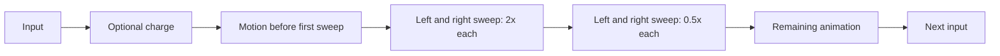

# Gemini Cross input timeline

The Praedos pilot uses the package export's animation durations and events.
The table gives one full loop at 1.0 attack speed and unmodified charge speed.

| Mode | Inputs | Attack events | Motion, seconds | Charge, seconds |
| --- | ---: | ---: | ---: | ---: |
| Neutral | 5 | 18 | 4.199999 | 0 |
| Forward | 3 | 3 | 1.133334 | 0 |
| Block | 2 | 11 | 2.733333 | 0 |
| Block + forward | 4 | 7 | 2.200000 | 0 |
| Heavy | 2 | 4 | 1.333334 | 1.39999998 |
| Slide | 1 | 2 | 0.933333 | 0 |

An input contains actions, and an action contains its animation events. Charge
uses wind-up speed; animation uses attack speed. Lead-in is the time before
the first event. Remaining motion after the final event keeps the action
occupied until its animation ends. These intervals are derived, so editing an
event cannot leave a contradictory handwritten lead-in or recovery value.

The neutral opener is one 0.933333-second animation. It has two simultaneous
sweeps at 0.536290341801 seconds, each 2x damage and two combo points, followed
by two simultaneous sweeps at 0.613440552914 seconds, each 0.5x damage and one
combo point. One input therefore produces four separately resolved strikes.

Tennokai replaces the next light input with a heavy input at the boundary.
Its charge defaults to zero; its two sweeps still occur 0.127688063844 seconds
into the first heavy animation. Each deals 2.5x and forces Slash and
Knockdown. Both read the same combo multiplier, and the input spends no combo.
The remaining animation plays before the light chain restarts at its opener.
Subsequent Tennokai inputs alternate the two heavy animations.

Source hit indices bind per-swing overrides before chronological sorting.
For example, neutral input two lists five sweep markers in hand order; its
Slash override belongs to the third chronological event. Sorting the markers
before assigning overrides would move that proc to another strike.

Runtime reads [the stance YAML](../../data/mods/tonfa/gemini_cross.yaml).
[The importer](../../scripts/import_melee_package.py) reproduces its bindings
and [shared actions](../../data/melee/actions.yaml) from
[the pinned package export](../../tests/fixtures/melee/package-2026-10-08.json).
`--check` fails on a difference. Thanks to
[@superexboom](https://github.com/superexboom) for extracting and organizing the
package data; commit, build and package hash are recorded in `data/notes.yaml`.

Sweep markers open collision; the arena places contact at the opening marker
for an in-range target. Sweep geometry, collision-window ends and animation
cancellation are not supplied by this export. Slide geometry and the closing
slam's one combo point retain the stance wiki's rules. Aerial attacks and the
independent heavy-slam mode are outside this six-mode pilot.
