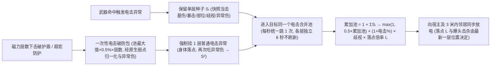
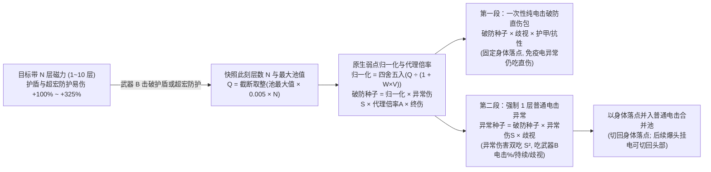

# 【Warframe｜星际战甲】磁力与电击异常计算机制全解析

> **整理与署名**：WFSim（WF模拟）｜[wfsim.app](https://wfsim.app)  
> **范围**：Warframe 中**磁力**与**电击**异常（及底层同源的**毒气**异常）的伤害结算规则、全武器原生弱点分档与实测算例；全部数值均对照幻影装置游戏内实测校准。

---

## 一、为什么要把“磁力”和“电击”放在一起讲？

在 Warframe 的元素体系里，**电击**是基础单元素，**磁力**（冰霜 + 电击）是复合元素；但在当前版本的底层结算中，两者已经深度绑定在一起：

1. **磁力击破护盾或超宏防护时，会直接生成“电击”**：不仅爆出一段一次性纯电击破防伤害，还会**强制挂上一层普通电击异常**。
2. **磁力破防电与普通电击共用同一套底层结算池**：破防生成的电击会直接并入目标现有的电击合并池，不仅共享计时器与累加器，还会**改写整池电击的落点部位与爆头击杀归属**。
3. **电击与毒气共享同一套“二次落点倍率”机制**：两者是全游戏仅有的两个“持续跳伤自身会落在某个身体部位上”的异常状态，理解了电击的合并池与落点锚定规则，毒气的底层逻辑也一并通透。



---

## 二、核心机制一：电击异常（特斯拉电弧）全流程计算

### 1. 基础属性与“第三种异常结算模型”

Warframe 的持续异常在底层共有**三种**截然不同的结算模型，电击（与毒气）属于第三种：

* **第一类（独立跳伤、各自计时）**：切割流血、毒素中毒。每一层各跳各的数字，各自 6 秒后过期。
* **第二类（合并跳伤、刷新全部时间）**：火焰点燃。全部层数合并成 1 个数字每秒跳一次，且每次新叠层都会**刷新所有旧层的持续时间**。
* **第三类（合并跳伤、各层独立过期不刷新）**：**电击**与**毒气**。同一目标身上的多层电击合并成 1 个大数字每秒统一跳一次，**但每一层依然保留自己独立的 6 秒倒计时，不会互相刷新**。

电击异常的 5 项基础硬参数：
* **基础持续时间**：**6 秒**（受异常持续时间加成缩放）。
* **0 秒延迟、瞬间出伤**：挂上异常的瞬间（`t = 0 秒`）立刻跳出第 1 跳，之后每秒 1 跳（`t = 0, 1, 2, 3, 4, 5 秒`，基础共 **6 跳**；没有切割/火焰/毒素那样的 1 秒等待延迟；即使持续时间被压至极低，0 秒首跳依然结算）。
* **层数上限**：**无上限**（可无限叠加）。
* **范围传播**：每次跳伤以宿主为中心，向周围 **3 米半径**内所有敌人同步放电。
* **控制硬直（经游戏内实测验证）**：仅最初被命中的宿主会受到约 **3 秒**电击硬直（周围 3 米被电弧波及的邻居只受伤害、不吃硬直）；且**电击硬直在持续期间无法被刷新**，必须等约 3 秒硬直完全结束后才能再次触发下一次硬直（不受异常持续时间延长），与火焰持续刷新恐慌截然不同。

---

### 2. 电击异常的精确伤害公式

#### （1）单层电击种子（每层各自快照保留）
每次命中触发电击时，都会生成一颗独立的“伤害种子”存入合并池，快照锁定当次命中的攻击端乘区：
```text
单层种子 S(i) = 结算基伤 × 暴击倍率 × 命中部位倍率 × 歧视倍率 × 异常伤害倍率
```
* **结算基伤**仅含基础伤害与基伤乘区（不含元素 Mod 数值，且不经过直伤的 `1/32` 量化；射线武器还会同步乘以多重合并数 `M` 与当跳预热倍率）。
* **命中部位倍率**：打身体为 `1`；打常规头部为 `3 × (1 + 爆头伤害加成%)`。若同时触发暴击爆头，暴击倍率按 `1 + 暴击等级 × (2 × 暴伤 - 1)` 计入种子。

#### （2）合并池单跳精确结算公式
每秒结算跳伤时，游戏把池内所有存活层的种子求和，并从底层累加器初始值 **`1`** 起步：
```text
累加池总值 = 1 + Σ S(i)                        ← 整个合并池只加一次 1
单跳基础伤害 = max(1, 0.5 × 累加池总值) × (1 + 电击元素加成%) × 歧视倍率
单跳最终伤害 = 单跳基础伤害 × 落点部位倍率 L × 目标实时护甲 / 抗性 / 病毒易伤
```
* **电击元素加成**：电击跳伤直接吃 `(1 + 电击元素加成%)`。
* **歧视双吃**：歧视倍率在构造种子 `S(i)` 时乘 1 次，在合并池跳伤结算时再乘 1 次（近似平方级缩放，仅底层 `+1` 累加器只乘外面那 1 次）。
* **异常伤害**：属于种子侧缩放（不放大累加器的初始 `1`）。

---

### 3. 电击的二次落点倍率 L 与最新层锚定规则

电击与毒气持续跳伤存在独立于首击之外的部位落点结算（经游戏内实测验证）：

#### （1）为什么电击爆头比毒素/火焰多出一整层倍率？
* 毒素、火焰、切割、爆炸等异常的跳伤本身**不附着在具体身体部位上**，爆头只在第一层种子 `S(i)` 里算 1 次。
* **唯独电击与毒气**的持续跳伤自身会**落在敌人的具体身体部位上**。
* 当跳伤落点位于**头部**时，游戏会对**整池跳伤（连同 `+1` 累加器一起）**在 `1x` 基础上**再乘一次爆头伤害加成**（包括死首类赋能、进化爆头加成等；不含精准类弱点加成）：
  ```text
  头部落点倍率 L = 1 + 爆头伤害加成%    （落身体时 L = 1.0）
  ```
* **数值示例**：设武器带有 `+80%` 爆头伤害加成（例如 +50% 进化爆头 + 30% 次要·死首）：
  * 常规头部命中倍率 = `3 × (1 + 0.8) =` **5.4 倍**
  * **毒素 / 火焰爆头**相对打身体：仅 **5.4 倍**
  * **电击（与毒气）爆头**相对打身体：`5.4 × (1 + 0.8) =` **9.72 倍**（连同 `+1` 累加器约 **9.75 倍**）——爆头伤害加成在电击与毒气上被乘算两次。

#### （2）“最后一层决定全池落点与爆头击杀归属”（经游戏内实测验证）
当同一个敌人身上既有打身体挂上的电击、又有打头挂上的电击时，结算遵循两条规则：
1. **每层旧种子原封不动保留**：先前爆头甚至暴击爆头打出的大种子，不会因为后面打了一枪身体就被覆盖变小。
2. **整个合并池的落点倍率 `L` 以及跳伤击杀是否计为爆头击杀，仅由最新施加的那一层电击所命中的部位决定。**
   * 若先打 10 枪头，最后不小心打 1 枪身体挂上电击 → **全池落点瞬间切回身体（`L` 降回 `1.0`）**，且若由电击跳死目标，**不算爆头击杀**（无法触发需要爆头击杀的条件）。
   * 反过来，若先打 10 枪身体，最后补 1 枪头挂上电击 → **全池（包含先前的 10 层身体种子）均切换至头部落点（`L` 升至 `1 + 爆头伤害%`）**，且跳伤击杀**计为爆头击杀**。

#### （3）电弧传给 3 米内邻居怎么算？
* 宿主身上爆头挂出的电击向 3 米内邻居放电时，**电弧完整保留宿主的爆头种子倍率**（邻居承受的电弧同样包含 `5.4 倍` 头部种子）。
* 至于电弧落在邻居身上是否触发二次头部落点 `L`，取决于空间相对位置；在游戏内 189 次多站位实测中，电弧落到邻居头部的比例约为 **5.3%（10/189）**，其余约 94.7% 落在邻居身体（`L = 1.0`）。

---

## 三、对比：毒气（Gas）与电击的异同

毒气（火焰 + 毒素）与电击在底层属于同一套“区域合并跳伤 + 落点部位”家族，只需记住 **4 处相同** 与 **4 处不同** 即可完全掌握：

* **4 处完全相同**：
  1. 均是 **0 秒延迟立即首跳**（基础 6 秒共跳 6 次：`0..5 秒`）；
  2. 均采用**合并跳伤、各层独立过期不刷新**模型与 `+1` 初始累加器；
  3. 均拥有**二次落点倍率 `L`**，且同样遵循**“最新挂上去的那一层毒气决定全池落点与爆头击杀归属”**（经游戏内实测确认）；
  4. 毒气云造成的击杀同样归属给施加毒气的武器本身（经游戏内实测确认）。
* **4 处核心不同**：
  1. **不吃元素 Mod**：电击跳伤吃 `(1 + 电击元素%)`；毒气是复合元素，**既不吃火焰 Mod 也不吃毒素 Mod**。
  2. **层数上限与半径成长**：电击**无层数上限、半径恒定 3 米**；毒气单目标最多叠 **10 层**，第 1 层半径 3 米，后续每多 1 层扩大 `+0.3 米`，上限 **6 米**。
  3. **宿主死后是否残留**：电击电弧随宿主死亡立刻消失；**毒气云固定留在空间原地，宿主死亡后毒气云会继续跳完剩余时间**，伤害经过该区域的敌人。
  4. **无硬直控制**：电击使宿主硬直 3 秒，毒气无控制效果。

---

## 四、核心机制二：磁力异常（干扰）与“磁力破防电”全流程拆解

磁力（冰霜 + 电击）的机制必须严格拆成**“破防前”**和**“破防瞬间”**两个阶段来算。



### 1. 阶段一：破防前（磁力干扰层数）

* **持续时间与上限**：单层持续 **6 秒**，上限 **10 层**（所有来源共用 10 个槽位，超出 10 层按先进先出顶替最老的一层）。
* **对护盾与超宏防护的易伤阶梯**：
  * 第 1 层：**+100%**（2.00 倍）
  * 之后每多 1 层：**+25%**
  * 满 **10 层**：`100% + 9 × 25% =` **+325%**（**4.25 倍**）
* **辅助效果**：阻止敌人的护盾自然回复。
* *边界说明*：磁力易伤仅作用于**护盾**与**超宏防护**，对敌人血量池不提供增伤。

---

### 2. 阶段二：破防瞬间——“磁力破防电”的完整双阶段公式（经游戏内实测与模型校准）

当带有 `N` 层磁力（`1 ≤ N ≤ 10`）的目标，其**护盾**或**超宏防护**被击破的瞬间，游戏会**快照锁定破防那一刻的层数 `N`**（此后磁力层数增减或过期均不改变本次破防伤害），并依次执行 **两段独立结算**：

1. **第一段：一次性“纯电击破防直伤包”**（固定身体判定、不暴击、不吃爆头、不吃磁力元素加成；即便目标免疫电击异常，第一段直伤依然照常生效）。
2. **第二段：由该破防包强制挂上的 1 层“普通电击异常”**（直接进入目标的普通电击合并池，持续 6 秒、0 秒立即首跳、3 米范围放电）。

#### 属性归属规则：全部乘区取自击破武器（经游戏内实测验证）
哪怕前面是武器 A 给敌人叠了 10 层磁力，只要最后一击是**武器 B 击破了护盾或超宏防护**，这两段破防电的**全部属性上下文（原生弱点加成 `W`、电击元素加成、异常伤害加成、异常持续时间、歧视加成）全部取自击破武器 B**，与此前挂磁力的武器 A 无关。

#### 精确 4 步结算算式

* **第 1 步：池值基础源值 `Q`**  
  实际生效的基础系数为 `0.005`（即每层磁力对应最大护盾或超宏防护的 **0.5%**，满 10 层为 **5%**），单精度截断取整：
  ```text
  Q = 截断取整( 最大护盾或超宏防护 × 0.005 × 破防时磁力层数 N )
  ```
* **第 2 步：原生弱点归一化与目标代理倍率**  
  游戏会选取目标身上第一个**严格最大的正向弱点代理**（若该代理带有通用伤害倍率 `A`），先用**击破武器的原生弱点加成 `W`** 做一次反向归一化除数，再依次乘以第一段异常伤害倍率 `S`、代理倍率 `A` 与独立终伤：
  ```text
  归一化源值 = 四舍五入( Q ÷ (1 + max(W, 0) × V) )
  破防基础种子 = 归一化源值 × 异常伤害倍率 S × 代理伤害倍率 A × 独立终伤(如月蚀)
  ```
  * *边界说明*：若目标没有正向弱点代理（如追随者 `V = 0`），或最高弱点代理未定义通用倍率 `A`（如科腐巴鲍），则**直接跳过本步的归一化与 `A` 倍率**，直接令 `破防基础种子 = Q × 异常伤害倍率 S × 独立终伤`（此时所有 `W` 档位武器伤害一致）。
* **第 3 步：第一段一次性“破防电击直伤包”**
  ```text
  破防电击包直伤 = 破防基础种子 × 歧视倍率 × 目标实时护甲 / 抗性
  ```
  * 若此直伤包顺带把紧接着的另一层池子也击破了（例如先破超宏防护，破防直伤包顺手打碎了紧随其后的护盾），会**连锁触发第二次磁力破防电**。
* **第 4 步：第二段强制普通电击异常（异常伤害双吃 `S²`）**  
  破防包强制挂入 1 层普通电击异常，进入普通电击合并池：
  ```text
  破防电异常种子 = 破防基础种子 × 异常伤害倍率 S × 歧视倍率
  ```
  * **异常伤害双吃（`S²`）**：`破防基础种子` 在第 2 步已经吃过 1 次异常伤害倍率 `S`，第 4 步作为普通电击异常子进程**再吃 1 次 `S`** → 最终磁力破防电击异常持续跳伤对异常伤害加成呈 **`S²`（平方级）** 缩放。例如 `+90%` 异常伤害（`S = 1.9`）时，破防电击异常跳伤放大为 `1.9² =` **3.61 倍**。
  * **其余乘区完全走普通电击规则**：吃击破武器的 **`1 + 电击元素加成%`**、**异常持续时间**、**歧视双吃**、**3 米范围放电**；**不吃 `+磁力%` 元素加成**。

---

### 3. 详解“原生弱点加成 W”：全部 5 个档位与代表武器一览

#### （1）什么是武器的“原生弱点加成 `W`”？
* **`W` 是每把武器自身固有的隐藏弱点加成属性**，与你装备的爆头伤害 Mod、死首赋能、灵化进化爆头词条**毫无关系**（装备再多爆头伤害词条也不会改变 `W`）。
* **灵化形态与次要开火模式继承基础武器的 `W`**：例如[托里德](https://wfsim.app/weapons/Torid)与[托里德](https://wfsim.app/weapons/Torid)灵化形态同为 `W = 0.2`，[奏凯](https://wfsim.app/weapons/Laetum)与[奏凯](https://wfsim.app/weapons/Laetum)灵化形态同为 `W = 0.5`，[米特尔](https://wfsim.app/weapons/Miter)与[米特尔](https://wfsim.app/weapons/Miter)灵化形态同为 `W = 1.0`。
* **为什么 `W` 越低，磁力破防电反而越高？**  
  因为在第 2 步结算中，`W` 处在归一化公式的**分母** `1 + max(W, 0) × V` 上，紧接着再乘以目标代理倍率 `A`。对常规人形敌人（`V = 1, A = 2`），净系数就是 **`2 ÷ (1 + W)`**——因此 `W = 0` 的武器能拿到完整的 `2.00 × Q`，而 `W = 1.0` 的武器被除以 `2` 后又乘回 `2`，只剩 `1.00 × Q`，恰好为 `W = 0` 武器的一半。

#### （2）全游戏武器原生弱点加成 `W` 全部 5 档与代表武器表（WFSim 实测与模型校准清单）

| 原生弱点 `W` | 常规人形净倍率 `2÷(1+W)` | 满 10 层等效最大池值% | 所属武器大类规律 | 官方中文代表武器举例 |
| :---: | :---: | :---: | --- | --- |
| **`0.0`** | **`2.00 × Q`** | **10.00%** | **全部近战武器**、大部分重型枪械与同伴利爪；以及无原生弱点加成的射线、能量波、发射器与投掷/泡泡类枪械 | **近战**：全部近战（如[战刃 Prime](https://wfsim.app/weapons/Glaive_Prime)、[驱魔之刃](https://wfsim.app/weapons/Xoris)、[和谐](https://wfsim.app/weapons/Harmony)、[憎恨](https://wfsim.app/weapons/Hate)、[翁 Prime](https://wfsim.app/weapons/Okina_Prime) 等）<br>**主武器**：[安培克斯](https://wfsim.app/weapons/Amprex)、[伊格尼斯·亡魂](https://wfsim.app/weapons/Ignis_Wraith)、[信条·弧电离子枪](https://wfsim.app/weapons/Tenet_Arca_Plasmor)、[赤毒·食人女魔](https://wfsim.app/weapons/Kuva_Ogris)、[赤毒·征服榴炮](https://wfsim.app/weapons/Kuva_Tonkor)、[信条·典客](https://wfsim.app/weapons/Tenet_Envoy)、[钢刃步枪](https://wfsim.app/weapons/Stahlta)、[祸根 Prime](https://wfsim.app/weapons/Scourge_Prime)<br>**副武器**：[赤毒·努寇微波枪](https://wfsim.app/weapons/Kuva_Nukor)、[原子矿融炮](https://wfsim.app/weapons/Atomos)、[咖玛腕甲枪](https://wfsim.app/weapons/Gammacor) / [枢议·咖玛腕甲枪](https://wfsim.app/weapons/Synoid_Gammacor)、[卡帕压力枪 Prime](https://wfsim.app/weapons/Kompressa_Prime)、[光谱切割器·破坏者](https://wfsim.app/weapons/Spectra_Vandal)、[终幕·脓痘](https://wfsim.app/weapons/Coda_Pox)、[棱晶·安格斯壮](https://wfsim.app/weapons/Prisma_Angstrum)<br>**重型枪械**：[葛拉特勒](https://wfsim.app/weapons/Grattler)、[凯旋将军·破坏者](https://wfsim.app/weapons/Imperator_Vandal)、[赤毒·怒雷](https://wfsim.app/weapons/Kuva_Ayanga)、[黑鸦 Prime](https://wfsim.app/weapons/Corvas_Prime) |
| **`0.2`** | **`1.67 × Q`** | **8.33%** | 绝大多数全自动步枪、霰弹枪、全自动副手、守护武器以及部分射线/爆发武器 | **主武器**：[托里德](https://wfsim.app/weapons/Torid)（含灵化）、[信条·冷冻光束步枪](https://wfsim.app/weapons/Tenet_Glaxion)、[幻离子 Prime](https://wfsim.app/weapons/Phantasma_Prime)、[野猪 Prime](https://wfsim.app/weapons/Boar_Prime)、[斯特朗 Prime](https://wfsim.app/weapons/Strun_Prime)、[逐枭](https://wfsim.app/weapons/Felarx)、[塞多 Prime](https://wfsim.app/weapons/Cedo_Prime)、[赤毒·鳄神](https://wfsim.app/weapons/Kuva_Sobek)、[赤毒·布拉玛](https://wfsim.app/weapons/Kuva_Bramma)、[赤毒·沙皇](https://wfsim.app/weapons/Kuva_Zarr)、[赤毒·邪眼](https://wfsim.app/weapons/Kuva_Chakkhurr)、[布莱顿 Prime](https://wfsim.app/weapons/Braton_Prime)、[螺钉步枪 Prime](https://wfsim.app/weapons/Boltor_Prime)、[月神 Prime](https://wfsim.app/weapons/Soma_Prime)<br>**副武器**：[信条·循环离子枪](https://wfsim.app/weapons/Tenet_Cycron)、[视使之触](https://wfsim.app/weapons/Ocucor)、[盗贼](https://wfsim.app/weapons/Furis)、[毒囊双枪](https://wfsim.app/weapons/Dual_Toxocyst)、[葬铭](https://wfsim.app/weapons/Epitaph) / [葬铭 Prime](https://wfsim.app/weapons/Epitaph_Prime)<br>**守护武器**：[冰凇 Prime](https://wfsim.app/weapons/Verglas_Prime)、[赫尔斯壮](https://wfsim.app/weapons/Helstrum) |
| **`0.4`** | **`1.43 × Q`** | **7.14%** | **仅 6 把传统狙击步枪** | [守望者](https://wfsim.app/weapons/Vectis) / [守望者 Prime](https://wfsim.app/weapons/Vectis_Prime)、[金工火神](https://wfsim.app/weapons/Vulkar) / [金工火神·亡魂](https://wfsim.app/weapons/Vulkar_Wraith)、[狙击特昂](https://wfsim.app/weapons/Snipetron) / [狙击特昂·破坏者](https://wfsim.app/weapons/Snipetron_Vandal) |
| **`0.5`** | **`1.33 × Q`** | **6.67%** | 半自动/点射精准步枪、精准手枪、多数飞镖/投掷副手与部分灵化武器 | **主武器**：[凤殁](https://wfsim.app/weapons/Phenmor)、[伯斯顿 Prime](https://wfsim.app/weapons/Burston_Prime)、[拉特昂 Prime](https://wfsim.app/weapons/Latron_Prime)、[席芭莉丝 Prime](https://wfsim.app/weapons/Sybaris_Prime)、[狂鲨 Prime](https://wfsim.app/weapons/Tiberon_Prime)、[楞次弓](https://wfsim.app/weapons/Lenz) / [棱晶·楞次弓](https://wfsim.app/weapons/Prisma_Lenz)、[铁晶磁轨炮](https://wfsim.app/weapons/Ferrox)<br>**副武器**：[奏凯](https://wfsim.app/weapons/Laetum)（含灵化）、[雷克斯 Prime](https://wfsim.app/weapons/Lex_Prime)、[暗杀者 Prime](https://wfsim.app/weapons/Sicarus_Prime)、[丧钟 Prime](https://wfsim.app/weapons/Knell_Prime)、[信条·漫射者](https://wfsim.app/weapons/Tenet_Plinx)、[终幕·异化者](https://wfsim.app/weapons/Coda_Catabolyst)、[阿索代 Prime](https://wfsim.app/weapons/Athodai_Prime)、[魔典](https://wfsim.app/weapons/Grimoire)、[玛瑞火枪](https://wfsim.app/weapons/Marelok)<br>**重型枪械**：[惩戒者](https://wfsim.app/weapons/Mausolon)、[合成燃气炮](https://wfsim.app/weapons/Cyngas) |
| **`1.0`** | **`1.00 × Q`** | **5.00%** | 传统弓箭、高倍率狙击/充能炮及少数特例爆炸武器（仅 `W = 0` 的一半） | **主武器**：[兰卡](https://wfsim.app/weapons/Lanka)、[绝路](https://wfsim.app/weapons/Rubico) / [绝路 Prime](https://wfsim.app/weapons/Rubico_Prime)、[月面狂风 Prime](https://wfsim.app/weapons/Perigale_Prime)、[奥堤克光子枪](https://wfsim.app/weapons/Opticor) / 破坏者、太始弓、[恐惧](https://wfsim.app/weapons/Dread)、[帕里斯 Prime](https://wfsim.app/weapons/Paris_Prime)、[西诺斯 Prime](https://wfsim.app/weapons/Cernos_Prime)、[大久和弓 Prime](https://wfsim.app/weapons/Daikyu_Prime)、[遂心](https://wfsim.app/weapons/Cinta)、[米特尔](https://wfsim.app/weapons/Miter)（含灵化）、[迅发电浆炮](https://wfsim.app/weapons/Acceltra) / [迅发电浆炮 Prime](https://wfsim.app/weapons/Acceltra_Prime)<br>**副武器**：[阿利乌双枪](https://wfsim.app/weapons/Akarius) / [阿利乌双枪 Prime](https://wfsim.app/weapons/Akarius_Prime) |

#### （3）不同敌人弱点代理 `(V, A)` 对破防电的影响速览
除了击破武器的 `W`，目标自身最高正向弱点代理的 `(V, A)` 也会改变第 2 步的净倍率：
* **常规人形敌人**（堕落重型机枪手、堕落船员、凶魂百夫长、遗骸体等）：头部代理 **`V = 1.0, A = 2.0`** → 净系数 `2 ÷ (1 + W)`（上表 5 档差距最明显）。
* **爆破型吞噬者**：最高代理 **`V = 0.05, A = 2.0`** → 净系数 `2 ÷ (1 + 0.05W)`（无论 `W = 0` 还是 `W = 1.0`，分母仅在 `1.00~1.05` 之间，全部 5 档 `W` 的净倍率均接近 `2.00 × Q`）。
* **科腐巴鲍**（`V = 1.0` 但无通用代理倍率 `A`）与 **追随者/小小黑系列**（无正向弱点代理 `V = 0`）：跳过归一化与代理倍率 → 所有武器统一按 **`1.00 × Q`** 结算，不受 `W` 影响。

---

### 4. 磁力破防电与“爆头电击池”的双向锚点互动（经游戏内实测验证）

因为磁力破防挂出的电击异常**固定以“身体部位”进入普通电击合并池**，它与武器主动打出的电击会产生两种双向交互：

1. **破防瞬间会“拉低”已有爆头电击池的落点**：若破防前你已经用武器爆头叠出了一个落点在头部（`L = 1.8`）的电击池，护盾/超宏防护破裂瞬间挤进来的“身体破防电”成了最新一层 → **整池落点会被临时拉回身体（`L = 1.0`）**，旧爆头种子本身不变。
2. **破防后补挂头部电击可将破防电种子切至头部落点**：只要在破防之后、下一次跳伤之前，再对目标头部挂出 1 层普通电击异常，最新落点立刻切回头部（`L = 1.8`）——**连那颗基于敌人巨额护盾/超宏防护算出来的破防电大种子，都会随整池一并获得 `1 + 爆头伤害%` 的二次落点倍率**。

---

## 五、4 组实测级完整手算实例

### 实例 1：电击（及毒气）混合命中顺序手算（对应游戏内实测验证）

* **条件**：[奏凯](https://wfsim.app/weapons/Laetum)基础形态（结算基伤 `160`，量化后黄暴倍率 `c ≈ 2.2037`），带有 `+80%` 爆头伤害加成（头部种子倍率 `P = 3 × 1.8 = 5.4`，头部二次落点倍率 `L = 1.8`），带有 `+200%` 电击元素加成（元素乘区 `× 3`），目标无护甲减伤。
* **各类型单层种子（乘 `0.5` 后的折算贡献）**：
  * 打身体非暴击：`0.5 × 160 =` **80**
  * 打头部非暴击：`0.5 × 160 × 5.4 =` **432**
  * 打头部黄暴击：`0.5 × 160 × 5.4 × (2 × 2.2037) =` **1903.97**
  * 合并池初始累加器：`0.5 × 1 =` **0.5**（整池只加 1 次）

| 依次触发电击的命中顺序 | 合并池精确算式 | 最终显示跳伤 | 跳死目标是否算爆头击杀 |
| --- | --- | :---: | :---: |
| **头(非暴) → 头(非暴) → 身(非暴)** | `(432 + 432 + 80 + 0.5) × 3 × 1.0` | **2,834** | **否**（最后打身） |
| **身(非暴) → 头(非暴) → 头(非暴)** | `(80 + 432 + 432 + 0.5) × 3 × 1.8` | **5,100** | **是**（最后打头） |
| **头(黄暴) → 头(非暴) → 身(非暴)** | `(1903.97 + 432 + 80 + 0.5) × 3 × 1.0` | **7,249** | **否**（保留暴击种子，但失 1.8× 落点） |
| **身(非暴) → 身(非暴) → 头(黄暴)** | `(80 + 80 + 1903.97 + 0.5) × 3 × 1.8` | **11,148** | **是**（全池吃满 1.8× 落点） |

> 对比第 1 行与第 2 行：三枪的命中分布完全相同（两头一身），仅仅因为最后一枪打在头还是打在身，跳伤就相差整整 **1.8 倍（2,834 vs 5,100）**；且相同算式对**毒气**完全一致。

---

### 实例 2：磁力破防超宏防护全流程手算——从裸卡、电击加成、异常伤双吃（`S²`）到破防后拉头（对应游戏内实测验证）

* **目标**：50 级钢铁之路堕落重型机枪手卓越者（已完全剥甲，最大超宏防护 = **`103,623`**，头部弱点代理 `V = 1.0, A = 2.0`），破防瞬间挂满 **10 层磁力**。
* **击破武器**：**[奏凯](https://wfsim.app/weapons/Laetum)**（原生弱点加成 **`W = 0.5`**，带 `+80%` 爆头伤害、附带 `+200%` 磁力）。
* **逐步演算**：
  1. **第 1 步（基础源值 `Q`）**：  
     `Q = 截断取整(103,623 × 0.005 × 10) = 截断取整(5,181.15) =` **5,181**
  2. **第 2 步（原生弱点归一化，与配卡无关）**：  
     `归一化源值 = 四舍五入(5,181 ÷ (1 + 0.5 × 1.0)) = 四舍五入(5,181 ÷ 1.5) =` **3,454**
  3. **逐步叠加各乘区后的精确伤害演变**（对照游戏内实测与精确浮点演算）：
     * **① 无电击、无异常伤、无歧视（基础实测基准）**：
       * 破防基础种子 = `3,454 × 1.0 × 2 =` **6,908** → **第一段一次性破防直伤包 = 6,908**
       * 第二段强制电击每跳 = `0.5 × (1 + 6,908) = 3,454.5 →` **3,455**（6 秒共 6 跳累计 **20,730**）
       * *(游戏内实测中，击破那一枪打头和打身跳出来的都是精准 **3,455**——验证了 `+80%` 爆头伤害与 `+200%` 磁力均不作用于破防包本身。)*
     * **② 给击破武器加上 `+165%` 电击元素加成**：
       * 第一段直伤包不变（直伤包不吃电击元素加成）：仍为 **6,908**
       * 第二段强制电击每跳 = `0.5 × (1 + 6,908) × (1 + 1.65) = 9,154.43 →` **9,154**（与游戏内实测 9,154 一致）
     * **③ 再叠加 `+90%` 异常伤害（`S = 1.9`）**：
       * 破防基础种子（第 1 次吃 `S`）= `3,454 × 1.9 × 2 =` **13,125.2** → **第一段直伤包 = 13,125**
       * 强制电击异常种子（第 2 次吃 `S`，形成 **`S²`**）= `13,125.2 × 1.9 =` **24,937.88**
       * 第二段强制电击每跳 = `0.5 × (1 + 24,937.88) × 2.65 = 33,044.02 →` **33,044**（相对 9,154 放大 `1.9² = 3.61 倍`）
     * **④ 再叠加 `+55%` 派系歧视（`1.55`）**：
       * 第一段直伤包（吃 1 次歧视）= `13,125.2 × 1.55 =` **20,344**
       * 强制电击种子（种子侧第 1 次吃歧视）= `24,937.88 × 1.55 = 38,653.71`
       * 第二段每跳（跳伤侧第 2 次吃歧视）= `0.5 × (1 + 38,653.71) × 2.65 × 1.55 = 79,387.12 →` **79,387**
     * **⑤ 若目标并非剥甲，而是剩余 `900` 护甲**（护甲减伤 `0.9 × √(900/2700) = 51.96%`，承伤系数 `0.4804`）：
       * 第一段直伤包 = `20,344 × 0.4804 =` **9,773**；第二段身体落点每跳 = `79,387 × 0.4804 =` **38,136**。
     * **⑥ 剥甲状态下，破防后再补一枪爆头挂出普通电击（拉上头部落点 `L = 1.8`）**：
       * 仅磁力破防电这一颗旧种子本身被拉上头部落点后的每跳贡献，将增至 `79,387.12 × 1.8 =` **142,897**（不含新补爆头枪自身新增的普通电击种子）。

---

### 实例 3：全部 5 档原生弱点 `W` 击破同一护盾的完整横评算例（对应游戏内实测验证）

#### 场景 A：100 级钢铁之路堕落船员（最大护盾 `19,157`，10 层磁力，头部代理 `V = 1.0, A = 2.0`）
* **基础源值 `Q`**（5 把武器完全相同）：`截断取整(19,157 × 0.005 × 10) = 截断取整(957.85) =` **957**
* 下表逐一列出 **全部 5 档 `W`** 在“裸卡无增伤”以及“带 `+165%` 电击 + `+90%` 异常伤（`S = 1.9`）”两种条件下的精确手算结果（已剥甲/无护甲）：

| 击破武器档位与代表 | 归一化源值 `round(957÷(1+W))` | 裸卡破防直伤包 (`×2`) | 裸卡每跳电击 (`0.5×(1+包)`) | 带 +165%电 +90%异常伤：直伤包 | 带 +165%电 +90%异常伤：每跳电击 (`S²`) | 相对 `W=1.0` 倍率 |
| --- | :---: | :---: | :---: | :---: | :---: | :---: |
| **`W = 0.0`**：[赤毒·努寇微波枪](https://wfsim.app/weapons/Kuva_Nukor) / [战刃 Prime](https://wfsim.app/weapons/Glaive_Prime) | `957 ÷ 1.0 =` **957** | **1,914** | **958** *(实测 958)* | **3,637** | **9,156** | **2.00×** |
| **`W = 0.2`**：[托里德](https://wfsim.app/weapons/Torid) / [信条·循环离子枪](https://wfsim.app/weapons/Tenet_Cycron) | `957 ÷ 1.2 =` **797*** | **1,594** | **798** | **3,029** | **7,626** | **1.66×** |
| **`W = 0.4`**：[守望者 Prime](https://wfsim.app/weapons/Vectis_Prime) / [金工火神·亡魂](https://wfsim.app/weapons/Vulkar_Wraith) | `957 ÷ 1.4 =` **684** | **1,368** | **685** | **2,599** | **6,545** | **1.43×** |
| **`W = 0.5`**：[奏凯](https://wfsim.app/weapons/Laetum) / [伯斯顿 Prime](https://wfsim.app/weapons/Burston_Prime) | `957 ÷ 1.5 =` **638** | **1,276** | **639** | **2,424** | **6,105** | **1.33×** |
| **`W = 1.0`**：[兰卡](https://wfsim.app/weapons/Lanka) / [绝路 Prime](https://wfsim.app/weapons/Rubico_Prime) / 太始弓 | `957 ÷ 2.0 =` **479** | **958** | **480** | **1,820** | **4,584** | **1.00×** |

> *注：`957 ÷ 1.2` 理论值为 `797.5`，因游戏内单精度浮点表示 `1.2` 略大于精确值（`1.20000005`），故 `957 ÷ f32(1.2) = 797.49997`，四舍五入后精确落为 `797`。

#### 场景 B：跨等级、护盾瓦解光环与 1 层磁力的多组游戏内实测校验
同一套 4 步公式可直接精准复现全部历史与游戏内跨条件实测（无任何误差）：
* **[赤毒·努寇微波枪](https://wfsim.app/weapons/Kuva_Nukor)（`W = 0`），10 层磁力，钢铁之路堕落船员**：
  * 80 级（最大护盾 `16,128`）→ `Q = 806` → 每跳 `0.5 × (1 + 1,612) =` **807**（实测 807）
  * 80 级 + 护盾瓦解 `-18%`（最大护盾 `13,225`）→ `Q = 661` → 每跳 `0.5 × (1 + 1,322) =` **662**（实测 662）
  * 100 级（最大护盾 `19,157`）→ `Q = 957` → 每跳 **958**（实测 958）
  * 120 级（最大护盾 `21,948`）→ `Q = 1,097` → 每跳 **1,098**（实测 1,098）
* **1 层磁力下的 `W = 0`（[咖玛腕甲枪](https://wfsim.app/weapons/Gammacor)）vs `W = 1.0`（[兰卡](https://wfsim.app/weapons/Lanka)）**：
  * 普通船员（最大护盾 `14,789`，1 层磁力 `Q = 73`）：[咖玛腕甲枪](https://wfsim.app/weapons/Gammacor) `73 × 2 = 146` → 每跳 **74**；[兰卡](https://wfsim.app/weapons/Lanka) `round(73/2) × 2 = 74` → 每跳 **38**（与实测 74 vs 38 完全吻合）。
  * 精英船员（最大护盾 `18,486`，1 层磁力 `Q = 92`）：[咖玛腕甲枪](https://wfsim.app/weapons/Gammacor)每跳 **93**；[兰卡](https://wfsim.app/weapons/Lanka)每跳 **47**（与实测 93 vs 47 完全吻合）。

---

### 实例 4：不同敌人弱点代理 `(V, A)` + 实战全乘区（含 900 护甲与破防后拉头）综合对比手算

* **统一实战条件**：目标拥有 **`100,000`** 最大护盾或超宏防护，破防时挂满 **10 层磁力**（`Q = 截断取整(100,000 × 0.005 × 10) = 5,000`）；击破武器带 **`+165%` 电击**、**`+90%` 异常伤害（`S = 1.9`）**、**`+55%` 歧视（`1.55`）** 与 **`+80%` 爆头伤害（`L = 1.8`）**；目标破防后暴露出的血量带 **`900` 护甲**（护甲减伤 `51.96%`，承伤系数 `0.480385`）。
* **手算示例（以常规人形 + `W = 0.0` 为例）**：
  1. 归一化源值 = `5,000 ÷ (1 + 0 × 1) = 5,000`
  2. 破防基础种子 = `5,000 × 1.9 × 2 = 19,000`
  3. **第一段直伤包（甲后）** = `19,000 × 1.55 × 0.480385 =` **14,147**
  4. **第二段电击种子** = `19,000 × 1.9 × 1.55 = 55,955`
  5. **第二段身体落点每跳（甲后）** = `0.5 × (1 + 55,955) × 2.65 × 1.55 × 0.480385 =` **55,206**（6 秒 6 跳累计 **331,236**）
  6. **破防后补一枪爆头电拉上 `L = 1.8`（甲后）** = `55,206 × 1.8 =` **99,370**（该破防电种子 6 跳累计约 **59.6 万**）

下表完整对比 **三类不同弱点代理目标** 与 **三档 `W` 击破武器** 的最终甲后输出：

| 目标类型与弱点代理 `(V, A)` | 击破武器 `W` | 归一化源值 | 第一段破防直伤包(甲后) | 第二段电击每跳(身体/甲后) | 破防后补头电拉池每跳(`L=1.8`/甲后) |
| --- | :---: | :---: | :---: | :---: | :---: |
| **常规人形（堕落重型机枪手 / 船员 / 凶魂百夫长）**<br>`V = 1.0, A = 2.0` | `W = 0.0` | 5,000 | **14,147** | **55,206** | **99,370** |
| 同上 | `W = 0.5` | 3,333 | **9,431** | **36,800** | **66,241** |
| 同上 | `W = 1.0` | 2,500 | **7,074** | **27,603** | **49,686** |
| **爆破型吞噬者**<br>`V = 0.05, A = 2.0` | `W = 0.0` | 5,000 | **14,147** | **55,206** | **99,370** |
| 同上 | `W = 0.5` | 4,878 | **13,802** | **53,859** | **96,946** |
| 同上 | `W = 1.0` | 4,762 | **13,474** | **52,578** | **94,640** |
| **科腐巴鲍 / 追随者**<br>无代理倍率（跳过归一化与 `A`） | 全部 `W`（0 / 0.5 / 1.0） | 5,000 *(×1)* | **7,074** | **27,603** | **49,686** |

> 对比结论：① 打常规人形敌人时，`W = 0` 武器破防电整整是 `W = 1.0` 武器的 **2 倍**；② 打爆破型吞噬者这类 `V = 0.05` 目标时，五档 `W` 差距不到 **5%**；③ 打科腐巴鲍或追随者时，由于缺少 `A = 2` 的通用代理倍率，全部武器的破防电均按 `1.00 × Q` 统一结算。

---

## 六、磁力 / 电击 / 毒气核心机制速查对照表

| 机制维度 | 磁力（干扰 + 破防电） | 电击（特斯拉电弧） | 毒气（毒气云） |
| --- | --- | --- | --- |
| **元素构成** | 冰霜 + 电击 | 单元素（电击） | 火焰 + 毒素 |
| **基础持续时间** | 6 秒（破防电击异常另计 6 秒） | 6 秒 | 6 秒 |
| **首跳延迟** | 破防瞬间立刻出伤 + 强制电 0 秒首跳 | **0 秒延迟**（`0..5s` 共 6 跳） | **0 秒延迟**（`0..5s` 共 6 跳） |
| **层数上限** | 10 层（先进先出顶替） | **无上限** | **10 层** |
| **结算与刷新模型** | 破防时快照层数；强制电并入电击合并池 | 合并跳伤、各层独立过期不刷新 | 合并跳伤、各层独立过期不刷新 |
| **吃自身元素 Mod** | 破防电不吃磁力%，**吃击破武器电击%** | **吃** `(1 + 电击%)` | **不吃**（火焰/毒素均不加成） |
| **吃异常伤害加成** | 破防包吃 1 次，强制电异常**双吃（`S²`）** | 吃 1 次（`S`） | 吃 1 次（`S`） |
| **原生弱点 `W` 影响** | **反向归一化**：常规人形净系数 `2÷(1+W)`，`W` 越低越高 | 无（只吃正常命中部位与 `L`） | 无（只吃正常命中部位与 `L`） |
| **二次落点倍率 `L`** | 破防强制电默认落身体；并池后受最新层锚定 | **有**（最新一层决定全池 `L` 与爆头击杀） | **有**（最新一层决定全池 `L` 与爆头击杀） |
| **范围半径** | 强制电继承电击的 3 米放电 | 固定 **3 米**（邻居保留爆头种子，约 5.3% 落头） | **3 米起**，每多 1 层 `+0.3 米`（上限 **6 米**） |
| **宿主死亡后残留** | 随电击规则消失 | 消失 | **毒气云留在原地继续跳完剩余时间** |
| **控制 / 辅助效果** | 护盾/超宏易伤 +100%~+325%，封锁回盾 | 宿主约 3 秒硬直（**运行中不可刷新**） | 无 |

---

## 七、常见误解与核对

1. **误区：“磁力破防电固定按护盾/超宏的 3%/层 计算，且所有武器破同一个盾伤害相同”**  
   → **实际机制**：实际生效的基础系数为 `0.005`（0.5%/层），并经过 `÷ (1 + max(W, 0) × V) × A` 的原生弱点归一化与目标代理倍率换算；因此击破武器的**原生弱点加成 `W` 越低，磁力破防电反而越高**（常规人形目标上，全部近战及[赤毒·努寇微波枪](https://wfsim.app/weapons/Kuva_Nukor)等 `W = 0` 武器，整整是[兰卡](https://wfsim.app/weapons/Lanka)/[绝路 Prime](https://wfsim.app/weapons/Rubico_Prime) 等 `W = 1.0` 武器的 2 倍）。
2. **误区：“装死首赋能或爆头伤害词条会提高 `W`，反而降低磁力破防电”**  
   → **实际机制**：`W` 是武器底层固有的原生弱点属性，**与任何爆头伤害 Mod、死首赋能或进化爆头词条无关**；装备爆头伤害不会降低磁力破防电，反而能在破防后补打爆头电时把整池破防电拉上更高的二次落点倍率 `L`。
3. **误区：“磁力破防电吃挂磁力那把武器的属性，而且吃磁力元素加成”**  
   → **实际机制**：全部属性上下文取自**最后一击击破护盾/超宏防护的那把武器**；破防电击异常不吃 `+磁力%`，而是吃击破武器的 **`+电击%`**、异常持续、歧视与异常伤害。
4. **误区：“磁力破防电只吃一次异常伤害加成”**  
   → **实际机制**：破防电击直伤包吃 1 次异常伤害 `S`，由其强制挂出的电击异常继承该源值后再吃 1 次 `S`，最终持续跳伤吃 **`S²`（双吃）**。
5. **误区：“电击和火焰一样能无限刷新持续时间和硬直”**  
   → **实际机制**：电击虽然合并成一个数字跳伤，但**每一层独立计时 6 秒互不刷新**；且电击的 3 秒硬直**在持续期间无法被刷新**，必须等硬直结束后才能触发下一次。
6. **误区：“电击（或毒气）只要前面爆过头，后面打身体不会影响之前的爆头跳伤”**  
   → **实际机制**：旧层数的爆头种子确实保留，但**最新挂上去的那一层打在哪里，会立刻改写整个合并池的二次落点倍率 `L` 与爆头击杀归属**（“头→头→身”与“身→头→头”总跳伤相差整整 `1 + 爆头伤害%` 倍）。

---

*本文由 **WFSim（WF模拟）** 整理发布，欢迎在保留署名的前提下自由转发。更多武器底层机制与精确伤害计算请访问：[wfsim.app](https://wfsim.app)*

## 附录：全站武器原生弱点加成 W 完整索引

### W = 0.0（常规人形净倍率 2.00× · 89 把非近战武器 + 全部 225 把近战）

[Adarza Claws](https://wfsim.app/weapons/Adarza_Claws), [Chesa Claws](https://wfsim.app/weapons/Chesa_Claws), [Crescent Claws](https://wfsim.app/weapons/Crescent_Claws), [Garuda Prime 之爪](https://wfsim.app/weapons/Garuda_Prime_Talons), [Garuda 之爪](https://wfsim.app/weapons/Garuda_Talons), [Helminth Claws](https://wfsim.app/weapons/Helminth_Claws), [Huras Claws](https://wfsim.app/weapons/Huras_Claws), [Medjay Claws](https://wfsim.app/weapons/Medjay_Claws), [Panzer Claws](https://wfsim.app/weapons/Panzer_Claws), [Pharaoh Claws](https://wfsim.app/weapons/Pharaoh_Claws), [Raksa Claws](https://wfsim.app/weapons/Raksa_Claws), [Sahasa Claws](https://wfsim.app/weapons/Sahasa_Claws), [Sly Claws](https://wfsim.app/weapons/Sly_Claws), [Smeeta Claws](https://wfsim.app/weapons/Smeeta_Claws), [Sunika Claws](https://wfsim.app/weapons/Sunika_Claws), [Valkyr 的利爪](https://wfsim.app/weapons/Valkyr_Talons), [Vasca Claws](https://wfsim.app/weapons/Vasca_Claws), [Venari Claws](https://wfsim.app/weapons/Venari_Claws), [Venari Prime Claws](https://wfsim.app/weapons/Venari_Prime_Claws), [Vizier Claws](https://wfsim.app/weapons/Vizier_Claws), [什长双枪](https://wfsim.app/weapons/Dual_Decurion), [伊格尼斯](https://wfsim.app/weapons/Ignis), [伊格尼斯·亡魂](https://wfsim.app/weapons/Ignis_Wraith), [保障·潘塔](https://wfsim.app/weapons/Secura_Penta), [信条·典客](https://wfsim.app/weapons/Tenet_Envoy), [信条·弧电离子枪](https://wfsim.app/weapons/Tenet_Arca_Plasmor), [光谱切割器](https://wfsim.app/weapons/Spectra), [光谱切割器·破坏者](https://wfsim.app/weapons/Spectra_Vandal), [净化者 1](https://wfsim.app/weapons/Purgator_1), [凯旋将军](https://wfsim.app/weapons/Imperator), [凯旋将军·破坏者](https://wfsim.app/weapons/Imperator_Vandal), [分离](https://wfsim.app/weapons/Deconstructor), [分离 Prime](https://wfsim.app/weapons/Deconstructor_Prime), [努寇微波枪](https://wfsim.app/weapons/Nukor), [卡帕压力枪](https://wfsim.app/weapons/Kompressa), [卡帕压力枪 Prime](https://wfsim.app/weapons/Kompressa_Prime), [原子矿融炮](https://wfsim.app/weapons/Atomos), [史特克](https://wfsim.app/weapons/Stug), [咖玛腕甲枪](https://wfsim.app/weapons/Gammacor), [圣洁·雷爆信镖](https://wfsim.app/weapons/Sancti_Castanas), [圣英](https://wfsim.app/weapons/Afentis), [圣英 Prime](https://wfsim.app/weapons/Afentis_Prime), [嫣红·潘塔](https://wfsim.app/weapons/Carmine_Penta), [安培克斯](https://wfsim.app/weapons/Amprex), [安柏勒斯](https://wfsim.app/weapons/Embolist), [安格斯壮](https://wfsim.app/weapons/Angstrum), [巨浪](https://wfsim.app/weapons/Fluctus), [弧电离子枪](https://wfsim.app/weapons/Arca_Plasmor), [征服榴炮](https://wfsim.app/weapons/Tonkor), [晶能放射器](https://wfsim.app/weapons/Exergis), [杀星](https://wfsim.app/weapons/Kulstar), [极速电磁步枪](https://wfsim.app/weapons/Velocitus), [枢议·咖玛腕甲枪](https://wfsim.app/weapons/Synoid_Gammacor), [枢议·重力奇点拟成枪](https://wfsim.app/weapons/Synoid_Simulor), [棱晶·什长双枪](https://wfsim.app/weapons/Prisma_Dual_Decurions), [棱晶·安格斯壮](https://wfsim.app/weapons/Prisma_Angstrum), [歌颂](https://wfsim.app/weapons/Cantare), [潘塔](https://wfsim.app/weapons/Penta), [燃焰标枪](https://wfsim.app/weapons/Javlok), [琉璃碎击](https://wfsim.app/weapons/Shattered_Lash), [祸根](https://wfsim.app/weapons/Scourge), [祸根 Prime](https://wfsim.app/weapons/Scourge_Prime), [终幕·脓痘](https://wfsim.app/weapons/Coda_Pox), [置灵者](https://wfsim.app/weapons/Morgha), [翠雀](https://wfsim.app/weapons/Larkspur), [翠雀 Prime](https://wfsim.app/weapons/Larkspur_Prime), [脓痘](https://wfsim.app/weapons/Pox), [菲德菈](https://wfsim.app/weapons/Phaedra), [葛拉特勒](https://wfsim.app/weapons/Grattler), [蕈菇](https://wfsim.app/weapons/Arbucep), [赤毒·努寇微波枪](https://wfsim.app/weapons/Kuva_Nukor), [赤毒·征服榴炮](https://wfsim.app/weapons/Kuva_Tonkor), [赤毒·怒雷](https://wfsim.app/weapons/Kuva_Ayanga), [赤毒·葛拉特勒](https://wfsim.app/weapons/Kuva_Grattler), [赤毒·预言者](https://wfsim.app/weapons/Kuva_Seer), [赤毒·食人女魔](https://wfsim.app/weapons/Kuva_Ogris), [辐光弩炮](https://wfsim.app/weapons/Mandonel), [送葬者](https://wfsim.app/weapons/Cortege), [重力奇点拟成枪](https://wfsim.app/weapons/Simulor), [钢刃步枪](https://wfsim.app/weapons/Stahlta), [镰刃刺](https://wfsim.app/weapons/Scyotid), [雷爆信镖](https://wfsim.app/weapons/Castanas), [静电能量导引枪](https://wfsim.app/weapons/Staticor), [预言者](https://wfsim.app/weapons/Seer), [食人女魔](https://wfsim.app/weapons/Ogris), [骇敌榴弹](https://wfsim.app/weapons/Aegrit), [鹰爪](https://wfsim.app/weapons/Talons), [黑鸦](https://wfsim.app/weapons/Corvas), [黑鸦 Prime](https://wfsim.app/weapons/Corvas_Prime)

### W = 0.2（常规人形净倍率 1.67× · 194 把非近战武器）

[AX-52](https://wfsim.app/weapons/AX-52), [Dex 盗贼双枪](https://wfsim.app/weapons/Dex_Furis), [MK1-布莱顿](https://wfsim.app/weapons/MK1-Braton), [MK1-斯特朗](https://wfsim.app/weapons/MK1-Strun), [MK1-盗贼](https://wfsim.app/weapons/MK1-Furis), [侦察者](https://wfsim.app/weapons/Reconifex), [保障·锡斯特双枪](https://wfsim.app/weapons/Secura_Dual_Cestra), [信条·冷冻光束步枪](https://wfsim.app/weapons/Tenet_Glaxion), [信条·循环离子枪](https://wfsim.app/weapons/Tenet_Cycron), [信条·德特昂](https://wfsim.app/weapons/Tenet_Detron), [信条·斯派克斯](https://wfsim.app/weapons/Tenet_Spirex), [信条·特拉](https://wfsim.app/weapons/Tenet_Tetra), [信条·纵横双枪](https://wfsim.app/weapons/Tenet_Diplos), [信条·通量步枪](https://wfsim.app/weapons/Tenet_Flux_Rifle), [信条·量子切割器](https://wfsim.app/weapons/Tenet_Quanta), [冰凇](https://wfsim.app/weapons/Verglas), [冰凇 Prime](https://wfsim.app/weapons/Verglas_Prime), [冷冻光束步枪](https://wfsim.app/weapons/Glaxion), [冷冻光束步枪·破坏者](https://wfsim.app/weapons/Glaxion_Vandal), [制胜者](https://wfsim.app/weapons/Vinquibus), [勇气·海克](https://wfsim.app/weapons/Vaykor_Hek), [卡拉克](https://wfsim.app/weapons/Karak), [卡拉克·亡魂](https://wfsim.app/weapons/Karak_Wraith), [双子寇恩霰机枪](https://wfsim.app/weapons/Twin_Kohmak), [双子小精灵](https://wfsim.app/weapons/Twin_Gremlins), [双子罗格](https://wfsim.app/weapons/Twin_Rogga), [双子葛拉卡达](https://wfsim.app/weapons/Twin_Grakatas), [双子蝰蛇](https://wfsim.app/weapons/Twin_Vipers), [双子蝰蛇·亡魂](https://wfsim.app/weapons/Twin_Vipers_Wraith), [双簧管](https://wfsim.app/weapons/Tenora), [双簧管 Prime](https://wfsim.app/weapons/Tenora_Prime), [史度巴](https://wfsim.app/weapons/Stubba), [史提托双枪](https://wfsim.app/weapons/Akstiletto), [史提托双枪 Prime](https://wfsim.app/weapons/Akstiletto_Prime), [哈帕克](https://wfsim.app/weapons/Harpak), [噬菌者](https://wfsim.app/weapons/Phage), [噬蛇弩](https://wfsim.app/weapons/Nagantaka), [噬蛇弩 Prime](https://wfsim.app/weapons/Nagantaka_Prime), [圣洁·猛虎](https://wfsim.app/weapons/Sancti_Tigris), [塞多](https://wfsim.app/weapons/Cedo), [塞多 Prime](https://wfsim.app/weapons/Cedo_Prime), [多连穿甲枪](https://wfsim.app/weapons/Multron), [夜语者 77](https://wfsim.app/weapons/Vesper_77), [天穹之顶](https://wfsim.app/weapons/Zenith), [夸兹](https://wfsim.app/weapons/Quatz), [夸塔克](https://wfsim.app/weapons/Quartakk), [孢丝感染枪](https://wfsim.app/weapons/Sporothrix), [寇恩热能枪](https://wfsim.app/weapons/Kohm), [寇恩霰机枪](https://wfsim.app/weapons/Kohmak), [导热聚焦枪](https://wfsim.app/weapons/Convectrix), [巴什穆](https://wfsim.app/weapons/Basmu), [巴兹火枪](https://wfsim.app/weapons/Buzlok), [布拉克](https://wfsim.app/weapons/Brakk), [布莱顿](https://wfsim.app/weapons/Braton), [布莱顿 Prime](https://wfsim.app/weapons/Braton_Prime), [布莱顿·破坏者](https://wfsim.app/weapons/Braton_Vandal), [幻离子](https://wfsim.app/weapons/Phantasma), [幻离子 Prime](https://wfsim.app/weapons/Phantasma_Prime), [异融量子枪](https://wfsim.app/weapons/Mutalist_Quanta), [循环离子枪](https://wfsim.app/weapons/Cycron), [德拉](https://wfsim.app/weapons/Dera), [德拉·破坏者](https://wfsim.app/weapons/Dera_Vandal), [德特昂](https://wfsim.app/weapons/Detron), [急冻喷枪](https://wfsim.app/weapons/Cryotra), [悦音 Prime](https://wfsim.app/weapons/Euphona_Prime), [托里德](https://wfsim.app/weapons/Torid), [扫除者](https://wfsim.app/weapons/Sweeper), [扫除者 Prime](https://wfsim.app/weapons/Sweeper_Prime), [斯特拉迪瓦](https://wfsim.app/weapons/Stradavar), [斯特拉迪瓦 Prime](https://wfsim.app/weapons/Stradavar_Prime), [斯特朗](https://wfsim.app/weapons/Strun), [斯特朗 Prime](https://wfsim.app/weapons/Strun_Prime), [斯特朗·亡魂](https://wfsim.app/weapons/Strun_Wraith), [方位角](https://wfsim.app/weapons/Azima), [晴日伞](https://wfsim.app/weapons/Higasa), [月神](https://wfsim.app/weapons/Soma), [月神 Prime](https://wfsim.app/weapons/Soma_Prime), [杀格 Prime](https://wfsim.app/weapons/Sagek_Prime), [棱晶 激光点发](https://wfsim.app/weapons/Prisma_Burst_Laser), [棱晶·双子小精灵](https://wfsim.app/weapons/Prisma_Twin_Gremlins), [棱晶·特拉](https://wfsim.app/weapons/Prisma_Tetra), [棱晶·葛拉卡达](https://wfsim.app/weapons/Prisma_Grakata), [棱晶·蛇发女妖](https://wfsim.app/weapons/Prisma_Gorgon), [横痃重炮](https://wfsim.app/weapons/Bubonico), [武使之力](https://wfsim.app/weapons/Battacor), [死亡机枪](https://wfsim.app/weapons/Deth_Machine_Rifle), [死亡机枪 Prime](https://wfsim.app/weapons/Deth_Machine_Rifle_Prime), [毒刺](https://wfsim.app/weapons/Stinger), [毒囊双枪](https://wfsim.app/weapons/Dual_Toxocyst), [氩格纳克](https://wfsim.app/weapons/Argonak), [氰毒](https://wfsim.app/weapons/Cyanex), [沙皇](https://wfsim.app/weapons/Zarr), [泰瑟步枪](https://wfsim.app/weapons/Tazicor), [海克](https://wfsim.app/weapons/Hek), [激光步枪](https://wfsim.app/weapons/Laser_Rifle), [激光步枪 Prime](https://wfsim.app/weapons/Prime_Laser_Rifle), [激光点发](https://wfsim.app/weapons/Burst_Laser), [激光点发 Prime](https://wfsim.app/weapons/Burst_Laser_Prime), [灭杀者](https://wfsim.app/weapons/Trumna), [灭杀者 Prime](https://wfsim.app/weapons/Trumna_Prime), [特拉](https://wfsim.app/weapons/Tetra), [猎豹](https://wfsim.app/weapons/Panthera), [猎豹 Prime](https://wfsim.app/weapons/Panthera_Prime), [猛毒](https://wfsim.app/weapons/Komorex), [猛虎](https://wfsim.app/weapons/Tigris), [猛虎 Prime](https://wfsim.app/weapons/Tigris_Prime), [瓦德雅 Prime](https://wfsim.app/weapons/Vadarya_Prime), [电幻步枪](https://wfsim.app/weapons/Alternox), [电幻步枪 Prime](https://wfsim.app/weapons/Alternox_Prime), [盗贼](https://wfsim.app/weapons/Furis), [盗贼双枪](https://wfsim.app/weapons/Afuris), [盗贼双枪 Prime](https://wfsim.app/weapons/Afuris_Prime), [碎裂者](https://wfsim.app/weapons/Astilla), [碎裂者 Prime](https://wfsim.app/weapons/Astilla_Prime), [科林斯](https://wfsim.app/weapons/Corinth), [科林斯 Prime](https://wfsim.app/weapons/Corinth_Prime), [突触生化枪](https://wfsim.app/weapons/Synapse), [终幕·低音爆囊](https://wfsim.app/weapons/Coda_Bassocyst), [终幕·孢丝感染枪](https://wfsim.app/weapons/Coda_Sporothrix), [终幕·孢蚀双枪](https://wfsim.app/weapons/Dual_Coda_Torxica), [终幕·横痃重炮](https://wfsim.app/weapons/Coda_Bubonico), [终幕·突触生化枪](https://wfsim.app/weapons/Coda_Synapse), [终幕·血肢](https://wfsim.app/weapons/Coda_Hema), [终极·螺钉步枪](https://wfsim.app/weapons/Telos_Boltor), [绘墨](https://wfsim.app/weapons/Enkaus), [舍杜](https://wfsim.app/weapons/Shedu), [艾弗旺-5 木星](https://wfsim.app/weapons/EFV-5_Jupiter), [苍鹰](https://wfsim.app/weapons/Baza), [苍鹰 Prime](https://wfsim.app/weapons/Baza_Prime), [苏普拉](https://wfsim.app/weapons/Supra), [苏普拉·破坏者](https://wfsim.app/weapons/Supra_Vandal), [苦痛·德特昂](https://wfsim.app/weapons/Mara_Detron), [荒谬双枪](https://wfsim.app/weapons/Akzani), [葛拉卡达](https://wfsim.app/weapons/Grakata), [葬铭](https://wfsim.app/weapons/Epitaph), [葬铭 Prime](https://wfsim.app/weapons/Epitaph_Prime), [蛇发女妖](https://wfsim.app/weapons/Gorgon), [蛇发女妖·亡魂](https://wfsim.app/weapons/Gorgon_Wraith), [蝰蛇](https://wfsim.app/weapons/Viper), [蝰蛇·亡魂](https://wfsim.app/weapons/Viper_Wraith), [螺钉步枪](https://wfsim.app/weapons/Boltor), [螺钉步枪 Prime](https://wfsim.app/weapons/Boltor_Prime), [血肢](https://wfsim.app/weapons/Hema), [视使之触](https://wfsim.app/weapons/Ocucor), [觉醒双枪](https://wfsim.app/weapons/Akjagara), [觉醒双枪 Prime](https://wfsim.app/weapons/Akjagara_Prime), [诸葛连弩](https://wfsim.app/weapons/Zhuge), [诸葛连弩 Prime](https://wfsim.app/weapons/Zhuge_Prime), [豪猪](https://wfsim.app/weapons/Hystrix), [豪猪 Prime](https://wfsim.app/weapons/Hystrix_Prime), [赤毒·卡拉克](https://wfsim.app/weapons/Kuva_Karak), [赤毒·双子史度巴](https://wfsim.app/weapons/Kuva_Twin_Stubbas), [赤毒·夸塔克](https://wfsim.app/weapons/Kuva_Quartakk), [赤毒·寇恩热能枪](https://wfsim.app/weapons/Kuva_Kohm), [赤毒·布拉克](https://wfsim.app/weapons/Kuva_Brakk), [赤毒·布拉玛](https://wfsim.app/weapons/Kuva_Bramma), [赤毒·沙皇](https://wfsim.app/weapons/Kuva_Zarr), [赤毒·海克](https://wfsim.app/weapons/Kuva_Hek), [赤毒·邪眼](https://wfsim.app/weapons/Kuva_Chakkhurr), [赤毒·雌鹿](https://wfsim.app/weapons/Kuva_Hind), [赤毒·鳄神](https://wfsim.app/weapons/Kuva_Sobek), [赤毒·龙骑兵](https://wfsim.app/weapons/Kuva_Drakgoon), [赫尔斯壮](https://wfsim.app/weapons/Helstrum), [超音波冲击枪](https://wfsim.app/weapons/Sonicor), [轻灵月神双枪](https://wfsim.app/weapons/Aksomati), [轻灵月神双枪 Prime](https://wfsim.app/weapons/Aksomati_Prime), [逐枭](https://wfsim.app/weapons/Felarx), [逐电](https://wfsim.app/weapons/Velox), [逐电 Prime](https://wfsim.app/weapons/Velox_Prime), [通量步枪](https://wfsim.app/weapons/Flux_Rifle), [邪莫斯](https://wfsim.app/weapons/Zymos), [野猪](https://wfsim.app/weapons/Boar), [野猪 Prime](https://wfsim.app/weapons/Boar_Prime), [野马](https://wfsim.app/weapons/Bronco), [野马 Prime](https://wfsim.app/weapons/Bronco_Prime), [野马双枪](https://wfsim.app/weapons/Akbronco), [野马双枪 Prime](https://wfsim.app/weapons/Akbronco_Prime), [量子切割器](https://wfsim.app/weapons/Quanta), [量子切割器·破坏者](https://wfsim.app/weapons/Quanta_Vandal), [金工火枪](https://wfsim.app/weapons/Vulklok), [锐铁](https://wfsim.app/weapons/Rauta), [锡斯特](https://wfsim.app/weapons/Cestra), [锡斯特双枪](https://wfsim.app/weapons/Dual_Cestra), [阿塔克斯](https://wfsim.app/weapons/Artax), [附肢寄生者](https://wfsim.app/weapons/Paracyst), [雌鹿](https://wfsim.app/weapons/Hind), [雷霆](https://wfsim.app/weapons/Fulmin), [雷霆 Prime](https://wfsim.app/weapons/Fulmin_Prime), [风鸣](https://wfsim.app/weapons/Aeolak), [食人鱼](https://wfsim.app/weapons/Pyrana), [食人鱼 Prime](https://wfsim.app/weapons/Pyrana_Prime), [骨葬 Prime](https://wfsim.app/weapons/Gotva_Prime), [鳄神](https://wfsim.app/weapons/Sobek), [龙骑兵](https://wfsim.app/weapons/Drakgoon)

### W = 0.4（常规人形净倍率 1.43× · 6 把非近战武器）

[守望者](https://wfsim.app/weapons/Vectis), [守望者 Prime](https://wfsim.app/weapons/Vectis_Prime), [狙击特昂](https://wfsim.app/weapons/Snipetron), [狙击特昂·破坏者](https://wfsim.app/weapons/Snipetron_Vandal), [金工火神](https://wfsim.app/weapons/Vulkar), [金工火神·亡魂](https://wfsim.app/weapons/Vulkar_Wraith)

### W = 0.5（常规人形净倍率 1.33× · 89 把非近战武器）

[Aksondol](https://wfsim.app/weapons/Aksondol), [Dex 席芭莉丝](https://wfsim.app/weapons/Dex_Sybaris), [MK1-苦无](https://wfsim.app/weapons/MK1-Kunai), [丧钟](https://wfsim.app/weapons/Knell), [丧钟 Prime](https://wfsim.app/weapons/Knell_Prime), [伯斯顿](https://wfsim.app/weapons/Burston), [伯斯顿 Prime](https://wfsim.app/weapons/Burston_Prime), [使节](https://wfsim.app/weapons/Ambassador), [信条·漫射者](https://wfsim.app/weapons/Tenet_Plinx), [信条·铁晶磁轨炮](https://wfsim.app/weapons/Tenet_Ferrox), [凤殁](https://wfsim.app/weapons/Phenmor), [勇气·玛瑞火枪](https://wfsim.app/weapons/Vaykor_Marelok), [北海巨妖](https://wfsim.app/weapons/Kraken), [压制者](https://wfsim.app/weapons/Quellor), [合成燃气炮](https://wfsim.app/weapons/Cyngas), [哈尔武](https://wfsim.app/weapons/Haalvu), [啐沫者](https://wfsim.app/weapons/Tysis), [奏凯](https://wfsim.app/weapons/Laetum), [布里斯提卡](https://wfsim.app/weapons/Ballistica), [布里斯提卡 Prime](https://wfsim.app/weapons/Ballistica_Prime), [席尔火枪](https://wfsim.app/weapons/Zylok), [席尔火枪 Prime](https://wfsim.app/weapons/Zylok_Prime), [席芭莉丝](https://wfsim.app/weapons/Sybaris), [席芭莉丝 Prime](https://wfsim.app/weapons/Sybaris_Prime), [异化者](https://wfsim.app/weapons/Catabolyst), [弧电探知者](https://wfsim.app/weapons/Arca_Scisco), [惩戒者](https://wfsim.app/weapons/Mausolon), [手鼓](https://wfsim.app/weapons/Pandero), [手鼓 Prime](https://wfsim.app/weapons/Pandero_Prime), [拉托](https://wfsim.app/weapons/Lato), [拉托 Prime](https://wfsim.app/weapons/Lato_Prime), [拉托·破坏者](https://wfsim.app/weapons/Lato_Vandal), [拉托双枪](https://wfsim.app/weapons/Aklato), [拉特昂](https://wfsim.app/weapons/Latron), [拉特昂 Prime](https://wfsim.app/weapons/Latron_Prime), [拉特昂·亡魂](https://wfsim.app/weapons/Latron_Wraith), [旋刃飞刀](https://wfsim.app/weapons/Spira), [旋刃飞刀 Prime](https://wfsim.app/weapons/Spira_Prime), [暗杀者](https://wfsim.app/weapons/Sicarus), [暗杀者 Prime](https://wfsim.app/weapons/Sicarus_Prime), [暴乱-848](https://wfsim.app/weapons/Riot-848), [棘背](https://wfsim.app/weapons/Thornbak), [棱晶·楞次弓](https://wfsim.app/weapons/Prisma_Lenz), [棱晶·葛恩火枪](https://wfsim.app/weapons/Prisma_Grinlok), [楞次弓](https://wfsim.app/weapons/Lenz), [毒芽](https://wfsim.app/weapons/Zakti), [毒芽 Prime](https://wfsim.app/weapons/Zakti_Prime), [漫射者](https://wfsim.app/weapons/Plinx), [狂鲨](https://wfsim.app/weapons/Tiberon), [狂鲨 Prime](https://wfsim.app/weapons/Tiberon_Prime), [玛瑞火枪](https://wfsim.app/weapons/Marelok), [瓦斯托](https://wfsim.app/weapons/Vasto), [瓦斯托 Prime](https://wfsim.app/weapons/Vasto_Prime), [瓦斯托双枪](https://wfsim.app/weapons/Akvasto), [瓦斯托双枪 Prime](https://wfsim.app/weapons/Akvasto_Prime), [石晶之花](https://wfsim.app/weapons/Steflos), [石晶之花 Prime](https://wfsim.app/weapons/Steflos_Prime), [终幕·啐沫者](https://wfsim.app/weapons/Coda_Tysis), [终幕·异化者](https://wfsim.app/weapons/Coda_Catabolyst), [终极·螺钉双枪](https://wfsim.app/weapons/Telos_Akbolto), [绝望](https://wfsim.app/weapons/Despair), [绯红·布里斯提卡](https://wfsim.app/weapons/Rakta_Ballistica), [艾弗旺-8 火星](https://wfsim.app/weapons/EFV-8_Mars), [苦无](https://wfsim.app/weapons/Kunai), [草原猎手](https://wfsim.app/weapons/Veldt), [葛恩火枪](https://wfsim.app/weapons/Grinlok), [螺钉双枪](https://wfsim.app/weapons/Akbolto), [螺钉双枪 Prime](https://wfsim.app/weapons/Akbolto_Prime), [螺钉手枪](https://wfsim.app/weapons/Bolto), [赘骨](https://wfsim.app/weapons/Onos), [赤毒·北海巨妖](https://wfsim.app/weapons/Kuva_Kraken), [追击者](https://wfsim.app/weapons/Sepulcrum), [铁晶磁轨炮](https://wfsim.app/weapons/Ferrox), [阿克里德](https://wfsim.app/weapons/Acrid), [阿提卡](https://wfsim.app/weapons/Attica), [阿索代](https://wfsim.app/weapons/Athodai), [阿索代 Prime](https://wfsim.app/weapons/Athodai_Prime), [雷克斯](https://wfsim.app/weapons/Lex), [雷克斯 Prime](https://wfsim.app/weapons/Lex_Prime), [雷克斯双枪](https://wfsim.app/weapons/Aklex), [雷克斯双枪 Prime](https://wfsim.app/weapons/Aklex_Prime), [飞扬](https://wfsim.app/weapons/Hikou), [飞扬 Prime](https://wfsim.app/weapons/Hikou_Prime), [魔典](https://wfsim.app/weapons/Grimoire), [麦格努斯](https://wfsim.app/weapons/Magnus), [麦格努斯 Prime](https://wfsim.app/weapons/Magnus_Prime), [麦格努斯双枪](https://wfsim.app/weapons/Akmagnus), [麦格努斯双枪 Prime](https://wfsim.app/weapons/Akmagnus_Prime), [齐射玻刃](https://wfsim.app/weapons/Fusilai)

### W = 1.0（常规人形净倍率 1.00× · 27 把非近战武器）

[MK1-帕里斯](https://wfsim.app/weapons/MK1-Paris), [Nunchasa](https://wfsim.app/weapons/Nunchasa), [兰卡](https://wfsim.app/weapons/Lanka), [刺吸西诺斯](https://wfsim.app/weapons/Proboscis_Cernos), [大久和弓](https://wfsim.app/weapons/Daikyu), [大久和弓 Prime](https://wfsim.app/weapons/Daikyu_Prime), [奥堤克光子枪](https://wfsim.app/weapons/Opticor), [奥堤克光子枪·破坏者](https://wfsim.app/weapons/Opticor_Vandal), [帕里斯](https://wfsim.app/weapons/Paris), [帕里斯 Prime](https://wfsim.app/weapons/Paris_Prime), [异融西诺斯](https://wfsim.app/weapons/Mutalist_Cernos), [恐惧](https://wfsim.app/weapons/Dread), [晚祷](https://wfsim.app/weapons/Evensong), [月面狂风](https://wfsim.app/weapons/Perigale), [月面狂风 Prime](https://wfsim.app/weapons/Perigale_Prime), [米特尔](https://wfsim.app/weapons/Miter), [绝路](https://wfsim.app/weapons/Rubico), [绝路 Prime](https://wfsim.app/weapons/Rubico_Prime), [绯红·西诺斯](https://wfsim.app/weapons/Rakta_Cernos), [西诺斯](https://wfsim.app/weapons/Cernos), [西诺斯 Prime](https://wfsim.app/weapons/Cernos_Prime), [迅发电浆炮](https://wfsim.app/weapons/Acceltra), [迅发电浆炮 Prime](https://wfsim.app/weapons/Acceltra_Prime), [遂心](https://wfsim.app/weapons/Cinta), [金工火舌](https://wfsim.app/weapons/Vulcax), [阿利乌双枪](https://wfsim.app/weapons/Akarius), [阿利乌双枪 Prime](https://wfsim.app/weapons/Akarius_Prime)

